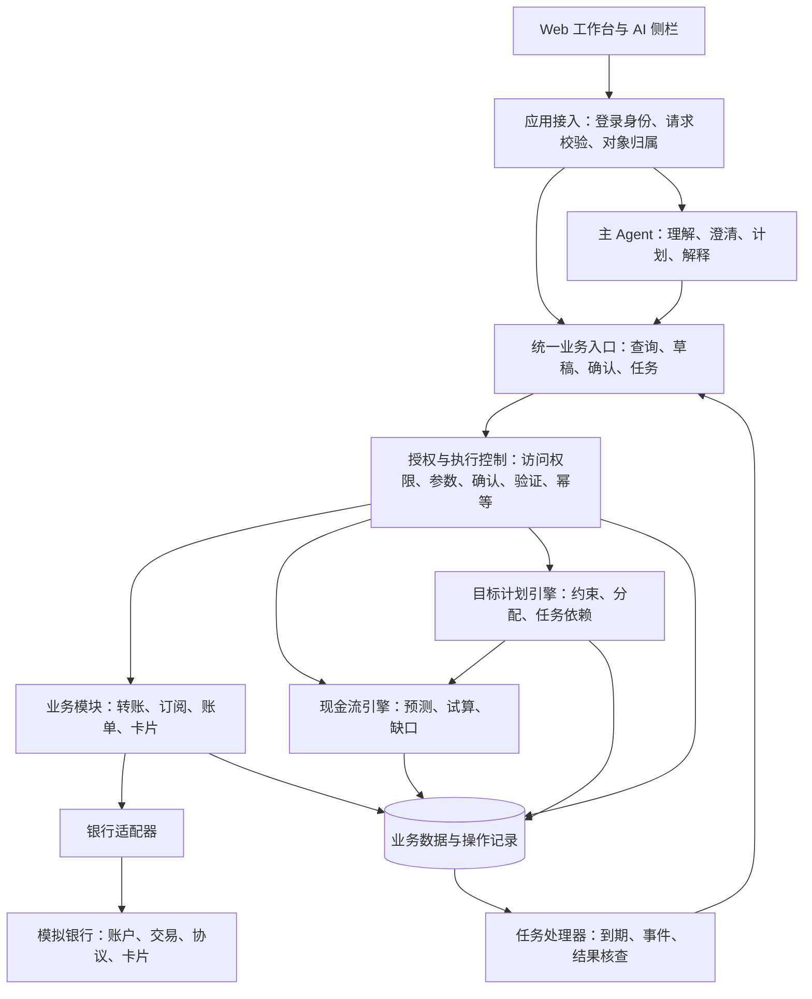

# Agent 设计框架 银行 AI 资金管家

> 版本：v2.0 评审稿  
> 日期：2026-09-19  
> 配套需求：[PRD 银行 AI 资金管家 v2.0](PRD_银行AI资金管家_v2.0.md)  
> 范围：产品与系统框架设计，不包含业务代码；具体库、版本及部署参数留待技术方案确定。

## 1 总体设计

产品由 Web 工作台、一个主 Agent、六项业务能力、统一授权执行入口以及模拟银行组成。

主 Agent 理解用户表达、补齐必要信息、提出任务计划并解释结果。账单汇总、现金流计算、资金冲突检查、权限判断和银行记账由确定性业务规则负责。用户可以通过 AI 侧栏或业务页面发起相同操作，两种入口共享业务对象和授权规则。

首版采用模块化单体后端，按业务边界划分模块，配合持久化任务处理器执行到期检查、交易结果核查和站内通知。任务处理器可以随应用启动或独立运行，但状态必须落库，不能依赖浏览器或聊天会话存活。这里的“模块”是软件职责划分，不意味着六个独立模型 Agent，也不要求六套服务部署。

首版约束为模拟银行、人民币、统一业务时区和可控演示时钟。六个模块范围及 P0/P1 划分以配套 PRD 为准。

## 2 产品框架

```text
银行 AI 资金管家 Web
│
├─ 首页：资金概况、近期事项、待确认操作、目标进度
├─ 转账：联系人、立即转账、到期确认式定时转账、回执
├─ 订阅：周期扣费候选、协议核查、续费提醒、取消处理
├─ 账单：分类统计、收支变化、异常候选、交易追溯
├─ 卡片：状态、关联交易、临时冻结、解冻、挂失
├─ 资金计划
│   ├─ 未来现金流：30 天日历、余额低点、缺口解释、情景试算
│   └─ 目标计划：目标与约束、方案比较、资金分配、冲突处理
└─ 任务中心：确认、进度、回执、失败处理、历史记录

贯穿页面：AI 侧栏、结构化确认卡、模拟强验证、站内通知
演示视图：数据来源、权限判定依据、操作记录、模拟时钟
```

页面操作和自然语言交互互相补充。例如，用户在资金计划页调整目标日期后，AI 侧栏使用更新后的目标版本；用户通过对话修改转账金额后，页面确认卡同步变化。

## 3 系统分层



图中授权控制对查询和执行均生效，但不同操作的检查强度不同。业务模块读取的银行数据通过受控适配器获取；两个规划引擎使用已完成权限检查的数据快照，不直接向银行发起写操作。目标生成的转账等任务必须再次回到统一业务入口执行。

| 层次 | 职责 | 主要输出 |
|---|---|---|
| Web 交互层 | 页面、对话、编辑、确认、结果展示 | 用户请求、结构化确认事件 |
| 应用接入层 | 登录身份、对象归属、输入校验、业务路由 | 可信用户上下文、可访问业务对象 |
| Agent 与任务层 | 理解目标、提出计划、管理等待与恢复 | 意图草稿、计划草稿、待办任务 |
| 授权与执行控制层 | 参数校验、确认版本、风险等级、模拟验证、幂等及额度占用 | 放行、拒绝、待确认、待验证 |
| 业务能力层 | 四项银行业务、现金流引擎、目标计划引擎 | 可核查的数据、方案与执行结果 |
| 银行与持久化层 | 模拟银行状态、应用任务、授权记录、通知与审计 | 银行事实及可恢复的业务状态 |

独立模块目录只是职责边界，不能单凭目录分开就宣称无法绕过。实现时必须限制写入路径、控制适配器访问，并验证直接业务请求与 AI 请求都经过授权入口。

## 4 六项功能之间的依赖

| 模块 | 输入 | 核心处理 | 输出及下游 |
|---|---|---|---|
| 智能转账 | 收付款对象、金额、日期、备注 | 对象解析、授权、提交、回执核查 | 更新交易和余额，触发预测与目标进度刷新 |
| 订阅管理 | 历史扣费、有效协议、接口能力 | 候选识别、协议核实、提醒、受支持的取消 | 未来支出及生效状态，供现金流使用 |
| 账单分析 | 账户流水、关联关系、分类修正 | 分类、比较、去重、异常候选 | 历史支出证据、日常预算候选 |
| 卡片管理 | 卡片状态、关联账户、交易和任务 | 查询、冻结、解冻、挂失 | 可执行能力变化及受影响任务 |
| 未来现金流预警 | 可用余额、未来账单、收入假设、日常预算、已知任务 | 按日计算、账户级检查、情景比较 | 余额低点、缺口、来源、操作影响 |
| 目标资金计划 | 用户目标、日期、约束、现有分配、现金流结果 | 可行性检查、方案比较、资金冲突、生成任务 | 用户可编辑的计划、确认后执行的步骤 |

基础数据和处理方向为：账户与流水 → 账单及订阅信息 → 未来现金流 → 目标方案 → 获得授权的业务执行 → 新的账户与流水。

卡片状态约束实际执行。已完成交易或取消协议的结果会使相关预测过期，再由系统重算。不能因为重算产生新方案就自动创建、授权并执行新交易。

## 5 主 Agent 的职责

### 5.1 一次请求的流程

1. 应用确认登录用户及可访问对象，再提供经过筛选的上下文。
2. Agent 判断是查询、办理单项业务、创建目标，还是修改现有任务。
3. 解析明确字段、历史推断字段和缺失字段，关联服务端业务对象。
4. 对关键缺失或歧义发起澄清；只读操作使用合理默认时，应在结果中说明范围。
5. 单项请求直接生成业务草稿；复杂请求生成带依赖和触发条件的计划草稿。
6. 规则引擎检查工具是否受支持、依赖是否有效、金额和约束是否成立、是否存在重复资金分配。
7. 查询及试算经访问控制返回结果；写操作进入结构化确认和必要的模拟强验证。
8. 执行结果、任务状态及必要记录落库，页面与 AI 从同一结果生成展示。

Agent 负责从“我想买电脑”提炼目标并解释不同方案；最终金额和最早可行日期由资金计算模块产生。模型可以建议候选方案，但不能自己宣告方案已通过财务约束检查。

### 5.2 字段来源与确认

关键字段记录值、来源、是否明确表达、是否解析到唯一对象、当前确认版本。例如“给张三转钱”里的姓名虽然明确表达，若匹配到两个联系人，收款账户仍未确定。

沿用历史金额属于推断；用户在确认卡核对后可成为当前版本已确认字段。查看确认卡不等于确认，保存目标不等于批准未来资金操作。

模型不接触验证凭证，也不能根据聊天内容自行判定“已验证”。验证结果由应用控制层提供。

### 5.3 对话与计划的边界

对话历史用于理解指代和解释意图。计划、授权、交易、卡片状态不能只保存在聊天记录中。

中断后恢复以服务端任务为准，重新核对用户、计划版本、数据变化和当前可执行状态。模型重试或重新生成回答不能重放已完成的银行写操作。

## 6 两个新增引擎

### 6.1 现金流引擎

现金流引擎是一套确定性的金额与日期计算规则。输入为账户快照、未来资金事件和情景假设，输出包括逐日余额、最低点、缺口及逐项来源。

未来事件区分已知账单、已计划操作和预计收入。用户确认“预计 10 日发工资”只确认这一假设，不能将其转成银行到账事实。

默认计算包含预计收入、不计未到账收入两种情景；同时保留单账户和合并账户视图。余额不能支付的账户，不因其他账户有钱就被判定可以执行。

本人账户互转在账户级分别记入流入流出，在合并级抵消。资金分配、转账任务和账单关联同一事项时统一去重。消费报告与现金流使用不同口径：信用卡消费计入消费报告，后续还款计入现金流，不重复统计消费。

每次结果绑定账户数据版本、假设版本和演示时间。数据变化后旧结果标为待更新；付款前重新核对余额。金额采用精确的货币表示，展示精度与记账精度一致，不由模型自由计算。

### 6.2 目标计划引擎

目标计划引擎管理目标金额、日期、优先级、生活缓冲、资金归属和任务依赖。它调用现金流引擎验证候选方案，再返回用户能够比较的安排。

P0 以有限、清晰的规则生成方案：保留目标金额并调整日期，或保留日期并调整金额。找不到可行方案时明确说明缺口，不为凑足两套方案伪造收入或删除必要支出。

多个目标竞争同一笔资金时，显示冲突金额和目标，由用户调整优先级；资金分配保存时应检查并发修改，避免两个页面同时把同一笔钱分配出去。

分配记录是计划用途，不是银行冻结。用户选择实际划转时生成转账任务，必须经过统一授权执行入口。任务成功后关联银行回执，更新目标进度；“资金已备齐”与“目标消费已完成”分别记录。

## 7 任务编排与跨时间执行

简单查询不建立复杂任务图。目标计划使用有限的任务类型和显式依赖，规则校验器拒绝循环、无效依赖、无权限对象及未支持的操作。

例如“分两次存够 6000 元”可以形成：

```text
读取可访问账户及账单
        ↓
现金流计算 → 比较方案 → 用户保存目标
        ↓
第一笔转账确认及验证 → 提交 → 核查回执
        ↓
更新已备资金，登记工资到账条件
        ↓
到期或到账事件触发检查
        ├─ 未到账：暂停该步骤，通知用户，提出调整方案
        └─ 已到账：重新计算 → 请求第二笔转账确认及验证
                                      ↓
                               执行并核查结果
                                      ↓
                               更新目标资金进度
```

不在模型调用中等待数天。待执行任务保存触发时间、截止时间、条件和当前状态，由任务处理器唤醒。P0 到期只创建待确认事项；满足触发条件也不直接获得交易授权。

| 状态 | 含义 | 允许的后续行为 |
|---|---|---|
| 草稿 | 尚未确认内容 | 编辑、放弃、发起确认 |
| 待确认 | 需要批准当前操作版本 | 确认、拒绝、修改、过期 |
| 待验证 | 当前操作需要模拟强验证 | 验证、取消；参数变化回到待确认 |
| 待执行 | 内容已保存，等待时间或业务条件 | 触发后复核并按规则请求确认；可取消 |
| 处理中 | 已提交执行 | 查询状态；取消仅在银行明确支持时成立 |
| 成功 | 已得到明确成功回执 | 展示结果、解锁依赖步骤；不重复执行 |
| 失败 | 已得到明确失败结果 | 修正后重新确认；按错误性质决定重试 |
| 结果待核实 | 不知道是否已执行成功 | 查询原请求、保持相关占用、暂停依赖操作 |
| 已取消或已过期 | 未执行步骤终止 | 不再执行；需要时创建新版本 |

任务事件可能重复到达，处理器须去重；同一任务只能被一个有效执行者取得执行权。进程重启后可以继续扫描待办，但不能把处理中或未知结果直接当成未执行再提交。

## 8 授权与执行控制

确认卡绑定用户、具体业务对象、金额、账户、日期、操作版本和有效期。用户点击确认后，服务端根据自身保存的草稿核验，不能接受客户端任意替换后的参数。

执行检查包括访问权限、对象解析、当前业务状态、确认版本、风险等级、验证、余额与当日累计。页面表单、Agent 和定时任务均执行相同规则。

沿用 PRD 的模拟分级：一般余额和账单查询为绿色；小额转账、协议查询及取消、临时冻结等为黄色；累计超过 1000 元的转账、挂失、解冻等为红色。这里的阈值属于比赛沙箱策略。是否能交易还取决于当前账户状态，授权通过不能覆盖银行业务拒绝。

累计金额按用户跨会话统一计算。执行前原子地检查并占用额度，避免并发请求同时看到旧累计；明确失败后释放，成功后转为已用，未知结果保留占用等待核查。

每个操作版本使用稳定的执行标识，重试携带相同标识；模拟银行也必须识别重复请求。应用与银行之间失败时采用状态核查和对账恢复，不假定跨系统调用具备整体原子性。

输入过滤用于标记可疑内容，不充当授权边界。商户名称、交易备注和工具返回的说明只能被当作数据，不能批准新操作。安全声明限定为已实现和已验证的控制，不宣称模型被攻击后系统必然零风险。

## 9 数据与事实归属

| 对象 | 权威来源 | 应用保存内容 |
|---|---|---|
| 账户、余额、交易、卡片状态 | 模拟银行 | 用于展示和预测的带时间与版本的快照 |
| 代扣协议、取消能力与生效结果 | 模拟银行或受支持服务适配器 | 查询结果、处理任务、回执 |
| 分类修正、生活预算、预计收入 | 用户及可追溯分析 | 来源、修改记录、假设版本 |
| 目标、资金分配、执行任务 | 应用业务服务 | 当前版本、依赖、状态、关联回执 |
| 确认、模拟验证、权限判定 | 授权控制服务 | 绑定操作版本的结果；不保存验证码原文 |
| 操作记录、通知、待处理事件 | 应用持久化层 | 关联用户、任务、时间与结果 |

每个对象具有用户归属，用户身份由已验证会话获取，不能由模型或请求体随意指定。日志脱敏，不记录密钥、验证码或模型内部推理原文。

模拟银行与应用数据库可以在比赛环境共享一个存储实例，但需明确表和访问职责；Agent 与预测模块无权直接改银行余额。未来接真实银行时通过适配器替换，仍需要重新验证银行授权、对账及业务能力，不能承诺仅换地址即可投产。

业务状态变化与待处理事件一并可靠保存，再由处理器更新预测、目标和通知。审计写入故障时，未提交的资金操作应停止；已提交的交易先核查银行结果，并补齐记录，不能为了补日志重做交易。

## 10 失败处理与降级

| 问题 | 系统行为 |
|---|---|
| 模型不可用或输出无效 | 提示对话暂不可用；常规表单、已保存任务和业务查询仍可使用 |
| 预测信息不足 | 展示已知范围和缺失项，允许用户补充；不虚构确定结论 |
| 银行请求超时 | 状态改为结果待核实，按原执行标识查询；不显示成功或立即重新转账 |
| 页面关闭或服务重启 | 服务端恢复任务与授权状态，过期确认不得复用 |
| 卡片冻结或协议状态变化 | 重算相关任务的可执行条件，提示受影响事项；不能声称所有账户交易都被阻断 |
| 计划数据过期 | 标记需要更新，执行前重算；改变用户批准的操作范围时重新确认 |
| 多步骤中途失败 | 保留已成功步骤，仅暂停相关后续步骤；返还资金需新操作和新授权 |
| 通知或事件重复 | 按业务事件去重；同一状态未改变时不重复提醒 |
| 持久化不可用 | 暂停新写操作，不以聊天记忆替代可靠存储；已提交结果恢复后核查 |

## 11 关键架构决策记录

下列 ADR 状态均为 Proposed，供本轮框架评审。需求依据为配套 PRD 第 4、10、11、12、13 和 15 节。

| ADR | 背景与决策 | 备选方案 | 收益及代价 |
|---|---|---|---|
| 001 模块化单体 | 比赛范围有限、六项能力高度共享数据；采用一个业务后端和明确模块边界 | 六个微服务 | 部署和排错简单；单模块故障隔离及独立扩容有限 |
| 002 一个主 Agent | 需要统一理解目标和确认状态；主 Agent 调用业务工具 | 每项功能一个自治 Agent | 减少状态同步、模型调用和授权歧义；主 Agent 的工具路由必须清晰 |
| 003 计算与授权外置 | 资金结果必须可核对；模型提出意图和方案，规则引擎计算并验证 | 模型直接计算金额并判定能否执行 | 金额和权限可复测；需要显式编写业务规则，复杂目标覆盖逐步扩展 |
| 004 统一业务入口 | 页面、AI 和任务可能同时发起操作；全部进入同一授权与执行流程 | 仅在聊天入口拦截 | 减少绕过和行为差异；入口必须支持完整的操作版本及错误状态 |
| 005 持久化任务 | 任务跨天且可能重启；任务及条件落库，由处理器唤醒 | 浏览器定时器或长时间挂起模型调用 | 可恢复、可核查；必须处理任务抢占、重复事件和过期 |
| 006 模拟银行适配 | 比赛不操作真实资金，但需要真实状态变化；独立模拟银行记账接口 | 只返回预置成功文案 | 可验证余额、回执和失败场景；需构建一致的模拟规则 |
| 007 分离计划与执行授权 | 一项目标包含多笔未来操作；保存计划与逐笔资金授权分开 | 保存目标时无限期批准全部交易 | 用户知道何时动钱；P0 到期仍需要交互确认 |

## 12 技术承载建议与非功能要求

框架阶段推荐成熟的 Web 组件体系、支持类型化请求与响应的后端、具备事务与唯一性约束的关系存储，以及可恢复的任务处理机制。模型通过统一出口调用，工具清单受控。具体产品和版本尚未冻结，后续按团队熟悉程度、打包成本和验证结果选择。

首版不因六个模块而引入六套部署，也不需要先建设独立消息平台或模型集群。持久化事件和任务可由同一后端配套处理器承载，后续有实测瓶颈时再拆分。

| 要求 | 框架承诺与验证方式 |
|---|---|
| 可运行性 | 用一组明确的启动步骤拉起 Web、后端、模拟银行和任务处理器；新环境验证 |
| 正确性 | 金额使用精确表示，状态变化和额度占用使用事务性规则；用固定样例验证 |
| 恢复能力 | 在提交前、提交后回执前、任务落库后分别中断，验证恢复且不重复交易 |
| 可复现性 | 固定银行数据、模拟时间与规则版本；计算和授权结果可复现，模型表述不要求逐字一致 |
| 响应体验 | 确认按钮立即反馈，慢任务有进度；对模型、查询及执行分别设超时和错误状态 |
| 可观测性 | 以请求、计划、任务和交易标识关联耗时与结果，便于定位失败步骤 |
| 隐私与隔离 | 数据最小化输入模型、用户对象隔离、日志脱敏，原始验证凭证不进入对话 |
| 成本 | 简单表单操作无需模型，重复查询复用有效快照；限制一次规划的模型调用和步骤数量 |

性能数值和承载人数在确定运行设备与数据规模后建立测试基线，不在比赛原型阶段承诺生产银行可用性指标。

## 13 与 PRD 的验收对应及推进顺序

先验证转账的理解、澄清、确认、执行、回执闭环，再接入账单、订阅、卡片；之后完成现金流引擎和目标计划。前端始终从真实服务端业务状态展示任务，逐步扩展页面。

重点用例与配套 PRD 保持一致：六个模块各有完整流程；三笔 400 元的累计升级；跨用户越权阻断；重复确认不重复扣款；结果未知先核查；取消协议按生效日期更新；本人账户互转不重复统计；目标争用资金得到提示；工资未到账暂停依赖步骤；重启恢复和恶意备注不绕过授权。

资金样例沿用 PRD：9000 元减去 3000 元房租、2000 元还款和 1200 元生活预算后，工资前预计剩余 2800 元；转入本人储蓄账户 2000 元后，付款账户预计剩余 800 元，合并资金仍为 2800 元。现金流、目标进度、交易回执和页面展示必须共同满足这一口径。

本版补齐配套框架，但仍为评审稿。确认产品范围和关键架构决策后，再将旧技术方案升级为对应的实现设计，确定具体接口、库版本、存储方案与团队分工。
