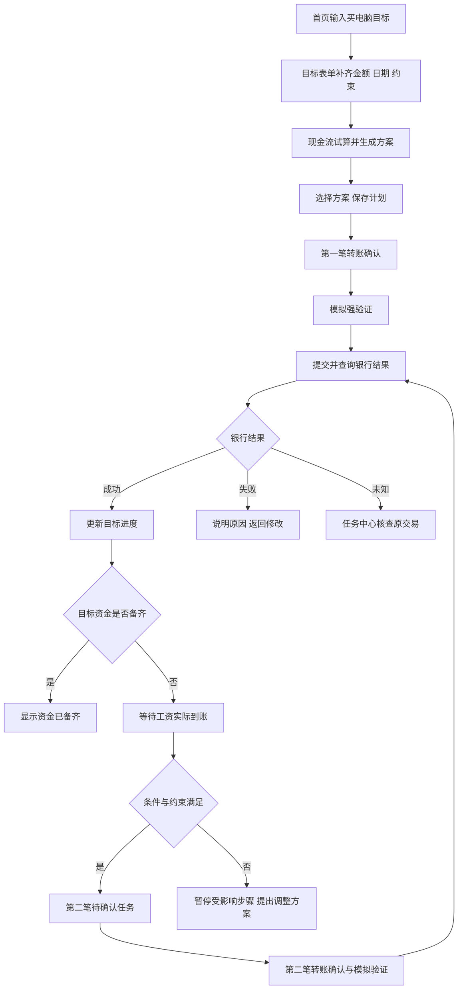

# 银行 AI 资金管家 Web 低保真原型与页面流程

> 日期：2026-09-19  
> 状态：静态交互评审稿，包含页面线框、控件行为、错误状态和接口映射；不是已运行或可点击的网页。  
> 对应：[PRD v2.0](PRD_银行AI资金管家_v2.0.md)、[技术方案 v2.0](AI_Banking_Agent_技术方案_v2.0.md)。

## 1 原型目标与视觉方向

用户进入后先看到近期资金状态和需要处理的事项；需要办理业务时使用表单或 AI，执行前能看到对象、金额与后果。主页面保持业务可操作，AI 作为辅助侧栏，不占据整屏。

推荐明亮的银行工作台风格：浅灰背景、白色内容区、深蓝主要操作、金额清晰对齐。风险级别用文字与图标配合颜色，避免整个界面布满红黄绿。图表与任务表承担信息展示，装饰保持克制。

### 1.1 基础设计约定

| 项目 | 建议值 | 使用规则 |
|---|---|---|
| 桌面基准 | 1440 × 960 | 左导航 200，主区自适应，AI 侧栏 320；中间留 24 间距 |
| 页面间距 | 4、8、12、16、24、32 | 区域间 24，表单项间 16，标签与说明间 8 |
| 字号 | 12、14、16、20、28、36 | 正文默认 14–16；主余额 36；金额表格使用等宽数字 |
| 默认字体 | 系统中文无衬线 + 系统 UI 字体 | 避免为字体增加网络依赖 |
| 可选字体组合 | Noto Sans SC + Inter；思源黑体 + IBM Plex Sans | 仅作为后续视觉选项，确认后本地打包；不阻挡低保真评审 |
| 背景与文字 | canvas #F5F7FA、surface #FFFFFF、text #172B4D、muted #52627A | 主要正文不使用很浅灰色 |
| 操作与状态 | primary #174EA6、success #176B42、warning #8A4B08、danger #B42318 | 状态必须附中文，不靠颜色区分 |
| 边界和圆角 | border #D8DFE8；小控件 6，大面板 10 | 表格尽量减少装饰，错误反馈贴近对应字段 |
| 点击尺寸 | 普通按钮高 40，窄屏主要按钮至少 44 | 确认与取消分开，危险动作避免紧邻默认主按钮 |

1200 像素以下默认收起 AI，右侧按钮展开抽屉；960 以下导航收起，内容改单列；确认弹窗在窄屏成为独立整页。最终实现检查文字对比和键盘焦点，达到常规可读标准，不以这份未渲染规范宣称已通过无障碍审计。

### 1.2 共同外壳

```text
┌────────────────────────────────────────────────────────────────┐
│ 银行 AI 资金管家      沙箱演示 · 无真实资金     通知(2)  用户     │
│ 演示时间 2026-10-01 09:00        数据更新于 09:00                 │
├──────────┬──────────────────────────────────────┬──────────────┤
│ 首页     │ 页面标题 / 当前筛选范围               │ AI 助手      │
│ 转账     │                                      │ 当前关联对象 │
│ 订阅     │ 当前页面的主要工作区域                │              │
│ 账单     │                                      │ 对话与建议卡 │
│ 卡片     │ 图表、列表、表单或方案                 │              │
│ 资金计划 │                                      │              │
│ 任务中心 │                                      │ [输入需求…]  │
├──────────┴──────────────────────────────────────┴──────────────┤
│ 演示视图入口：操作记录 / 演示场景（有权限时显示）                │
└────────────────────────────────────────────────────────────────┘
```

页眉“演示时间”与“数据更新时间”分开。按钮点击中的旋转标识只表示请求中，不代表成功。数据过期、会话失效、模型离线分别提示，不用一个通用“网络错误”覆盖所有情况。

## 2 页面与路由

| 页面 ID | 路由 | 主要动作 | 对应模块 |
|---|---|---|---|
| P00 | /demo-entry | 选择演示画像及独立数据场景 | 会话 |
| P01 | /dashboard | 查看近期风险、进入待办或目标 | 首页聚合 |
| P02 | /transfers | 创建转账、定时任务、查看回执 | F1 |
| P03 | /subscriptions | 查询协议、查看候选、提醒与取消 | F2 |
| P04 | /bills | 分类、对比、明细追溯 | F3 |
| P05 | /cards | 核查、冻结、解冻、挂失 | F4 |
| P06 | /plans | 未来现金流、目标列表、方案比较 | F5 + F6 |
| P07 | /tasks | 待确认、进度、结果核查 | 跨模块 |
| P08 | /demo-review | 脱敏审计、时钟、场景与故障设置 | 演示管理 |

下文七个业务页面为完整的静态线框；P00 和 P08 为辅助入口。具体对象详情使用抽屉或 `/tasks/{id}`、`/plans/{id}` 子路由，刷新后可通过 ID 恢复。

## 3 P00 演示入口

```text
┌────────────────────────────────────────────────────┐
│ 进入银行 AI 资金管家                                 │
│ 本应用使用模拟账户，所有资金操作均为演示。            │
│                                                    │
│ 演示画像 [工资收入用户 v]                           │
│ 数据场景 [A 电脑目标与现金流 v]                      │
│                                                    │
│ [进入独立演示场景]                                  │
│ AI 状态：实时模型 / 回放模式（按实际配置显示）       │
└────────────────────────────────────────────────────┘
```

主按钮调用 `POST /demo/sessions` 后读取会话，再进入 P01。只有角色允许的场景选项可见；不允许通过填 user_id 读取另一人的场景。回放模式始终在 AI 标题旁显示“回放”，不能仅在入口短暂提示。

## 4 P01 首页

线框使用 fixture A 初始时刻，尚未创建目标或发生转账。

```text
┌────────────────────────────────────────────────────────┐
│ 资金概况                  范围：工资账户 + 储蓄账户     │
│                                                        │
│ 当前可用资金         工资前预计低点        待处理任务    │
│ ¥9,000.00            ¥2,800.00 · 10/09     0             │
│ 银行模拟数据         基于已列账单及预算                  │
├────────────────────────────────────────────────────────┤
│ 近期支出                                                │
│ 10/05  房租             ¥3,000.00     [查看]             │
│ 10/08  信用卡还款       ¥2,000.00     [查看]             │
│ 10/01–09 生活预算       ¥1,200.00     [调整假设]         │
│ [查看未来 30 天]                                       │
├────────────────────────────────────────────────────────┤
│ 我的资金目标                                            │
│ 还没有目标。可以从一笔计划中的支出开始。                  │
│ [创建资金目标]                                         │
├────────────────────────────────────────────────────────┤
│ 常用操作    [转账]   [检查周期扣费]   [管理卡片]         │
└────────────────────────────────────────────────────────┘
```

交互：点击低点进入 P06 并定位 10/09；“查看”打开来源抽屉；“调整假设”进入 P06 假设编辑；创建目标跳 P06 目标表单；已有待办时点击进入 P07 对应任务，不自动确认。

数据来自 `GET /dashboard`，首页复用已生成预测摘要。尚无预测时显示“生成未来收支预测”，不显示预置的 2800 元。低点低于缓冲才出现资金压力提示，不能为了演示制造无根据告警。

## 5 P02 智能转账

```text
┌────────────────────────────────────────────────────────┐
│ 转账                      [立即转账] [定时安排]        │
├────────────────────────────────────────────────────────┤
│ 付款账户     [工资账户 · 可用 ¥9,000.00       v]         │
│ 收款人       [搜索姓名、联系人手机号或别名        ]    │
│              已选择：本人储蓄账户 · 尾号 5678            │
│ 转账金额     [2,000.00                         ] 元     │
│ 备注         [电脑目标首笔                     ]        │
│                                                        │
│ 来源提示：金额由本轮填写；收款账户由你选择。             │
│ [查看影响并核对信息]                                   │
├────────────────────────────────────────────────────────┤
│ 对近期资金的影响                                        │
│ 工资账户预计低点：¥2,800 → ¥800                         │
│ 合并资金不变；¥2,000 转入本人储蓄账户。                  │
│ [查看计算依据]                                         │
├────────────────────────────────────────────────────────┤
│ 最近转账       对象 / 金额 / 状态 / 时间 / [详情]        │
└────────────────────────────────────────────────────────┘
```

“查看影响并核对信息”创建 operation 并调用 preview，显示 M01 确认弹窗，尚未转账。金额框限制两位小数，前端转换为整数分；服务端仍做完整校验。同名候选必须选择带脱敏账户的具体对象，不能仅高亮第一项就视为选定。

定时安排模式增加日期、时间、确认截止时间。默认截止为当日 23:59:59，用户可修改，必须晚于触发时间；提示“到期后需要你再次确认，未确认不会转账”。保存 schedule.create 成功显示“定时任务已创建”，不能显示“转账成功”。

详情用 `GET /operations/{id}`。执行期间切换页面不会停止银行请求；回到页面继续显示当前状态。结果未知只能查看和核查，不显示“再转一次”主按钮。

## 6 P03 订阅管理

### 6.1 尚未授权查询协议

```text
┌────────────────────────────────────────────────────────┐
│ 订阅与周期扣费                                          │
│ 从流水发现 3 项疑似周期扣费，尚未核实代扣协议。          │
│ [确认查询我的代扣协议]                                 │
├────────────────────────────────────────────────────────┤
│ 商户          预计金额    周期     证据        状态      │
│ 云盘示例服务  ¥29.00      月度     [3笔交易]   疑似      │
│ 视频示例服务  ¥19.00      月度     [3笔交易]   疑似      │
│ 健身示例服务  ¥35.00      月度     [3笔交易]   疑似      │
└────────────────────────────────────────────────────────┘
```

主按钮创建 subscription.inspect 操作，经过 M01 确认后查询。列表证据来自 `GET /subscription-candidates`；无权限时不自动用别的接口查出协议详情。

### 6.2 已查询后的同一页面

```text
┌────────────────────────────────────────────────────────┐
│ 订阅与周期扣费               协议更新于 10/01 09:00     │
│ [全部] [已核实] [待核实] [已处理]  [刷新协议]           │
├────────────────────────────────────────────────────────┤
│ 云盘示例服务      ¥29.00 / 月       10/15 预计扣款       │
│ 已核实银行代扣    提前 [3天 v] 提醒 [开启]              │
│ [查看证据] [终止银行代扣]                               │
├────────────────────────────────────────────────────────┤
│ 视频示例服务      ¥19.00 / 月       10/18 预计续费       │
│ 商户模拟接口可用                 [取消商户订阅]        │
├────────────────────────────────────────────────────────┤
│ 健身示例服务      ¥35.00 / 月       日期来自历史估算     │
│ 服务方未接入                     [查看办理指引]        │
└────────────────────────────────────────────────────────┘
```

取消前弹窗明确显示动作对象、作用范围和生效时间；终止银行代扣提示“这不会自动解除商户服务合同”。取消成功后刷新该项和现金流，展示“从生效日起，预计支出减少 ¥29”，不计为已经收回 29 元。

办理指引打开安全固定链接或文字步骤，保留“待用户处理”；点击指引不标记为已取消。不支持取消时不放可点击的“取消订阅”按钮。

提醒偏好调用 reminders 接口，页面明确仅为站内提醒。修改失败恢复先前开关状态。

## 7 P04 账单分析

```text
┌────────────────────────────────────────────────────────┐
│ 账单分析                                               │
│ [本月 v] [全部已接入账户 v] [与上月同期比较 ✓]           │
├────────────────────────────────────────────────────────┤
│ 消费合计       收入合计       同期变化                   │
│ 由接口返回     由接口返回     差额及比较天数             │
├───────────────────────────┬────────────────────────────┤
│ 分类分布                  │ 变化说明                   │
│ 餐饮 / 交通 / 购物 / 其他  │ 哪类增加、哪类下降         │
│ 点击分类筛选下方明细      │ 每条说明均有 [查看明细]    │
├───────────────────────────┴────────────────────────────┤
│ 需要核查：某笔交易金额高于该商户历史记录                │
│ [查看交易] [核查对应卡片]                               │
├────────────────────────────────────────────────────────┤
│ 日期    商户    金额    分类       关联关系    [详情]    │
│ ...     ...     ...     [修改]     退款/互转             │
└────────────────────────────────────────────────────────┘
```

不在此页写死第二套金额。图表点击带筛选条件调用 transactions，底部显示明细汇总与统计口径；信用卡还款标为资金划转，不重复计入消费。

“修改分类”保存 annotation 并同步刷新统计；失败显示行内错误，恢复旧值。异常区展示触发规则和交易引用；用户点击“核查对应卡片”进入 P05 定位该卡，仍需独立确认冻结。

对已退款、未分类、数据不完整提供筛选或文字说明。无法比较时显示“上期数据不足”，不输出 0% 变化。

## 8 P05 卡片管理

```text
┌────────────────────────────────────────────────────────┐
│ 我的卡片                                               │
│ [尾号1234 · 正常]   [尾号5678 · 正常]                  │
├────────────────────────────────────────────────────────┤
│ 当前卡片  尾号 1234                                    │
│ 所属账户：工资账户          状态：正常使用              │
│ [临时冻结]     [挂失]                                  │
├────────────────────────────────────────────────────────┤
│ 本卡近期交易                                           │
│ 10/01  示例商户  ¥880.00   金额变化提示    [查看依据]    │
├────────────────────────────────────────────────────────┤
│ 操作影响                                               │
│ 临时冻结会暂停卡级消费及本卡绑定的模拟订阅扣费。         │
│ 账户级转账和账户代扣按各自规则处理。                    │
│ 受影响事项：1 项卡绑定订阅               [展开]        │
└────────────────────────────────────────────────────────┘
```

该异常交易例子属于 fixture C，不与首页 fixture A 同时作为同一账户事实展示。点击临时冻结先取 impact，再创建操作进入 M01；成功后服务器状态为 FROZEN，按钮变为“解冻”“挂失”。解冻和挂失进入 M02 强验证。

LOST 状态不显示“解冻”；展示可用办理指引。卡片状态刷新前显示“正在确认处理结果”，不能在按钮点击时直接改成“已冻结”。

## 9 P06 资金计划

### 9.1 未来现金流页签

```text
┌────────────────────────────────────────────────────────┐
│ 资金计划                      [未来现金流] [我的目标] │
│ 范围：10/01–10/30 [工资账户 v]                         │
│ 情景：[包含预计收入] [不计未到账收入]                  │
├────────────────────────────────────────────────────────┤
│ 预计最低余额 ¥2,800.00 · 10/09                         │
│ 生活缓冲 ¥800.00                         [修改假设]    │
│                                                        │
│ 余额曲线：逐日可用资金                                  │
│   10/01 → 房租 → 还款 → 10/09 低点 → 预计工资          │
│ 预计收入和未来预算使用虚线/文字标签说明                 │
├────────────────────────────────────────────────────────┤
│ 收支日历                                               │
│ 10/05 房租 -3,000   10/08 还款 -2,000                  │
│ 10/10 预计工资 +10,000 [查看来源]                       │
├────────────────────────────────────────────────────────┤
│ 试算一笔支出                                           │
│ 金额 [6,000.00] 日期 [10/01]     [查看影响]              │
│ 试算后预计低点 -¥3,200.00                               │
│ [将这笔支出设为目标，比较安排方案]                     │
└────────────────────────────────────────────────────────┘
```

切换账户范围后同时改变曲线、低点和证据。本人互转在合并视图不改变总额，账户级视图清楚显示调出/调入。最低余额与“目标分配后尚未安排的金额”使用不同标签，不能一个数字承担两种口径。

点击某日期打开来源抽屉，包括当日期初余额、逐项流入流出、日终余额、日内保守低点、预计/已知标记。图表 hover 不是唯一入口，下方日历和表格支持键盘查看。

修改假设打开 M04 表单。保存后重算 forecast，旧结果先标“待更新”。页面展示“本次覆盖至 10/30”，避免用户将区间外义务理解为不存在。

### 9.2 目标创建与比较

```text
┌────────────────────────────────────────────────────────┐
│ 创建资金目标                                           │
│ 名称 [买电脑]       金额 [6,000.00] 元                  │
│ 希望日期 [10/09]    最晚可接受 [10/12]（用于讨论）     │
│ 资金账户 [工资账户] 生活缓冲 [800.00] 元               │
│ 必要支出：房租 ¥3,000；还款 ¥2,000；生活预算已纳入      │
│ [比较安排方案]                                         │
├───────────────────────────┬────────────────────────────┤
│ 方案 A 保留金额           │ 方案 B 保留原日期          │
│ 目标：¥6,000              │ 10/09 前最多：¥2,000       │
│ 预计 10/10 可备齐         │ 需要降低电脑预算            │
│ 条件：工资实际到账        │ 保留 ¥800 生活缓冲          │
│ 今天转入 ¥2,000          │                            │
│ 到账后再转 ¥4,000        │                            │
│ [选择此方案]             │ [调整目标金额]             │
└───────────────────────────┴────────────────────────────┘
```

表单“最晚可接受”是可选的用户讨论约束：选择方案后明确更新最终 target_date 并生成新 revision，不增加第二个未定义的银行日期字段；如果用户未填写，则直接呈现系统计算的替代日期供选择。

“比较安排方案”保存目标草稿并调用 proposals，不会转账。“选择此方案”展示保存计划确认摘要，创建 goal.activate。主文案为“保存计划并生成待办”，其下说明“每笔资金操作仍需你确认”。

方案 A 若依赖预计工资，卡片必须明确条件。用户选择后，第一笔转账到 M01/M02 单独办理；第二笔在工资实际到账且条件满足后生成待确认任务。没有可行方案时显示差额和缺失条件，不用推荐样式伪装为可行。

### 9.3 目标详情及资金冲突

```text
┌────────────────────────────────────────────────────────┐
│ 买电脑                         进行中   [修改] [暂停] │
│ 目标 ¥6,000     已存入 ¥2,000    尚需 ¥4,000           │
│ 预计 10/10 备齐，取决于工资实际到账                     │
├────────────────────────────────────────────────────────┤
│ 1 今天转入 ¥2,000      已完成          [银行回执]       │
│ 2 等待工资实际到账     等待条件                         │
│ 3 再转入 ¥4,000       到时需要确认                      │
├────────────────────────────────────────────────────────┤
│ 资金归属：本人储蓄账户，计划用途为买电脑                │
│ 此标记不会冻结银行资金。                               │
│ [结束此目标]                                          │
└────────────────────────────────────────────────────────┘
```

创建另一个目标若占用同一资金，显示“当前可分配 ¥800，新目标需要 ¥1,500，差额 ¥700”，前提是接口实际返回这些金额。提供“降低目标金额”“调整日期”“调整其他目标”的操作，不自动挪用已分配资金。

暂停只停止未执行步骤；结束弹窗说明已存资金仍在账户，列出将取消的未执行任务。工资未到账时状态为“需要调整”，按钮为“比较新方案”，不能继续展示旧方案可立即执行。

## 10 P07 任务中心

```text
┌────────────────────────────────────────────────────────┐
│ 任务中心                                               │
│ [待我处理] [等待条件] [处理中] [已完成] [全部]          │
├────────────────────────────────────────────────────────┤
│ 电脑目标第二笔转账                                     │
│ ¥4,000 · 工资账户 → 本人储蓄账户                       │
│ 状态：待确认    截止：10/10 23:59                       │
│ [核对并确认] [查看计划] [取消此步骤]                   │
├────────────────────────────────────────────────────────┤
│ 一笔模拟转账                                          │
│ 状态：结果待核实                                      │
│ 银行结果尚未确认，暂时不能发起相同资金操作。            │
│ [核查进度] [查看详情]                                 │
└────────────────────────────────────────────────────────┘
```

上面两行表示不同状态的设计样例，实际仅显示当前场景真实存在的任务。任务中心通过 GET /tasks 读取，详情从 GET /tasks/{id} 和关联 operation 取得。

执行详情每 2 秒轮询，页面隐藏时暂停，重新可见立即刷新；连续 30 秒无变化改为 5 秒，不发起任何自动重复确认。结果待核实可以触发 reconcile，其含义是查询原交易。

任务详情时间线展示创建、用户确认、模拟验证、提交、回执等可证实事件；不展示模型推理原文。过期任务不能通过刷新重新激活，创建新操作需要重新核对信息。

## 11 公共弹窗及抽屉

### M01 操作确认

```text
┌──────────────────────────────────────────────┐
│ 请核对转账信息                          [关闭]│
│ 付款：工资账户 · 尾号 1234                    │
│ 收款：本人储蓄账户 · 尾号 5678                │
│ 金额：¥2,000.00                              │
│ 备注：电脑目标首笔                           │
│                                              │
│ 本笔超过演示累计阈值，需要模拟强验证。        │
│ 执行后工资账户预计低点：¥800.00               │
│ [查看来源与影响]                             │
│                                              │
│ [返回修改]                 [确认并验证]      │
└──────────────────────────────────────────────┘
```

黄色操作的主按钮为“确认办理”；红色为“确认并验证”。关闭弹窗仅关闭界面，不取消已存在草稿；明确“取消操作”才调用取消接口。已提交操作关闭弹窗不会停止执行。

弹窗打开时拉取当前版本；确认时携带 revision 和 params_hash。版本冲突显示“信息已更新，请重新核对”，重新加载差异，不自动再次发送确认。

### M02 模拟强验证

```text
┌──────────────────────────────────────────────┐
│ 模拟验证                                     │
│ 操作：向本人储蓄账户转账 ¥2,000.00            │
│ 这是演示验证，没有发送真实短信。              │
│ 演示验证码：由当前挑战显示                    │
│ 验证码 [______]                             │
│ 剩余时间 01:58                               │
│ [取消]                         [验证并提交] │
└──────────────────────────────────────────────┘
```

验证码不经过 AI 输入框。失败显示剩余次数，连续三次失败当前挑战失效；过期只允许重新申请挑战，必要时重新确认。提交中按钮禁用，服务端仍需保证重复请求无额外效果。

### M03 执行结果

| 状态 | 主文案 | 可见操作 |
|---|---|---|
| 正在处理 | 已提交，正在确认银行结果 | 查看任务；不显示成功图标 |
| 成功 | 模拟转账成功，回执号… | 查看回执、查看目标；金额取 result |
| 明确失败 | 未完成转账：余额不足/对象状态不允许… | 返回修改、查看原因；修改后新授权 |
| 结果未知 | 结果待核实，请勿重复转账 | 核查进度、查看任务 |
| 已取消 | 已取消尚未执行的操作 | 返回业务页 |
| 已过期 | 本次确认已过期 | 重新核对当前信息 |

### M04 来源与假设

来源抽屉显示数据来源类型、日期、金额、关联交易或协议及是否预计。假设编辑按“预计收入”“生活预算”“保留缓冲”分组；保存前显示变更摘要，保存后标注受影响计划。预计工资不能被用户勾选成银行“已到账”。

### M05 计划保存与结束

保存时列出目标金额、最终日期、预计收入依赖、资金分配及步骤，主按钮为“保存计划并生成待办”。结束时列出已完成和将取消的步骤，明确“已完成转账不会自动撤销”。两者不能共用模糊的“确定”话术。

## 12 AI 侧栏行为

AI 面板提供当前上下文标签、消息区和输入框；用户主动从某交易点击“问 AI”后，标签显示“关联：交易… [移除]”。仅浏览页面不代表授权修改对象。

| 用户表达 | AI 展示 | 下一步 |
|---|---|---|
| 给张三转 500 | 同名候选或转账草稿卡 | 选择唯一账户，进入确认 |
| 下次扣费是什么时候 | 历史候选或协议查询确认卡 | 按权限确认协议查询 |
| 为什么这个月多花了钱 | 分类差额和明细引用 | 点击证据进入账单 |
| 卡丢了先停一下 | 卡片选择和冻结/挂失差异 | 用户选择具体动作再确认 |
| 买电脑但别影响还款 | 目标草稿、必要澄清、方案卡 | 到资金计划页比较并保存 |
| 好的，直接做吧 | 当前明确对象的结构化确认卡 | 用户点击确认，模型本身不授权 |

用户改口时检查是否已提交：未提交可以修订草稿并标记旧卡失效；已提交只能查询当前结果。多个待办时询问指的是哪一项，不批量批准所有待办。

模型离线显示“AI 暂不可用，仍可使用页面办理业务”；不影响用户通过表单读取和操作。回放模式的结果带“示例回放”标记。

## 13 关键流程图



当第二笔已完成且资金达到目标时转为 FUNDED，不再生成新的转账步骤。订阅和卡片流程共用 M01、M02、M03，但动作说明及风险等级由其业务定义决定。

## 14 全局状态与可访问性

| 情况 | 页面表现 | 行为限制 |
|---|---|---|
| 首次加载 | 骨架屏、明确加载区域 | 不出现伪造金额闪烁 |
| 空数据 | 说明为何为空，给出下一步入口 | 无账单不等于支出为零 |
| 局部失败 | 错误贴近对应区域，可重试只读查询 | 不用整页白屏替代可用部分 |
| 数据过期 | 显示更新时间和“待更新” | 执行前服务端复核 |
| 表单错误 | 字段说明、保留已填有效内容 | 不自动改金额或对象 |
| 未授权 | 显示当前范围不可办理 | 不展示他人对象细节 |
| 服务中断 | 保留任务 ID，提示重新连接后查询 | 不自动重复写入 |

所有操作可通过键盘进入；弹窗打开后焦点进入标题或首个可操作项，关闭后回到触发按钮。Esc 可关闭未提交界面，但不能悄悄取消银行请求。错误信息与字段关联，状态变化用适当的可访问通知，不能通过高频播报干扰阅读。

图表有表格替代，颜色区分之外使用“预计”“已知”“待确认”等文字。关键确认信息不依赖 hover，不把收款人或金额折叠到默认看不到的位置。

## 15 页面与接口映射

全部接口以 `/api/v1` 为前缀，详细请求字段以技术方案为准。

| 页面/组件 | 读取 | 写入或动作 |
|---|---|---|
| P01 首页 | /dashboard | 跳转，不直接执行资金操作 |
| P02 转账 | /accounts、/contacts、/transactions | /operations，type=transfer.create 或 schedule.create |
| P03 订阅 | /subscription-candidates、/subscriptions | /operations，type=subscription.inspect/cancel；reminders 设置 |
| P04 账单 | /bills/summary、/transactions | /transactions/{id}/annotation |
| P05 卡片 | /cards、/cards/{id}/impact | /operations，type=card.freeze/unfreeze/report_lost |
| P06 资金计划 | /assumptions、/goals、/forecasts/{id} | /forecasts、/goals/{id}/proposals、goal.activate 及目标状态动作 |
| P07 任务 | /tasks、/tasks/{id}、/operations/{id} | 关联操作确认、取消、核查 |
| AI 侧栏 | 会话消息、关联对象 | /conversations/{id}/messages；不持有银行执行权限 |
| M01/M02 | 当前 operation | confirm、verification、verify |
| P08 演示视图 | /audit、当前演示状态 | /demo/clock/advance、/demo/faults、/demo/reset |

## 16 原型评审与前端交付检查

逐页检查正常、空、加载和失败状态；逐笔检查确认卡到回执的状态变化；使用 fixture A 验证首页、曲线、目标和账户金额一致；使用 B/C 验证协议与卡片边界。

前端实现时，需把本静态线框转换成页面组件并做浏览器检查。本次没有可点击原型、截图验证或前端代码，也没有声称设计已通过真实用户测试。视觉精修应在上述流程可理解、接口能对应后进行。
