# ARCHITECTURE — 青禾银行 AI 资金管家的整体架构

> 本文描述**当前真实实现**，不是设想。每条断言都能在源码里找到对应文件。
> 维护义务见 [AGENTS.md](../AGENTS.md) §2。最后更新：2026-09-28

---

## 1. 这份文档回答什么

| 问题 | 看哪一节 |
| --- | --- |
| 这个项目的范式是什么？和普通银行 App 有什么不同？ | §2 |
| 整体分成几层，谁依赖谁？ | §4 |
| 用户说一句话，到屏幕上出现界面，中间发生了什么？ | §5 |
| **每一个业务环节具体怎么渲染？** | **§7** |
| 权限分级怎么保证不被绕过？ | §6.3 |
| 界面为什么长这样？ | §9 |
| 哪个文件负责什么？ | §10 |

---

## 2. 范式：一个成熟的 AI Native 银行系统由两层组成

这不是「传统银行 App 加一个聊天框」。两层各有各的职责，缺一层都不成立。

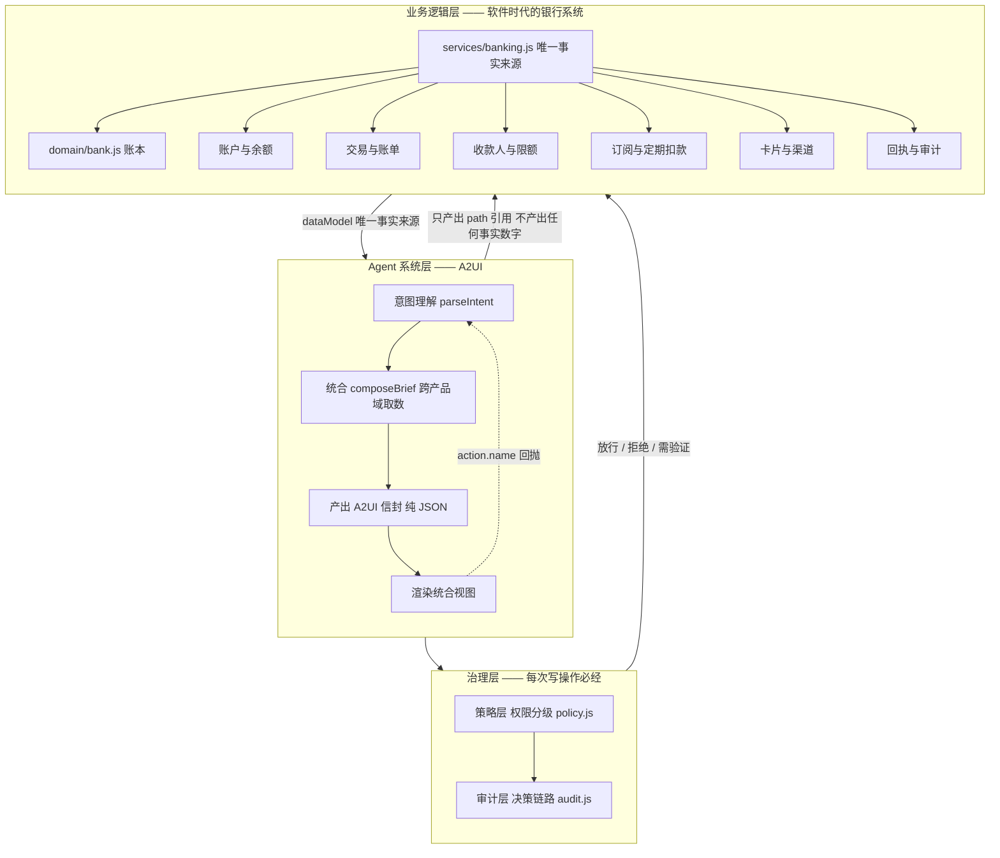

### 2.1 两层的分工对照

| | 业务逻辑层 | Agent 系统层 |
| --- | --- | --- |
| **是什么** | 原有银行系统在软件时代的系统逻辑 | A2UI 形式，AI 通过意图识别帮你统合和总结所有业务 |
| **边界** | `services/` + `domain/`，**零 React** | `agent/` + `a2ui/`，**零 React（除渲染器）** |
| **谁拥有事实** | **只有它**。所有数字从 `buildDataModel` 出来 | 不拥有任何事实，只产出 path 引用 |
| **呈现粒度** | 按「产品」切：账户 / 账单 / 订阅 / 卡片 | 按「用户此刻要办的事」切：跨产品合成一张统合视图 |
| **界面** | 产品层：七个功能页（`views/pages/*`） | 业务层：助手工作区（`views/AssistantView.jsx`） |
| **失败方式** | 数据错则界面显示错的值 | 引用错则显示占位符，**绝不退回猜测值** |

### 2.2 「统合视图」是两层之间的接缝

**这是 AI Native 银行与软件时代银行的分界线。**

软件时代：余额在账户页、账单在账单页、订阅在订阅页。用户办一件事要跨三个页面，自己把信息拼起来。
Agent 时代：把跨产品的信息合起来，一次呈现。

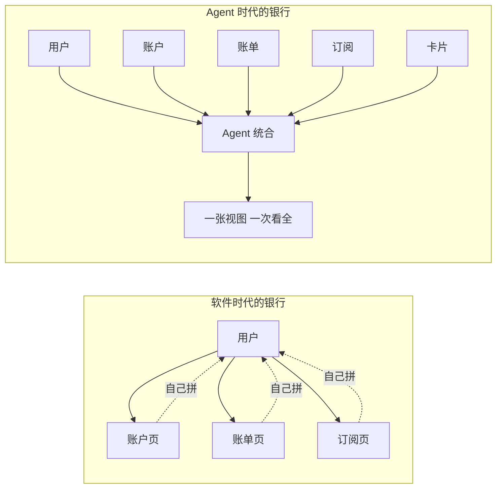

| 统合视图 | 跨了哪些域 | 代码位置 |
| --- | --- | --- |
| 首页状态板 | 账户 + 账单 + 订阅 + 卡片 + 待处理事项 | `composeHome` |
| 账单结论 | 账单 + 订阅（「订阅占了支出的 X%」） | `composeSpending` |
| 订阅总览 | 订阅 + 账单（占本月支出比例） | `composeSubscriptions` |
| **转账核对** | 转账 + 账户（转后余额）+ 账单（本月支出变化）+ 订阅（扣完还剩多少安全垫） | `composeTransferReview` |
| 转账回执 | 转账 + 账户 + 账单 + 下一步可做什么 | `composeTransferDone` |
| 跨场景联动 | 账户 + 账单 + 订阅 + 可执行建议 | `composeOccasion` |

---

## 3. 技术栈与硬约束

| 项 | 选择 | 理由 |
| --- | --- | --- |
| 框架 | React 19 + Vite 7 | — |
| 语言 | **纯 JSX，无 TypeScript** | 项目决策；不引入 TS 构建链 |
| 样式 | **手写 CSS**，`tokens.css` 是唯一颜色来源 | 组件里禁止出现 hex / rgb 字面量 |
| 图表 | **手绘 SVG**，零依赖 | 六种形态只是几段 path |
| 头像 | **手绘 + 品牌色常量**，零依赖 | 手抄 simple-icons 的 slug 与 hex，不引包、不搬 SVG |
| 任务图 | 自研 178 行 DAG | 需求只有拓扑排序 + 四种状态变换 |

### 3.1 依赖白名单

```
react   react-dom   lucide-react   vite   @playwright/test
```

**其余一律不加。** 这条不是偏好，是项目级硬约束（[AGENTS.md](../AGENTS.md) §1，ponytail ultra）。

### 3.2 其他硬约束

- **单文件 < 300 行**（当前最大 `styles/wallet.css` 277 行）
- **无障碍是底线不是加分项**：流式内容 `aria-live`、弹窗焦点管理、`prefers-reduced-motion` 降级
- **中文输入法**：任何回车提交的输入框必须处理 `compositionstart` / `compositionend`

---

## 4. 整体分层

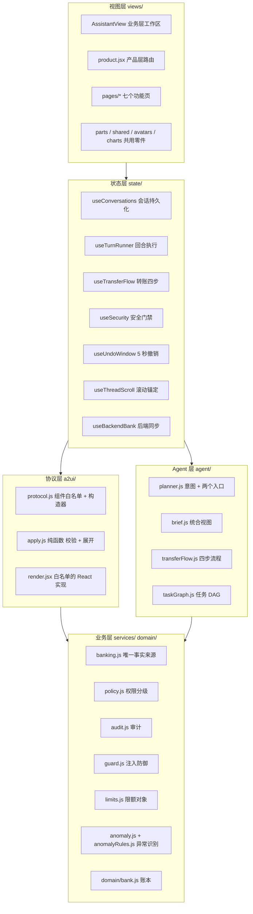

### 4.1 依赖规则（不可违反）

这三条保证**协议层与业务层可以被单测直接 import** —— 仓库里 87 条测试就是这么跑的，不需要浏览器。

| 模块 | 禁止 |
| --- | --- |
| `a2ui/` | 除 `render.jsx` 外，禁止 import React |
| `agent/` | 禁止 import React |
| `services/` `domain/` | 禁止 import React |
| `views/` | 禁止直接读写账本，必须走 `ctx` |

---

## 5. 端到端数据流

### 5.1 用户说一句话，到界面上出现视图

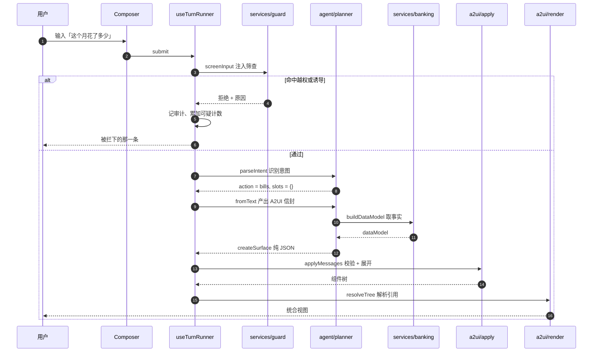

### 5.2 两个入口，一个内核

**这是「统一入口」这句话的技术含义。**

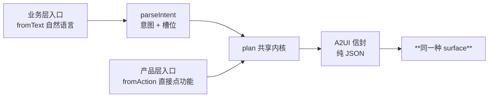

产品层不是「另一套界面」，而是**跳过意图理解那一步的同一个渲染管线**。
这一点有测试守着：`tests/brief.test.js` 断言「自然语言与直接点功能必须落到同一张视图」。

### 5.3 为什么不可能出现幻觉数字

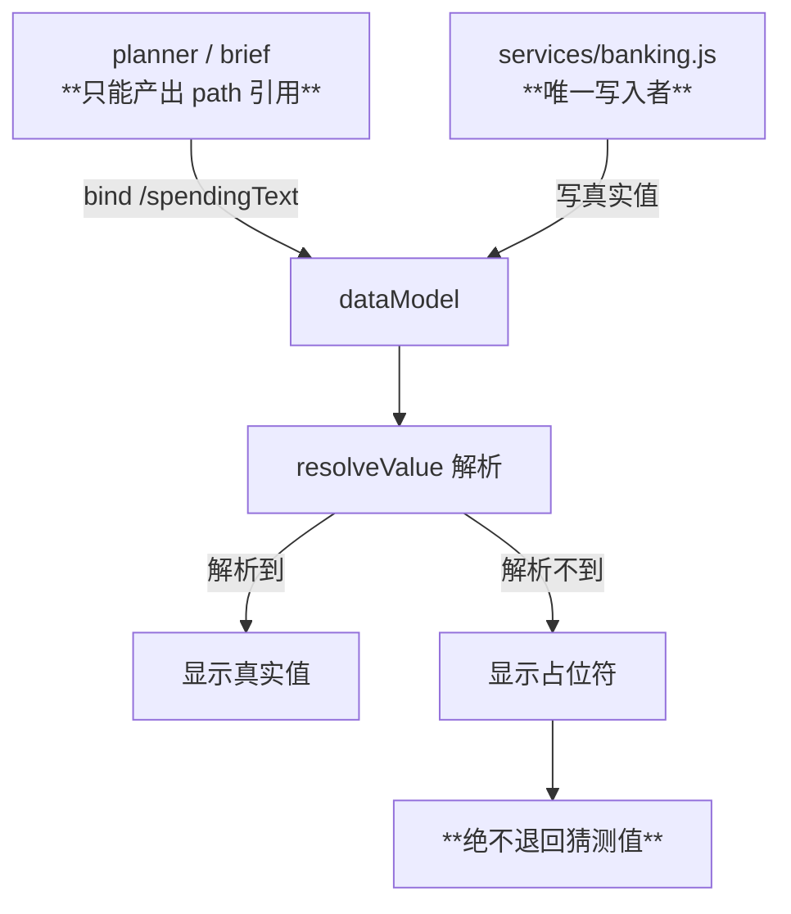

三道防线：

1. **planner 不产出任何事实数字**，只产出引用 —— 有测试断言「组件结构里不含写死的金额字面量」
2. **只有 service 能写 dataModel**
3. **解析不到就显示占位符**，不猜

---

## 6. 六大模块详解

### 6.1 协议层 a2ui/ —— 组件白名单

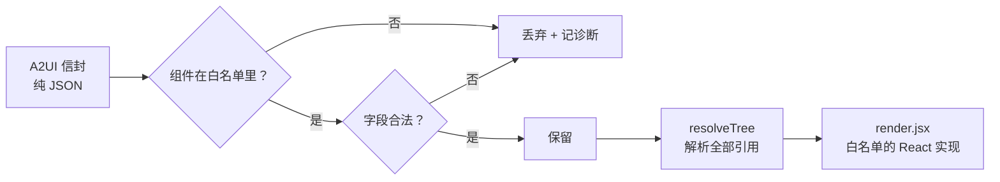

**17 个组件**：Text / Icon / Row / Column / Card / ActionGroup / TextField / Select /
Meter / Progress / Divider / Figure / CardFace（以及 envelope 用的 createSurface 等）。

**为什么要有白名单**：信封将来可以整段来自后端。白名单保证
「**未知组件会被丢弃，悬空引用降级为占位符，绝不渲染未授权内容**」。

### 6.2 Agent 层 —— 意图、统合、流程、任务图

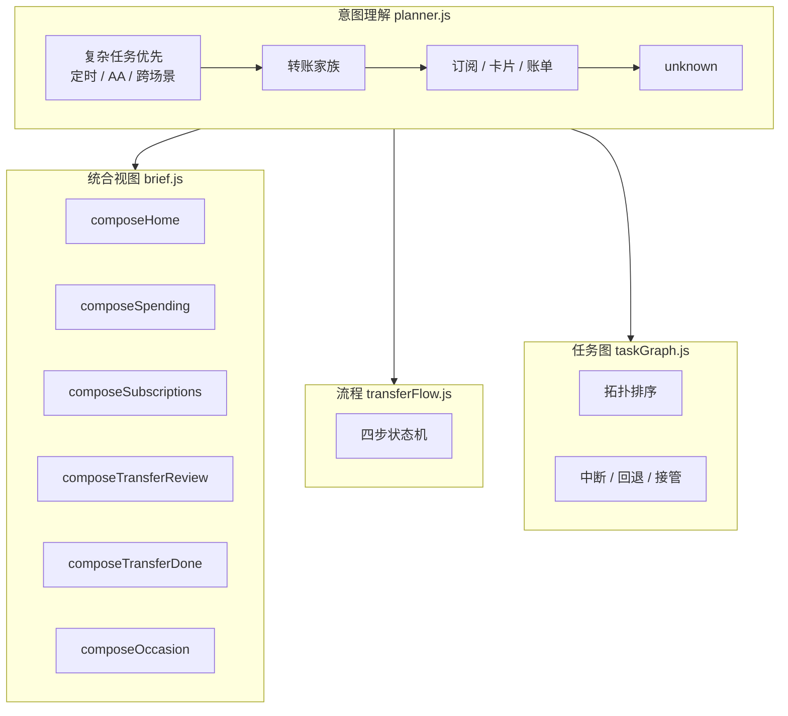

### 6.3 策略层 —— 权限分级（唯一门禁）

**赛题高优先级项。三条不变量是它可信的原因。**

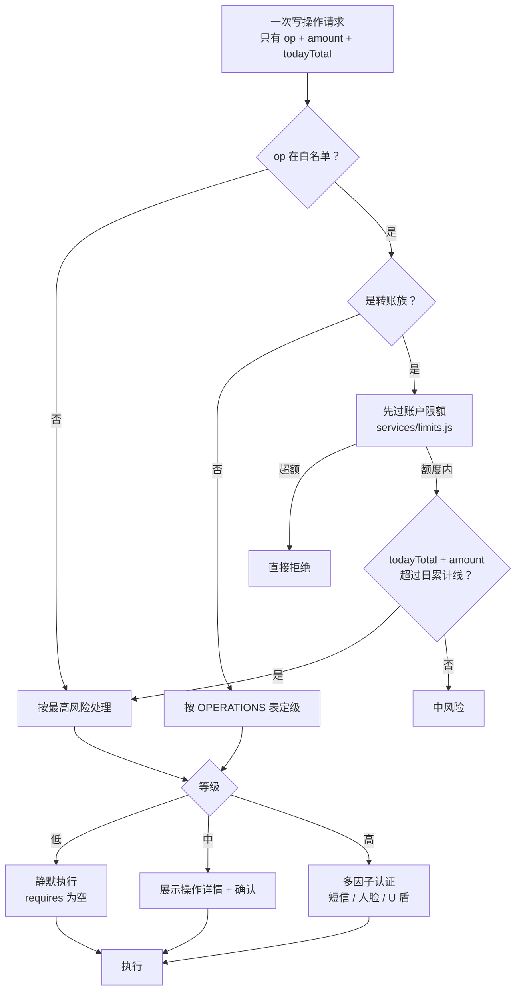

| 不变量 | 含义 | 守它的测试 |
| --- | --- | --- |
| **风险不由调用方声明** | `assess` 只接受「要做什么」和「多少钱」，不接受「多危险」 | 传 `level:low, trusted:true` 仍判高风险 |
| **按日累计不按单笔** | 分两笔 600 绕不过 1000 门槛 | 两笔 600 → 第二笔升高风险 |
| **未知操作不放行也不降级** | 白名单外一律最高风险 | 未知 op → HIGH |

> **第一层注入防御是结构性的**：任何 Prompt 都无法让高风险操作降级，
> 因为「降级」这个动作在 API 上不存在。

### 6.4 审计层 —— 决策链路

记录的**不是**「谁在什么时候做了什么」，而是**为什么允许它发生**。

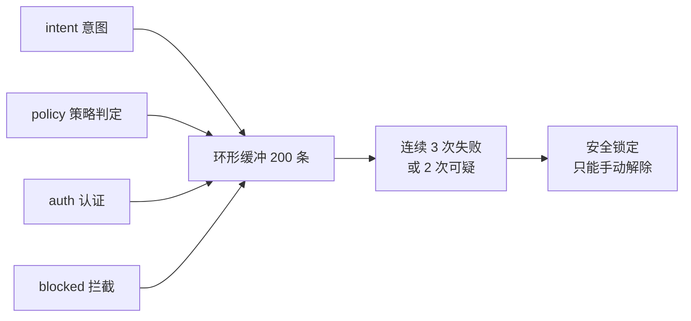

### 6.5 业务层 —— 唯一事实来源

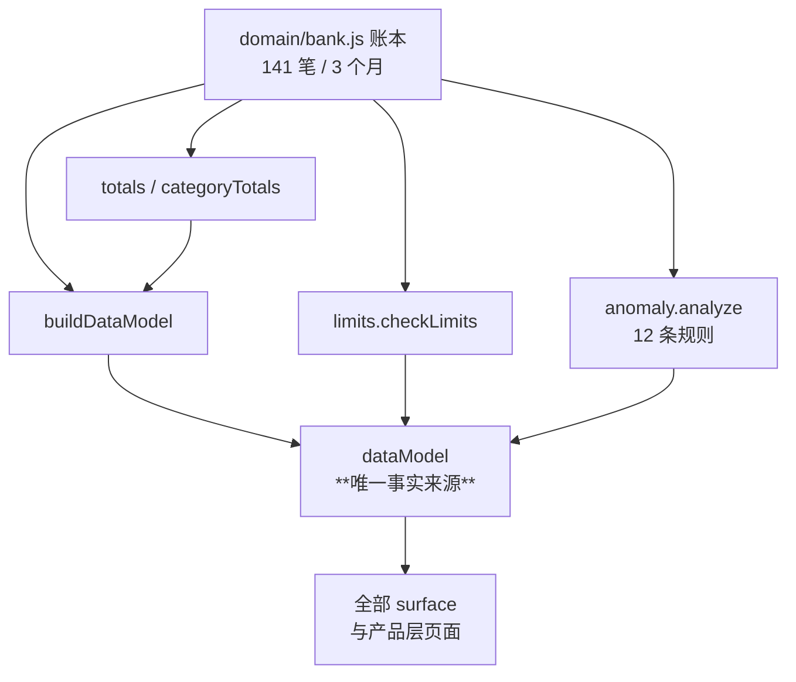

**余额是四则模型**：`available + frozen + pending = total`。
转账**只校验 available** —— 「同时发两笔都显示余额够」被堵死，有测试守着。

**原子性**：`ledgerVersion()` + `transfer(state, { expect })`，草稿带快照、
提交时比对，对不上直接拒绝而不是照扣（防 TOCTOU）。

---

## 7. 每一个业务环节怎么渲染

> 本节的每张图都是**该环节实际产出的组件树**。信封是纯 JSON，
> 由 `a2ui/apply.js` 校验后交给 `render.jsx` 渲染 —— 所以图与界面一一对应。

### 7.1 首页统合视图（composeHome）

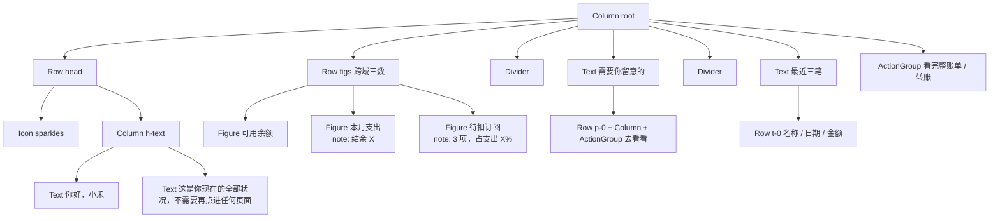

**跨了哪些域**：账户（余额）+ 账单（本月支出）+ 订阅（待扣）+ 卡片（待处理）+ 账本（最近三笔）。

### 7.2 转账四步流程（transferFlow.js）

四步共用一个 `surfaceId`，**在原地换页而不是堆叠** —— 消息流里始终只有一张卡。

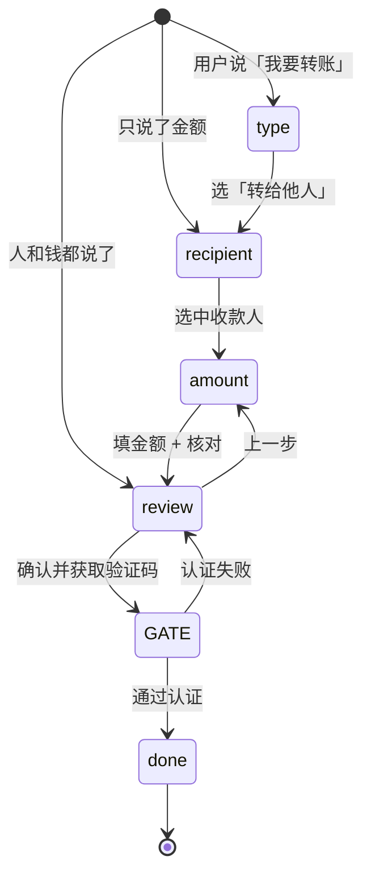

每一屏的组件树：

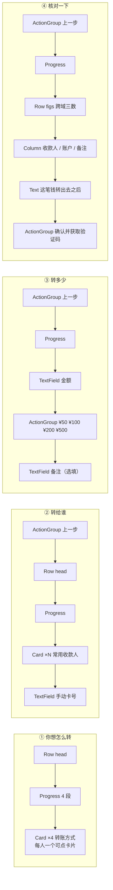

**核对页的跨域三数**（这是统合视图最直接的证据）：

| Figure | 值 | 来自哪个域 |
| --- | --- | --- |
| 转出 | 用户填的金额 | 转账 |
| **转后余额** | 现在 − 转出 | 账户 |
| **扣完订阅还剩** | 转后余额 − 活跃订阅合计 | 订阅 |

再加一句「本月支出会从 X 变成 Y，增加约 N%」—— 来自账单域。

### 7.3 定时转账：任务 DAG（taskGraph.js）

**赛题要求「复杂任务需拆解为有序的子任务 DAG；支持中断、回退和人工接管」。**

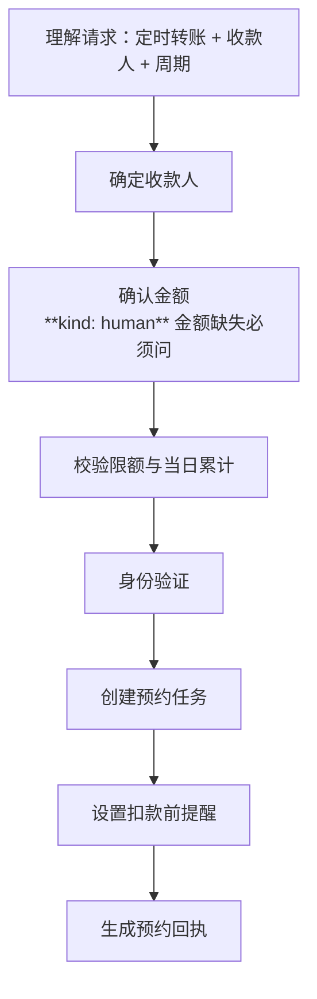

界面上按**依赖深度缩进**呈现，缩进本身就是「为什么回退会重置后面全部」的答案：

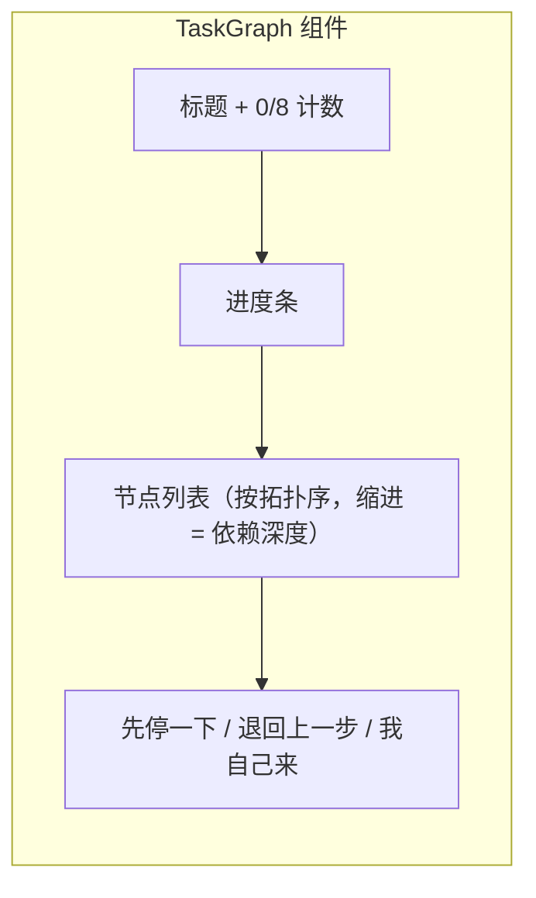

三种控制的状态变换：

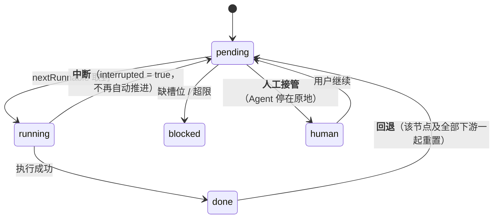

> 回退靠**依赖图**算，不写特判：重置目标节点，再沿边找到全部下游一起重置。

### 7.4 AA 收款

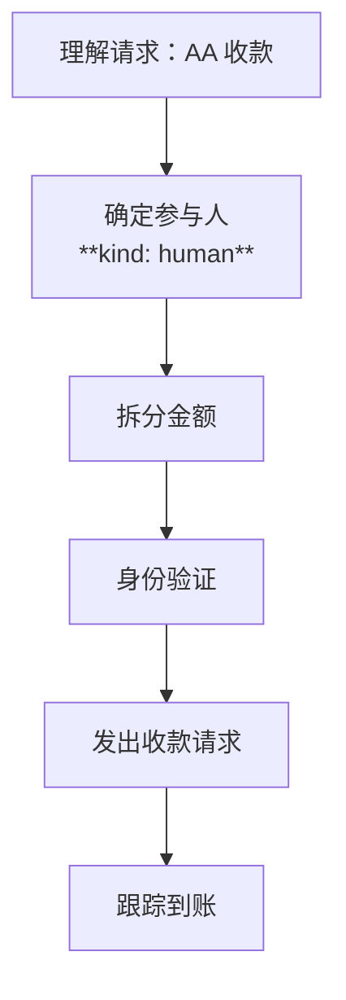

### 7.5 账单：六种图表形态共享同一个高亮

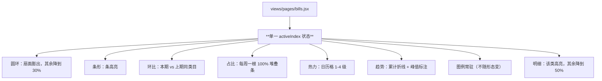

**为什么共享状态**：滑过任一形态的任一段，圆环、图例、读数区、明细**一起响应** ——
用户不用读表就能看出结构。切换形态不清空高亮，因为状态不在图里。

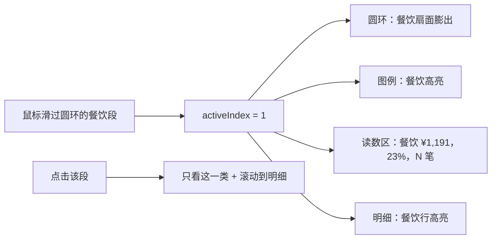

> **hover 不触发滚动，只有点击才滚动** —— 频率门：hover 一天几十次，
> 让页面自己跳比不动更糟。

### 7.6 异常交易识别（anomaly.js）

```mermaid
flowchart TB
    TX["账本 141 笔"] --> D["detectAnomalies"]
    D --> R1["R-AMT-01 金额偏离 3σ"]
    D --> R2["R-AMT-04 贴近报告线 ¥49,000"]
    D --> R3["R-AMT-05 拆分规避"]
    D --> R4["R-TIME-01 深夜大额"]
    D --> R5["R-FREQ-02 卡测试 5 笔 × ≤¥10"]
    D --> R6["R-MER-01/02 商户异常"]
    D --> R7["R-ACCT-01 睡眠户复活"]
    D --> R8["R-BEN-01 首次收款人"]

    R1 --> SCORE["scoreAnomaly 评分合成"]
    R8 --> SCORE
    SCORE --> SUP{"误报抑制"}
    SUP -->|"白名单 / 时间衰减 / 每日限 2 次确认"| DROP["压制"]
    SUP -->|"通过"| DISP["四档处置"]
    DISP --> P1["放行"]
    DISP --> P2["二次确认"]
    DISP --> P3["挂起人工"]
    DISP --> P4["拒绝 + 冻卡"]
```

**每条规则输出 `{ ruleId, weight, evidence }`** —— 这天然满足赛题的「决策链路审计」：
评委问「为什么标记这一笔」，能直接答出规则 id 和证据。

### 7.7 订阅

```mermaid
flowchart TB
    PAGE["views/pages/subscriptions.jsx"] --> HEAD["StatBar 每月固定支出 / 下次扣费"]
    HEAD --> LIVE["生效中：一项一张身份卡"]
    LIVE --> C1["46px 方形形象（圆角方 = 周期性）"]
    LIVE --> C2["下次扣费胶囊：3 天后 + 日期"]
    LIVE --> C3["每月 ¥29 与每年 ¥348 双视角"]
    LIVE --> C4["已续 6 个月 · 累计已付 ¥174"]
    LIVE --> C5["取消按钮 → 就地展开后果预览"]
    HEAD --> GONE["已取消：同一张卡的「不在运行」材料"]
```

**取消的后果预览**（就地展开，不套弹窗 —— 同一个问题不问两遍）：
哪几项权益失效、哪天之后不再扣款、本月已扣不退、一年少付多少。

### 7.8 卡片与卡包

```mermaid
flowchart TB
    PAGE["views/pages/cards.jsx"] --> W["卡包：横向 scroll-snap，选中浮起 10px"]
    W --> SEL["选中卡"]
    SEL --> F["CardFace 卡面<br/>EMV 芯片 / 非接波纹 / 持卡人 / 卡组织"]
    SEL --> SB["StatBar 可用额度 / 本月消费"]
    SEL --> PRO["cardProfile 档案<br/>账单日 / 还款日 / 单笔与日累计限额"]
    SEL --> CH["ChannelBoard 四类渠道逐项开关"]
    SEL --> ACT["操作宫格：冻结 / 限额 / 挂失 / 流水"]
    SEL --> HIST["状态历史时间线"]
    SEL --> ACTI["这张卡自己的动账"]
```

**冻结是一条流程而不是一个开关**：

```mermaid
stateDiagram-v2
    [*] --> active
    active --> confirming: 点冻结
    confirming --> active: 取消
    confirming --> frozen: 确认<br/>逐条列出哪四个渠道停用
    frozen --> result: 卡面换暗面 + 磨砂斜纹 + 已冻结徽标
    result --> active: 一次性撤销
    result --> frozen: 关闭
```

**助手侧的卡面**：`CardFace` 已进 A2UI 白名单，所以助手说的卡片视图里
渲染的是**真卡面**而不是「一个图标 + 两行灰字」。

### 7.9 收款人

```mermaid
flowchart TB
    PAGE["views/pages/payees.jsx"] --> Q{"这一页回答什么"}
    Q --> Q1["这是谁"]
    Q --> Q2["上次给了他多少"]
    Q --> Q3["还能不能再转"]
    Q1 --> ROW["每行：首字母头像 + 姓名 + 关系标签"]
    Q2 --> ROW2["上次往来：日期 · 金额 · 用途「房租」"]
    Q3 --> ROW3["已登记 → 再转一笔 / 未登记 → 设为常用"]
```

> **未登记的人不给「转账」按钮，给「设为常用」** —— 转账流程只认常用收款人，
> 硬给一个转账按钮只会在下一步把人丢掉。那是不诚实的设计。

### 7.10 回执

```mermaid
flowchart LR
    DONE["记账完成"] --> UNDO["**5 秒可撤销窗口**<br/>倒计时条 + 撤销按钮"]
    UNDO -->|"撤销"| CANCEL["这笔转账没有执行"]
    UNDO -->|"5 秒走完"| RECEIPT["composeTransferDone"]
    RECEIPT --> A["回执编号"]
    RECEIPT --> B["账户余额 / 本月支出 / 扣完订阅还剩"]
    RECEIPT --> C["下一步：设为常用 / 看账单 / 再转一笔"]
```

### 7.11 跨场景联动（composeOccasion）

赛题点名的差异化能力。用户说「我爱人生日」，Agent 不该只回一句祝福。

```mermaid
flowchart TB
    IN["我爱人生日"] --> G["任务图 tg-occasion"]
    G --> G1["识别场景"] --> G2["看这个月还剩多少可支配"] --> G3["给建议"] --> G4["**你选一个** human"] --> G5["按所选动作的风险等级验证"] --> G6["执行"]

    G --> V["统合视图"]
    V --> V1["Row figs 可支配 / 本月已花 / 待扣订阅"]
    V1 --> V2["三张可执行卡片：直接转账 / 先看账 / 清掉不用的订阅"]
```

### 7.12 助手工作区的布局

**不是一条会不断变长的聊天流。**每办一件事就多一张卡，看到第三张就得往上滑 —— 那违背最小操作原则。

```mermaid
flowchart TB
    subgraph W["AssistantView"]
        direction TB
        H["view-head 标题"]
        WS["**工作区**：当前这件事的统合视图，占满主要面积，一屏看全"]
        TG["TaskGraph（仅复杂任务）"]
        HIST["**历史条**：以往问句折成一行 chips，点一下换回当时那张视图"]
        FL["FlowLauncher 可以让他做什么"]
        CP["Composer"]
    end
    H --> WS
    WS --> TG
    TG --> HIST
    HIST --> FL
    FL --> CP
```

> **不滚动的历史，可切换的现在。**

### 7.13 多因子认证

```mermaid
stateDiagram-v2
    [*] --> sms: 默认短信
    sms --> face: 切到人脸
    sms --> token: 切到 U 盾
    face --> scanning: 开始识别
    scanning --> pass: 1.8s 后通过
    token --> holding: 长按 1.2s
    holding --> pass: 完成
    sms --> fail: 验证码错误
    face --> fail: —
    token --> fail: —
    fail --> counted: 累计失败
    counted --> locked: 满 3 次
    pass --> [*]: 执行操作
    locked --> [*]: 只能手动解除
```

### 7.14 注入防御与安全锁定

```mermaid
flowchart TB
    IN["用户输入"] --> L1["**第一层：结构性**（无法绕过）"]
    L1 --> L1a["Agent 不产出事实数字"]
    L1 --> L1b["操作必须在白名单"]
    L1 --> L1c["风险由 policy 推出，不由调用方声明"]
    L1 --> L2["**第二层：文本筛查** guard.js"]
    L2 -->|"命中越权"| B1["拦截 + 审计留痕"]
    L2 -->|"命中诱导"| B2["拦截 + 审计留痕"]
    L2 -->|"通过"| OK["继续"]
    B1 --> CNT["可疑计数 +1"]
    B2 --> CNT
    CNT --> LOCK{"满 2 次？"}
    LOCK -->|"是"| L["**安全锁定**"]
```

> **答辩要讲清楚的一点**：就算第二层被完全绕过，第一层仍然有效 ——
> 因为「把高风险操作降级」这个动作在 API 上不存在。

---
## 8. 关键状态机

### 8.1 会话与回合

```mermaid
stateDiagram-v2
    [*] --> 空会话
    空会话 --> 已播欢迎: runAction welcome
    已播欢迎 --> 待答: 用户提交
    待答 --> 骨架: 先占位（pending = true）
    骨架 --> 已成图: 420ms 后落内容
    已成图 --> 待答: 继续追问
    待答 --> 被拦: 注入筛查未通过
    被拦 --> 待答: 换一句
```

「先占位再填充」的两个作用：**加载态**（craft-floor 要求的四态之一），
以及**让对话有节奏** —— 卡片是被想出来的，不是瞬间贴上来的。

### 8.2 滚动锚定

```mermaid
stateDiagram-v2
    [*] --> 跟随
    跟随 --> 脱离: 用户主动上滑超过 32px
    脱离 --> 跟随: 回到底部 24px 以内
    脱离 --> 跟随: **用户明确发送（意图优先）**
```

非对称迟滞（32 / 24）+ 意图优先：用户自己发消息时**强制恢复跟随**，
不管他刚才滑到哪里。

---

## 9. 视觉与动效规约

### 9.1 两层材质模型（Apple）

```mermaid
flowchart LR
    subgraph CONTENT["内容层 —— 不透明"]
        C1["卡片 / 列表 / 面板"]
        C2["不透明底 + 细边或阴影<br/>**禁止玻璃**"]
    end
    subgraph FUNC["功能层 —— 玻璃"]
        F1["顶栏 / 输入框 / 抽屉 / 浮层"]
        F2["tint + blur/saturate + 顶部高光 + 边缘影"]
    end
    CONTENT -.->|"每屏玻璃元素 ≤ 3 个"| FUNC
```

### 9.2 craft-floor 的硬禁令（违反即返工）

| 禁令 | 处理 |
| --- | --- |
| 标题上方的 eyebrow / kicker | 全部删除。原文：「这是一个 ban，没有 brief 能换回来」 |
| ghost card（1px 边框 + 大阴影并存） | 面板只声明一次 elevation |
| 渐变文字 | 未使用 |
| `feTurbulence` 噪点 | 已删除（读起来像业余作品） |
| 卡片半径超过 16px | 已收到 16px |
| emoji / Unicode 当图标 | 一律 lucide-react + 白名单 |
| 用户可见文案里的破折号 | 清零 |
| **嵌套卡片** | 永远禁止 —— 分组靠 Divider |

### 9.3 动效的频率门

**频率是取消资格，不是判断题。**

| 频率 | 规则 | 本项目 |
| --- | --- | --- |
| 一天 100+ 次 | 永不动效 | 侧边栏切换只给按压反馈 |
| 一天几十次 | 只允许几乎不可感知 | 转账对流 ±2px 保留循环；餐饮/购物的签名动作改成**一次性** |
| 偶发 | 标准动效 | 对焦切换、surface 入场 |
| 罕见 / 首次 | 惊喜预算花在这里 | 5 秒可撤销、工资金币的入场扫光 |

**内容不动，交互动**：余额数字不加持续动效、图表不加视差。

### 9.4 设计令牌

`src/styles/tokens.css`（260 行）是**唯一颜色来源**。
组件 CSS 里出现 hex / rgb 字面量即视为 bug，有一条命令可以自查：

```powershell
Get-ChildItem src -Recurse -Include *.css |
  Where-Object { $_.Name -ne 'tokens.css' } |
  Select-String -Pattern '#[0-9a-fA-F]{3,8}\b|rgba?\('
# 期望：无输出
```

配色原则：**单一色相**（蓝）。曾经有靛紫作为品牌渐变第二停靠点，已全部移除 ——
紫色既不表达状态也不是品牌色，纯装饰。

**类别色盘不含红与绿** —— 红绿留给金额方向。

---

## 10. 文件职责表

**硬约束：单文件不超过 300 行。** 当前最大 `styles/wallet.css` 277 行。

### 协议层 a2ui/

| 文件 | 行数 | 职责 |
| --- | ---: | --- |
| `protocol.js` | 123 | 17 个组件白名单 + 构造器 + 信封统一封装 |
| `apply.js` | 206 | `applyMessages` / `resolveTree` / 校验。**纯函数，零 React** |
| `render.jsx` | 148 | 白名单的 React 实现 |

### Agent 层 agent/

| 文件 | 行数 | 职责 |
| --- | ---: | --- |
| `planner.js` | 155 | `parseIntent` / `fromText` / `fromAction` / `plan` |
| `brief.js` | 246 | **六个统合视图**：首页 / 账单 / 订阅 / 核对 / 回执 / 跨场景 |
| `transferFlow.js` | 131 | 转账四步流程 |
| `taskGraph.js` | 178 | 任务 DAG：拓扑排序 + 中断 / 回退 / 接管 |

### 业务层 services/ + domain/

| 文件 | 行数 | 职责 |
| --- | ---: | --- |
| `banking.js` | 182 | `buildDataModel` **唯一事实来源** + 跨域汇总 + 校验 |
| `policy.js` | 94 | **权限分级**：三级分档 + 19 个操作目录 |
| `audit.js` | 82 | 审计：决策链路 + 安全锁定 |
| `guard.js` | 54 | 注入防御：越权 / 诱导两类模式 |
| `limits.js` | 99 | 限额一等对象 + 时间窗 + `checkLimits` |
| `anomalyRules.js` | 226 | 12 条异常规则 + 统计工具 |
| `anomaly.js` | 216 | 检测 → 评分 → 分档 → 误报抑制 |
| `domain/bank.js` | 137 | 账本：四则余额模型 + 原子转账 |
| `domain/conversations.js` | 80 | 会话持久化 |

### 状态层 state/

| 文件 | 行数 | 职责 |
| --- | ---: | --- |
| `useConversations.js` | 27 | 会话持久化（含函数式补丁） |
| `useTurnRunner.js` | 107 | 回合执行：输入 → 计划 → 信封 → 落进会话 |
| `useTransferFlow.js` | 97 | 转账四步状态机 |
| `useSecurity.js` | 61 | **安全门禁**：三级路由 + 锁定 |
| `useUndoWindow.js` | 34 | 5 秒可撤销窗口 |
| `useThreadScroll.js` | 74 | 滚动锚定（非对称迟滞 + 意图优先） |
| `useBackendBank.js` | 43 | 后端模式同步 |

### 视图层 views/

| 文件 | 行数 | 职责 |
| --- | ---: | --- |
| `AssistantView.jsx` | 100 | 业务层：工作区 + 历史条 + 任务图 |
| `product.jsx` | 19 | 产品层路由 |
| `parts.jsx` | 103 | 共用零件：Page / Panel / StatBar / IconTile / Row / CountUp |
| `shared.jsx` | 34 | 分类视觉语言的兼容层（实现已搬到 avatars） |
| `avatars.jsx` | 201 | **16 类 PFC 头像体系** + 品牌色常量 |
| `charts.jsx` | 246 | **六种图表形态**，共享高亮状态 |
| `pages/overview.jsx` | 121 | 概览：余额主卡 + 4×3 宫格 |
| `pages/feed.jsx` | 170 | 动态：三段时间轴 + 可展开 |
| `pages/bills.jsx` | 208 | 账单：结论 → 结构 → 节奏 → 明细 |
| `pages/subscriptions.jsx` | 198 | 订阅：一项一张身份卡 |
| `pages/cards.jsx` | 132 | 卡包 + 档案 + 操作 |
| `pages/cardFace.jsx` | 126 | 卡面组件（助手侧也用它） |
| `pages/cardProfile.jsx` | 132 | 额度尺 / 渠道板 / 状态历史 |
| `pages/cardFreeze.jsx` | 74 | 冻结流程 |
| `pages/cardData.jsx` | 167 | 演示扩展数据（补进账本） |
| `pages/cardUtils.jsx` | 43 | 账期模型 |
| `pages/payees.jsx` | 149 | 收款人 |
| `pages/transfer.jsx` | 238 | 转账页（渲染同一套 A2UI surface） |
| `pages/receipts.jsx` | 23 | 回执 |

### 外壳 components/

| 文件 | 行数 | 职责 |
| --- | ---: | --- |
| `App.jsx` | 266 | 状态编排；产出 `ctx`；派发 action |
| `Sidebar.jsx` | 69 | 首页块 + 功能列表 + 历史对话 |
| `Composer.jsx` | 53 | 输入区（IME 三级防护 + autosize） |
| `FlowLauncher.jsx` | 37 | 常驻「可以让他做什么」 |
| `TaskGraph.jsx` | 66 | 任务 DAG 呈现 + 三个控制 |
| `AuthDialog.jsx` | 104 | 多因子认证 |
| `AppOverlays.jsx` | 31 | 浮层栈（纯组合，无逻辑） |
| `UndoBar.jsx` | 29 | 5 秒可撤销条 |
| `ConfirmDialog.jsx` | 31 | 确认弹窗 |
| `TransferDialog.jsx` | 45 | 后端模式核对 / 验证码 |
| `Toast.jsx` | 7 | 轻提示 |

### 样式 styles/

| 文件 | 行数 | 职责 |
| --- | ---: | --- |
| `tokens.css` | 260 | **设计令牌唯一来源** |
| `wallet.css` | 277 | 卡片与卡包 |
| `pages.css` | 259 | 侧边栏 / 视图头 / 面板 / 卡面 |
| `app.css` | 240 | 外壳 / 背景 / 浏览器表面 |
| `motion.css` | 189 | 对焦切换 / 错峰 / 分类签名动作 |
| `charts.css` | 185 | 六种图表 |
| `a2ui.css` | 168 | A2UI 协议组件 |
| `views.css` | 161 | StatBar / IconTile / Row / 按日分组 / 撤销条 |
| `avatars.css` | 119 | 头像形状系统 |
| `auth.css` | 51 | 多因子认证 |
| `taskgraph.css` | 36 | 任务图 |

---

## 11. 已知限制与升级路径

| 限制 | 现状 | 升级路径 |
| --- | --- | --- |
| **意图理解是规则引擎**，不是 LLM | 演示环境 | 接口已隔离在 `parseIntent` 一处，换成 LLM 只改这一个函数 |
| **没有接入 RAG** | 未实现 | 银行规则与费率表可做本地知识库检索 |
| **余额并发** 靠 `ledgerVersion` 快照比对 | 单机演示够用 | 真后端里这一步是「限额校验 + 占用 pending」同事务 |
| **审计只在内存** | 环形缓冲 200 条 | 结构按可落库设计（每条自带 id / seq / at） |
| **规则引擎未接前端** | `anomaly.analyze` 已跑通并有 32 条测试 | 界面上还没有呈现异常标记，是下一步 |
| **理财域不存在** | 赛题要求，尚未实现 | 至少做到「收益查询 + 申购流程」 |
| **沙箱隔离未实现** | 本项目不生成并执行代码 | 若被追问，给 Monzo 的「受限工具子集」定义作为方向 |

完整的已知风险清单见 [SECURITY.md](SECURITY.md) §3。

---

## 12. 维护记录

| 日期 | 变更 |
| --- | --- |
| 2026-09-28 | **全文重写**：补齐两层范式、治理层、任务 DAG、§7 每个业务环节的渲染图、文件职责表按真实树重排 |
| 2026-09-28 | 新增 §2A 两层定义与 §5A 视觉规约（后续并入本文对应章节） |
| 2026-09-28 | 建立本文档：as-is 与 to-be，全部用 Mermaid |
