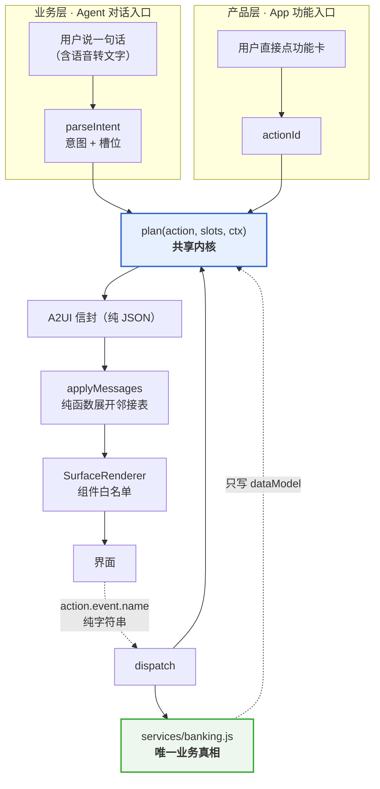
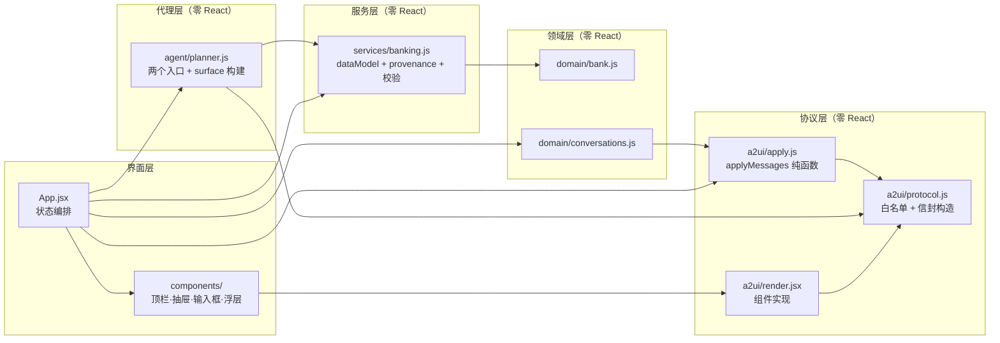
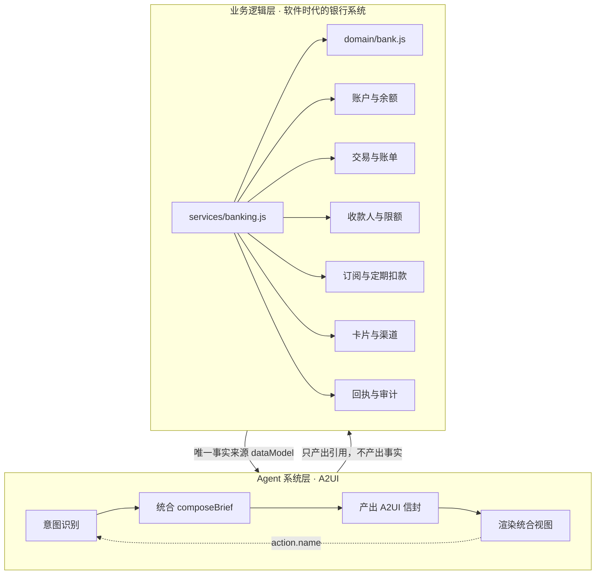
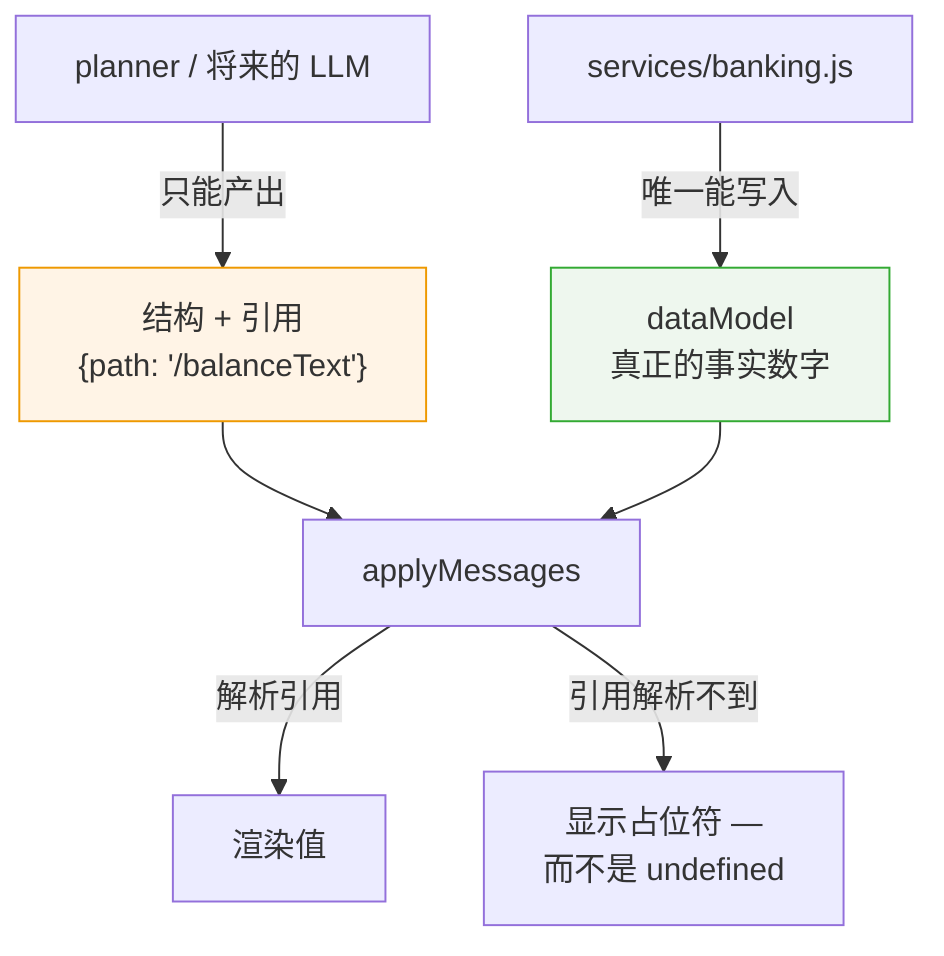
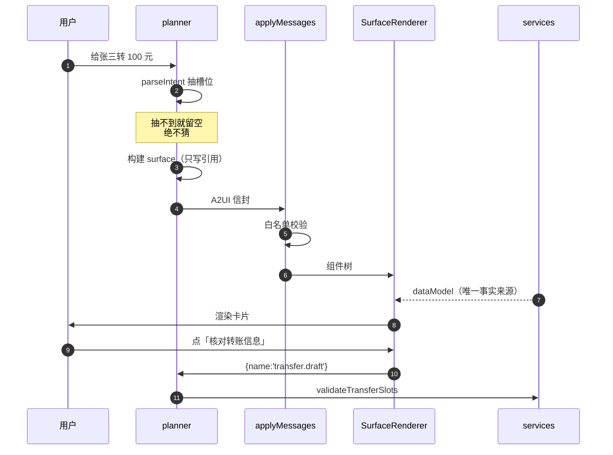
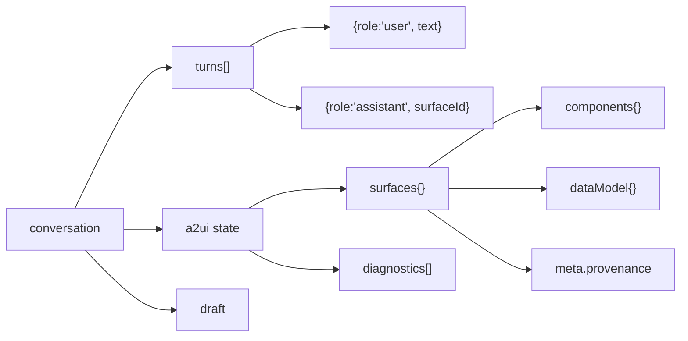

# ARCHITECTURE — 青禾 · AI Banking ChatBox

> 本文档描述系统架构，**所有结构图使用 Mermaid**。
> 维护义务见 [AGENTS.md](../AGENTS.md) §2：任何结构/数据流/协议变更必须同步本文。
>
> 最后更新：2026-09-28

---

## 1. 核心结构：两个入口，一个内核

产品有两个入口，但它们**不是两套界面**，而是同一条渲染管线的两个起点：

**为什么这样分**：产品层不是"另一套界面"，而是**跳过意图理解那一步的同一个 surface 内核**。这一点有单测守着（`tests/planner.test.js`「两个入口产出同一种 surface」）。

## 2. 分层与依赖方向

依赖只能向下。**领域层不知道 UI，UI 不知道后端。**

## 2A. 两层定义（本项目的基本盘）

一个成熟的 AI Native 银行系统由两层组成，缺一层都不成立：

| | 业务逻辑层 | Agent 系统层 |
|---|---|---|
| 是什么 | 原有银行系统在软件时代的系统逻辑 | A2UI 形式，AI 通过意图识别帮你统合和总结所有业务 |
| 边界 | `services/` + `domain/`，**零 React** | `agent/` + `a2ui/`，**零 React（除渲染器）** |
| 谁拥有事实 | **只有它**。所有数字从 `buildDataModel` 出来 | 不拥有任何事实，只产出 `{path}` 引用 |
| 呈现粒度 | 按「产品」切：账户 / 账单 / 订阅 / 卡片 | 按「用户此刻要办的事」切：跨产品合成一张统合视图 |
| 界面 | 产品层：七个功能页（`views/pages/*`） | 业务层：助手工作区（`views/AssistantView.jsx`） |

### 2A.1 统合视图（composed brief）

**这是两层之间的接缝，也是 AI Native 与软件时代银行的分界线。**

软件时代：余额在账户页、账单在账单页、订阅在订阅页。用户办一件事要跨三个页面，
自己把信息拼起来。Agent 时代：把跨产品的信息合起来，一次呈现给用户。

所以 `agent/brief.js` 里每个 `compose*` 都**刻意跨域取数**：

| 统合视图 | 跨了哪些域 |
|---|---|
| 首页状态板 | 账户 + 账单 + 订阅 + 卡片 + 待处理事项 |
| 账单结论 | 账单 + 订阅（「订阅占了支出的 X%」） |
| 转账核对 | 转账 + 账户（转后余额）+ 账单（本月支出变化）+ 订阅（扣完还剩多少安全垫） |
| 转账回执 | 转账 + 账户 + 账单 + 下一步可做什么 |

这几件事分散在三个产品页里，用户原本要自己算。

### 2A.2 「动线」的定义

**动线是用户体验的顺滑度，不是给用户看的流程图。**

因此：界面上**没有**任何「动线面板」。曾经做过一个右侧 trace 面板并配了「隐藏动线面板」按钮，
那是把「动线」理解成了管线遥测 —— 已删除。

真正的动线设计体现在：
- 已经说过的信息不重复问（说「给张三转 100」直接跳核对步）
- 跨域信息一次给全，不用跳页面（转账核对页给出转后余额与订阅影响）
- 历史不滚动，点一下换回去
- 不可逆的操作给 5 秒可撤销窗口

## 3. 「可靠性」是怎么保证的

这是本架构最重要的部分。用户问的是「怎么确保召回来的东西是真实的、可靠的」——答案不是"提示词写好一点"，而是**结构上让它不可能编造**：

五道闸门：

| # | 机制 | 位置 | 挡住的错误 |
|---|---|---|---|
| 1 | **组件白名单** | `protocol.js` `COMPONENT_NAMES` | 任意 HTML / 未知组件。catalog 里**没有颜色字段**，所以也产不出违反 `tokens.css` 的 UI |
| 2 | **结构与事实分离** | `planner.js` 只写 `{path}` | 卡片显示 ¥100 而正文说 ¥200 这类不一致 |
| 3 | **枚举校验** | `apply.js` `validate()` | 非法 variant / tone / icon，一律丢弃并记诊断 |
| 4 | **悬空引用降级** | `apply.js` `resolveValue()` | 解析不到 → `null` → 界面显示 `—`，绝不显示 `undefined` |
| 5 | **provenance** | `services/banking.js` | 用户无法判断数据新旧 → 每个 surface 带来源与截止时间 |

单测直接守着第 1/2/4 条（见 `tests/a2ui.test.js`「未知组件被丢弃」「悬空引用解析为 null」，`tests/planner.test.js`「结构里不含任何硬编码金额字面量」）。

## 4. A2UI 协议接入

依据 `doc/research/A2UI-protocol.md`（官方仓库 [a2ui-project/a2ui](https://github.com/a2ui-project/a2ui)，16530★，Apache-2.0）。

| 项 | 决策 |
|---|---|
| 协议版本 | 按 **v1.0 形状**写（`createSurface` 可内联 components），渲染器对 v0.9.1 也容错 |
| 样式归属 | **不实现 `theme` 字段**（v1.0 已移除）；颜色唯一来源是 `tokens.css` |
| 依赖 | **零新增**。A2UI 是消息格式规范，不是库 |
| 组件子集 | 9 个：`Text` `Icon` `Row` `Column` `Card` `ActionGroup` `TextField` `Select` `Meter` |

> ⚠️ **最大的坑**：网上大量早期资料讲的是 **v0.8 的 `surfaceUpdate` / `beginRendering` / `dataModelUpdate`**——那套协议**已封闭**，不要抄。

### 4.1 邻接表与消息流

组件是**扁平数组**，靠 `id` 互相引用，必须有且仅有一个 `id: "root"`。`applyMessages` 维护 `Map`，`resolveTree` 从 root 递归展开。

### 4.2 后端替换为零成本的三个前提

1. 消息是**纯 JSON**（无 React 元素、无函数）
2. 交互只走 `action.name` **字符串**，由渲染器回抛
3. 渲染器是纯函数 `applyMessages(state, messages)`

满足后接真后端只改一行：`stream.onmessage = e => applyMessages(state, JSON.parse(e.data))`。

## 5. 前端文件职责

**硬约束：单文件不超过 300 行**（AGENTS.md §1）。当前最大 product.jsx 294 行。

| 文件 | 行数 | 职责 |
|---|---:|---|
| `src/main.jsx` | 5 | 入口，仅挂载 |
| `src/App.jsx` | 276 | 状态编排；产出 `ctx`；派发 action；记录动线 |
| **协议层** | | |
| `a2ui/protocol.js` | 124 | 10 个组件白名单 + 信封/组件构造器 |
| `a2ui/apply.js` | 184 | `applyMessages` / `resolveTree` / 校验。纯函数 |
| `a2ui/render.jsx` | 141 | 组件白名单的 React 实现 |
| **代理层** | | |
| `agent/planner.js` | 216 | `fromText` / `fromAction` / `plan` + surface 构建器 |
| `agent/transferFlow.js` | 190 | 转账四步流程 |
| **服务层** | | |
| `services/banking.js` | 83 | `buildDataModel`（唯一真相）+ `provenance` + 校验 |
| **状态** | | |
| `state/useConversations.js` | 24 | 会话持久化 |
| `state/useThreadScroll.js` | 76 | 滚动锚定（非对称迟滞 32/24px，意图优先） |
| `state/useTransferFlow.js` | 108 | 转账四步状态机（从 App 抽出） |
| **视图** | | |
| `views/AssistantView.jsx` | 91 | 业务层：工作区（统合视图）+ 可切换的历史条 |
| `views/product.jsx` | 21 | 产品层路由 |
| `views/parts.jsx` | 103 | 共用零件：Page / Panel / StatBar / IconTile / Row / Amount / CountUp |
| `views/shared.jsx` | 33 | 兼容层：CategoryIcon / 订阅细分 / EyeIcon / CATS |
| `views/avatars.jsx` | 191 | **交易头像体系**：PFC 16 类 + 商户品牌色 + 形状/降级/周期规则（§D） |
| `views/charts.jsx` | 267 | **六种图表形态**，手绘 SVG 零依赖，共享同一个高亮状态 |
| `views/pages/overview.jsx` | 134 | 概览：余额主卡 + 4×3 宫格 + 可筛动态（含 16px 代扣头像） |
| `views/pages/bills.jsx` | 222 | 账单：结论 → 结构 → 节奏 → 明细 |
| `views/pages/subscriptions.jsx` | — | 订阅 |
| `views/pages/cards.jsx` | — | 卡片与卡包 |
| `views/pages/payees.jsx` | 149 | 收款人：这是谁 / 上次给了多少 / 还能不能再转 |
| `views/pages/receipts.jsx` | 23 | 回执 |
| `views/pages/transfer.jsx` | — | 转账（渲染同一套 A2UI surface） |
| **代理层 · 统合** | | |
| `agent/brief.js` | 205 | **统合视图**：跨域取数，把账户/账单/订阅/卡片合起来一次呈现 |
| **外壳** | | |
| `components/Sidebar.jsx` | 62 | 常驻侧边栏：业务层 + 产品层 + 历史对话 |
| `components/FlowLauncher.jsx` | 42 | 常驻「可以让他做什么」入口 |
| `components/PipelineInspector.jsx` | 95 | 动线可视化：一次交互的 6 步 |
| `components/Composer.jsx` | 62 | 输入区。IME 三级防护 + autosize |
| `components/UndoBar.jsx` | 34 | 5 秒可撤销条（ZA 的做法） |
| `components/ConfirmDialog.jsx` | 41 | 确认弹窗 |
| `components/Toast.jsx` | 8 | 轻提示 |
| `components/TransferDialog.jsx` | 45 | 后端模式核对/验证码 |
| **样式** | | |
| `styles/tokens.css` | 243 | **设计令牌唯一来源** |
| `styles/avatars.css` | 116 | **交易头像**：形状系统 / 品牌色三级优先 / 工资金币（§D，零颜色字面量） |
| `styles/pages.css` | 229 | 侧边栏 / 视图头 / 面板 / 卡面 |
| `styles/views.css` | 190 | StatBar / IconTile / Row / 按日分组 / 撤销条 |
| `styles/motion.css` | 189 | 动效：对焦切换 / 错峰 / 分类签名动作 / 订阅三条 |
| `styles/app.css` | 174 | 外壳 / 背景 / 浏览器表面 |
| `styles/a2ui.css` | 164 | A2UI 协议组件 |
| `styles/inspector.css` | 52 | 动线面板 |

## 5A. 视觉与动效规约（来自三项前端技能，已落地）

参考素材在 `vendor/skills/`（**参考素材而不是依赖，已 gitignore**）：
`impeccable`（Apache-2.0）、`taste-skill`（MIT）、`emilkowalski-skills`（MIT）、
`huashu-design`（MIT）、`gsap`（Standard no-charge license，**不是 OSI 开源**）。

### 5A.1 craft-floor 的硬禁令（违反即返工）

| 禁令 | 本项目的处理 |
|---|---|
| 标题上方的 eyebrow / kicker | 全部删除。原文：这是一个 ban，没有 brief 能换回来 |
| ghost card（1px 边框 + 大阴影并存） | 面板只声明一次 elevation（用阴影）；可点胶囊反过来只留边框 |
| 渐变文字 | 未使用 |
| feTurbulence 噪点 | 已删除（codex 规则：读起来像业余作品） |
| 卡片半径大于 16px | 已收到 16px |
| emoji / Unicode 字符当图标 | 一律用 lucide-react，并在 `ICON_NAMES` 白名单里登记 |
| 用户可见文案里的破折号 | 清零（taste-skill 称这是最常被违反的一条） |

### 5A.2 浏览器表面（最容易被漏、也最能看出功夫）

`::selection` / `caret-color` / 全局滚动条 / `::placeholder` / `text-underline-offset` 全部从 `tokens.css` 派生；
金额、卡号、日期统一 `font-variant-numeric: tabular-nums`。

### 5A.3 动效的频率门

emilkowalski 的规则：**频率是取消资格，不是判断题。**

| 频率 | 规则 | 本项目 |
|---|---|---|
| 一天 100+ 次（快捷键、命令面板） | 永不动效 | 侧边栏切换只给按压反馈 |
| 一天几十次（hover、列表） | 只允许几乎不可感知 | 转账对流正负 2px 保留循环；餐饮/购物的签名动作改成一次性 |
| 偶发（弹窗、抽屉） | 标准动效 | 对焦切换、surface 入场 |
| 罕见 / 首次 | 惊喜预算花在这里 | 5 秒可撤销 |

**内容不动，交互动**：余额数字不加持续动效、图表不加视差。这一条同时满足 Apple 的
「用户正在读的数据不该为了风格而移动」和 taste-skill 把受监管产品归为低动效的判断。

### 5A.4 交易头像体系（doc/research/revolut-ai-and-za-deep-dive.md §D）

产业界的答案是**双轨制**（Plaid Enrich 的两个字段就是官方出处）：有商户就上商户形象，
识别不出才退到类别图标。落地在 `views/avatars.jsx` + `styles/avatars.css`：

| 维度 | 规则 | 依据 |
|---|---|---|
| 形状 | 圆 = 消费/兜底/收入；**圆角方形 = 周期性**；人物位 = 转账给人 | §D-54，零文字的分类手法 |
| 配色 | **商户品牌色 > 品类色调 > 类别色 > 中性兜底**。16 类类别色盘不含纯红/纯绿，红绿只做金额信号 | §D-54、Skins Factory |
| 餐饮 | 一张关键词表同时出图标与品类色调（`diningLook` 语义优先、哈希兜底），两条路同一份数据 | 本文件 §5A.4 |
| 降级 | 品牌名+品牌色 → 商户名+类别色 → 类别名+类别图标，**原始串码一次都不许露面** | Monzo 原文 |
| 规格 | 流水行 40px（移动 36）、行内徽标 16px、与文字间距 12px | §D.5 |
| 动效 | 只给新事件一次入场；地铁等高频小额连徽标都不加 | §D.3 ③ |

分类对齐 **Plaid PFC 的 16 个 primary**（`category` 直接用英文常量，中文名只做显示），
旧的中文分类由 `LEGACY` 兜住；「周期/订阅」是**标签**（`recurring`）而不是类别，它跨越房租与订阅。

品牌色常量手抄自 `simple-icons` 的 `title`/`hex` 字段（**不引包、不搬 SVG**）。
⚠️ CC0-1.0 覆盖的是该仓库的数据组织，**不覆盖商标**：品牌图形归各自所有者，演示内使用需标注来源。

## 6. 会话模型

一次对话 = 一串 turn + 一份 A2UI state。**卡片是协议产物**，所以能整体序列化、能单测、将来能整段来自后端。会话只记「渲染了哪些 surface」。

半损坏的历史会被**整份丢弃重建**——比留下引用了不存在 surface 的 turn 要好。

## 7. 维护记录

| 日期 | 变更 |
|---|---|
| 2026-09-28 | 建立本文档；记录 as-is 基线 |
| 2026-09-28 | 四路调研完成；据 Apple 两层模型更正 PRD §3.3；建立 `tokens.css` |
| 2026-09-28 | 交易头像体系（§D）落地：avatars.jsx + avatars.css，shared.jsx 收成兼容层 |
| 2026-09-28 | 第一阶段结构化重构：`main.jsx` 275 → 4 行，拆为组件 + 注册表 |
| 2026-09-28 | **第三阶段**：账户侧边栏常驻（业务层/产品层分组 + 历史对话）；补产品层 5 个功能页；动线可视化面板；转账改为**四步流程**（不再一进来就问金额，且已说过的信息不重复问）；分类视觉语言（6 类各自的图标/配色/底座形状 + 餐饮哈希变体）；ZA Card 卡面按实测几何复刻（1.669 比例 / 角对角渐变 / 零高光）；三条订阅动效；`app.css` 按职责拆成 app/a2ui/motion 三个文件 |
| 2026-09-28 | **第二阶段：A2UI 内核落地**。新增协议层/代理层/服务层；两个入口接通；会话模型改为 turn + A2UI state；旧 `surfaces/` 与三栏布局移除。验证：单测 29/29、构建通过、e2e 7 组断言通过、组件样式零硬编码颜色 |