# DECISIONS — 决策台账

> 每条决策 **≤100 字**，配一张 Mermaid 展示「它是什么、影响什么」。
> 骨架级不变量在 [PRODUCT-ARCHITECTURE.md](PRODUCT-ARCHITECTURE.md)（受保护）；本文是可改的血肉。
>
> **读取规则**：先看图，再看一句话。看不懂图说明这条决策没写清楚，回来改。
> 最后更新：2026-10-16

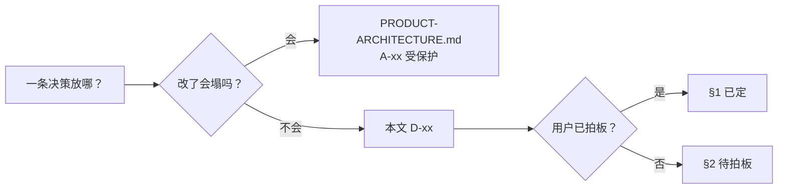

---

## §1 已定

### D-27 · 前后端合并交付并发布源码

用户要求合并前后端并上传 GitHub。增加同源构建启动入口，保留热更新、业务及数据边界；上传源码与运行说明，不含本机配置、数据库和缓存。原话 U-46。

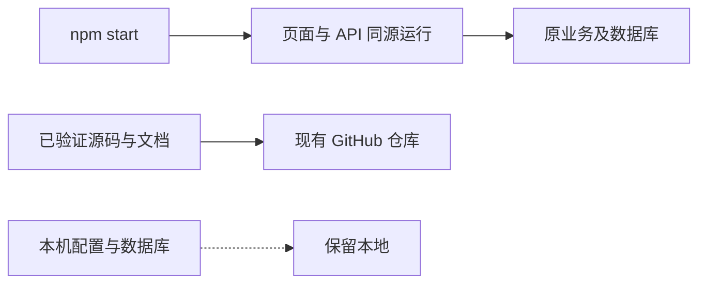

### D-26 · 借鉴银行公开体验，完善原前端

按用户指定 REA 拆解银行公开界面。保留三色及十三业务，完善账户首页、服务搜索、金额隐私与办理控件；不新增 Agent，不改变原授权和持久化边界。原话 U-45。

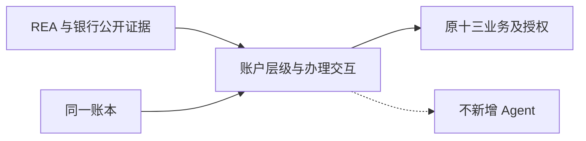

### D-25 · 三色更鲜明，入口保持简洁

用户要求概览及功能页色彩更丰富，保留薄荷、浅蓝、暖杏。加强余额、标题带、数据和选中态；白底入口与统一薄荷图标保留，业务流程不变。

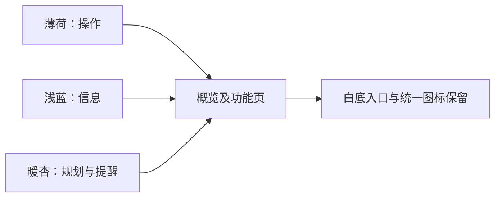

### D-24 · 产品讨论先落地业务 UI

用户要求按讨论文档完善 UI、暂不做 Agent。重点补生活缴费可视化、银行卡交互与储蓄进度；统计来自原账本，手动支付沿用原核对和授权，不新增自动代办。原话 U-44。

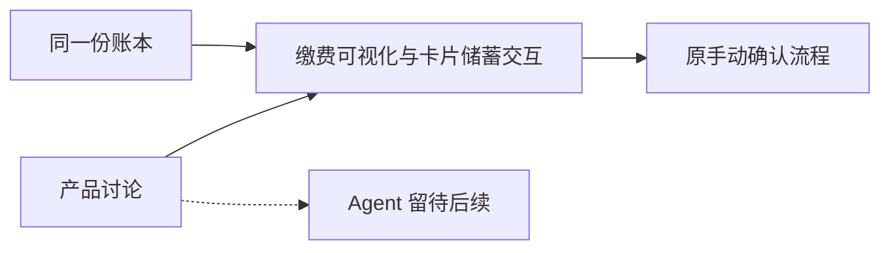

### D-01 · 单页上限 150 字

界面文案 ≤150 字；**数据不计入**。超了 = 设计不够好。

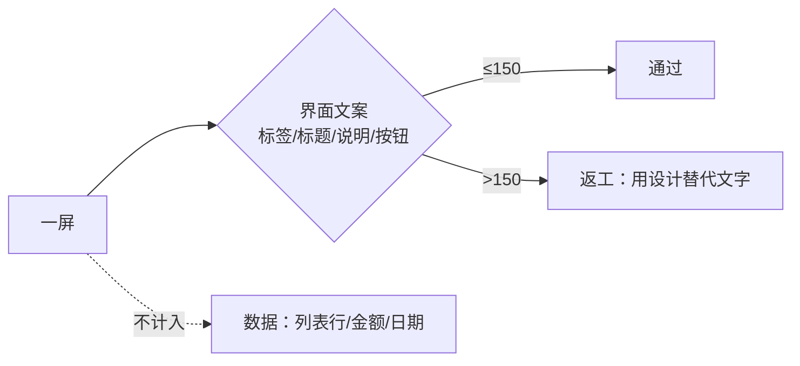

`npm run test:text` ｜ 原话 U-06

### D-02 · 界面不留演示备注

用户可见处不出现「演示 / 模拟 / 预设规则 / 占位」。代码注释保留。

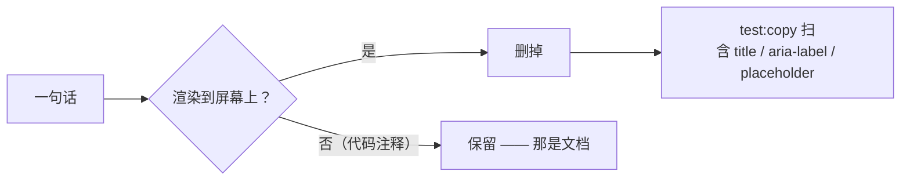

原话 U-07

### D-03 · 用设计代替文字

能用一个图标 + 一个数字说清的，不写一句话。层级靠视觉权重，不靠副标题。

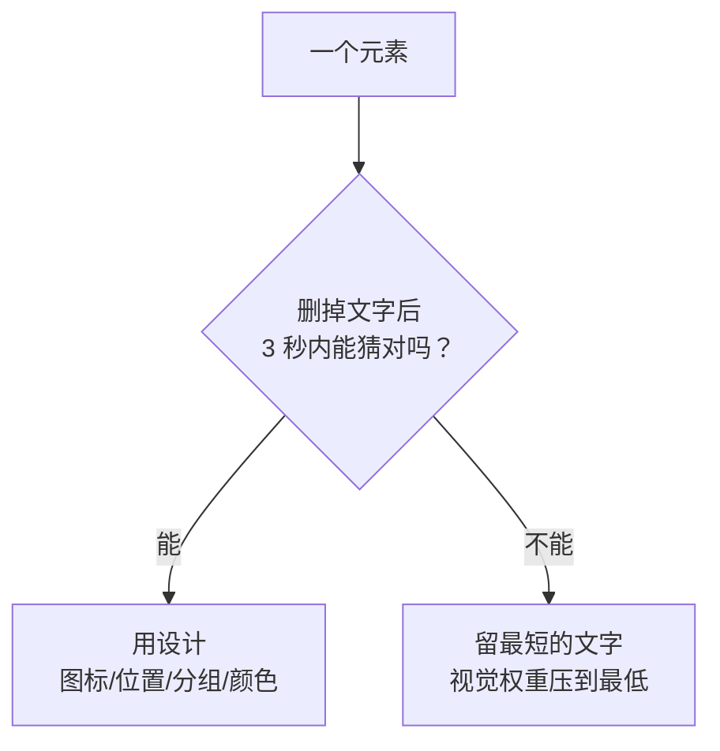

原话 U-05

### D-04 · 空 / 错 / 加载三态

口径照抄众安**真实上线**的文案结构。

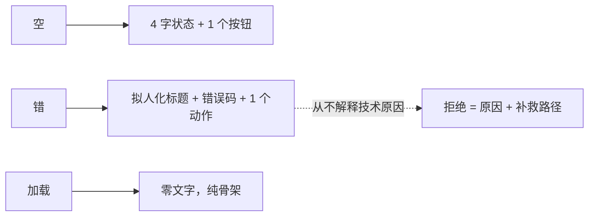

依据：众安投资子站 887 条 UI 字串表
### D-05 · 助手首页 = 问候 + 连续对话流

可滚动的连续对话逻辑。**不用工作区 + 折叠历史那套。**

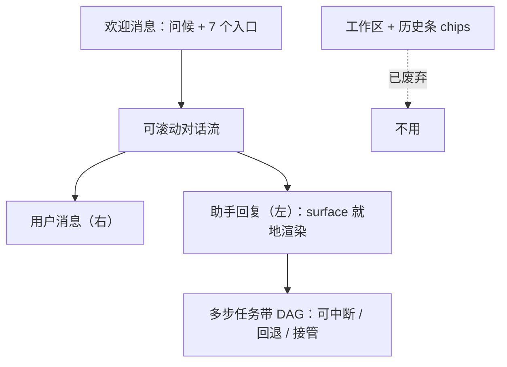

原话 U-13 / U-14

### D-06 · 入口嵌在欢迎消息里

功能入口**不在输入框上方的常驻栏**，而在欢迎消息里。

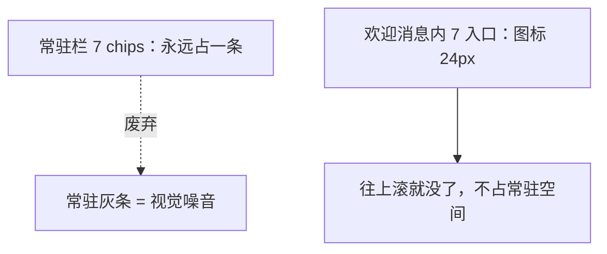

原话 U-13 ｜ 连带解决「两排 chips 长得像」的问题

### D-07 · 收款人不进导航

侧边栏与宫格都没有它；**名录嵌在转账页里**，「再转一笔」在同页闭环。

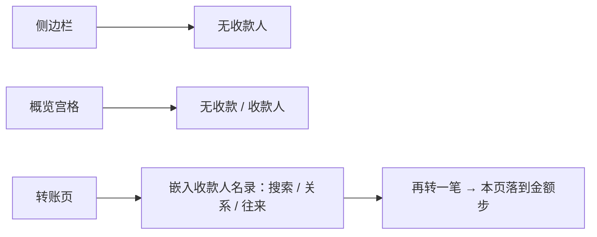

原话 U-16 ｜ 页面与路由保留（去掉会让 setRoute 静默落概览）

### D-08 · 每类动账都有专属形象

形状即语义：圆 = 消费，圆角方 = 周期，人物位 = 转给人。

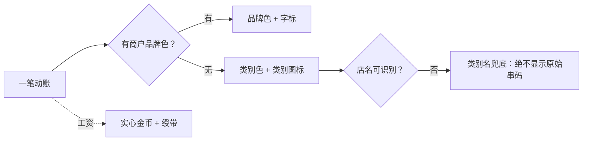

原话 U-29 ｜ 16 类对齐 Plaid PFC

### D-09 · 订阅三条签名动效

云空间浮、光影视频扫光、随听音乐律动。**扫光要慢**（2400ms）。

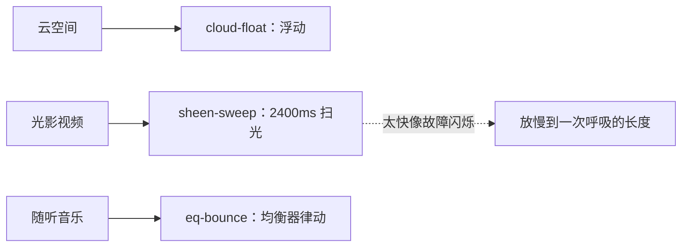

原话 U-32 / U-33 ｜ `npm run test:motion` 守着

### D-10 · 助手侧渲染真卡面

不是「图标 + 两行灰字」，是可复用的卡面组件。

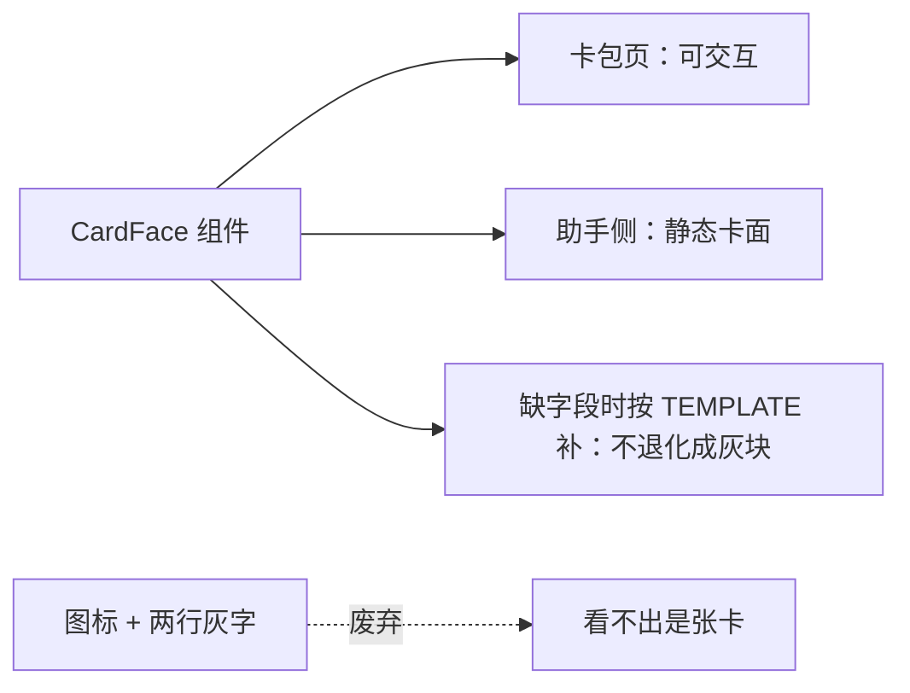

原话 U-30

### D-11 · 理财榜单写「别人在干什么」

标题全是**行为数据**，零评级语义。这是**合规设计**不是文案风格。

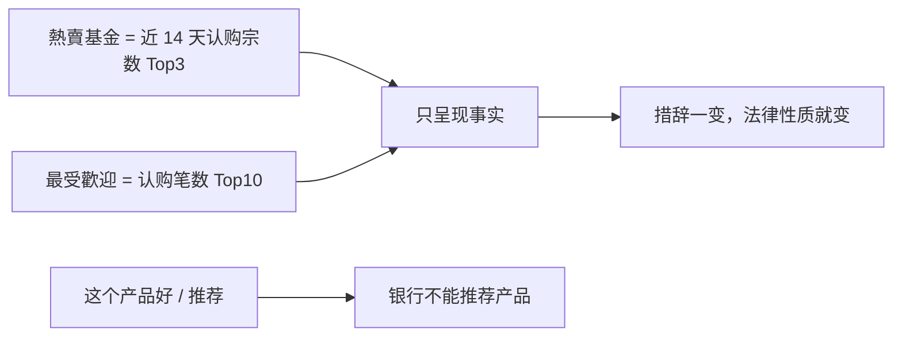

原话 U-09 ｜ 依据众安 8 种榜单
### D-12 · 不用紫色

品牌色相统一在蓝。曾经第二停靠点是靛紫，已全部移除。

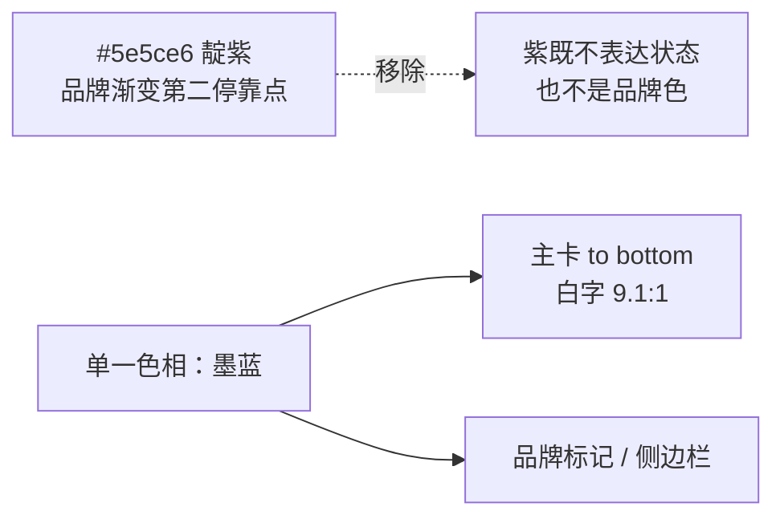

原话 U-25

### D-13 · 概览是「家」

不与功能页平级；切到它时侧栏**不跳走**。

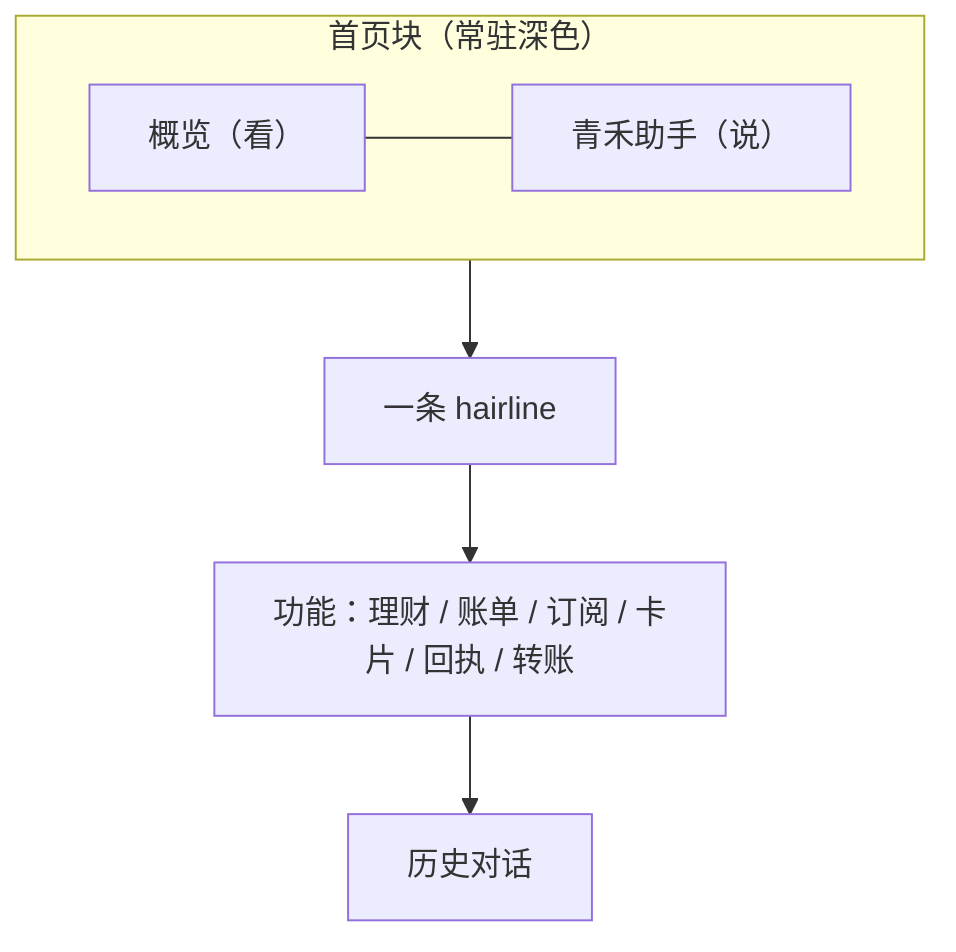

原话 U-27 ｜ 断点来自「点概览 = 离开了所在的地方」

### D-14 · 撤销窗口

不可逆操作给 5 秒缓冲 + 倒计时条 + 撤销按钮。

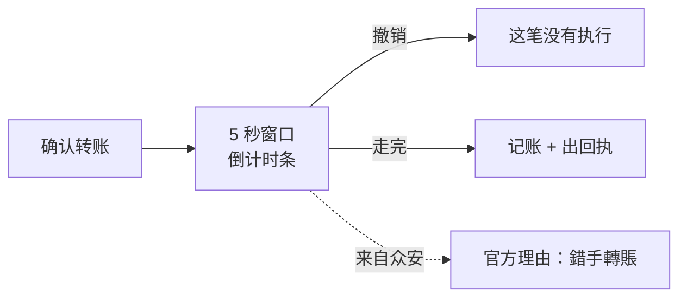

原话 U-12（最小操作）｜ 建议扩展到所有写操作（D-05 待拍板）

### D-15 · 理财域范围

收益查询 + 产品货架 + 申购四步。**资金直连活期，没有投资钱包。**

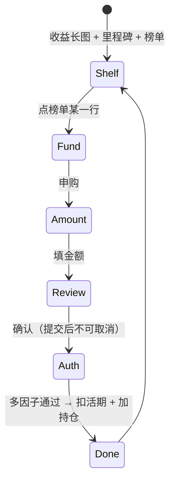

原话 U-09 / U-23

### D-16 · 金额等宽 + 右对齐

数值一律 `tabular-nums`；**金额右对齐，表头也右对齐**。

```mermaid
flowchart LR
    BAD["居中的数值列"] -.->|"列会抖"| X["读不出量级"]
    GOOD["tabular-nums + 右对齐"] --> G1["条形图百分比列<br/>错位 36px → 0px"]
    GOOD --> G2["分组头右缘对齐<br/>26px → 0px"]
```

依据 Material 3 / M2 规范

### D-19 · 挂失补卡（不可逆）

挂失要走多因子；补卡有进度；**挂失后原卡不可用，且不可逆**。

```mermaid
stateDiagram-v2
    [*] --> Normal: 卡正常
    Normal --> Confirm: 点挂失<br/>后果先摊开（补卡费 / 卡号作废 / 新卡寄送）
    Confirm --> Auth: 过门禁 —— 风险由 policy 判，本页不声明
    Auth --> Lost: 多因子通过 → 账本写 lost
    Auth --> Normal: 未通过 → 账本不变
    Lost --> Replacing: 补卡受理 → 制卡 → 寄出
    Replacing --> [*]: 新卡可用
```

**三条纪律**：风险等级不由页面声明（走 `gate → policy`）· 页面不写账本（唯一写入口是 App 的 applyConfirmation）· 结果由账本推出（卡变 lost，浮层自己消失）

原话 U-19（赛题点名的能力）｜ 实测：`npm run test:card`

---

## §2 待拍板

> 用户最新配色要求：依据所附截图改善单调感，让整体有三个色系。在已确认的浅薄荷与统一图标上加入浅蓝信息色、暖杏计划色，覆盖此前大面积偏绿的呈现；具体值见 DESIGN.md。

> 后续局部修正：用户指出资产管理整排蓝色卡块太花哨，该区域恢复白底和统一薄荷图标，保留六个入口的分组及操作。

```mermaid
flowchart LR
  M["薄荷绿操作与统一图标"] --> UI["已有前端"]
  B["浅蓝信息与资产"] --> UI
  A["暖杏计划与提醒"] --> UI
```

> 2026-10-13 用户要求全部图标统一为账单入口的浅薄荷绿圆角方形与绿色线条。覆盖 D-08 的头像形状和品牌色显示规则；保留原图形、名称、功能和金额状态。

```mermaid
flowchart LR
  R["账单图标参考"] --> I["统一浅薄荷绿圆角方底与绿色线条"]
  I --> S["服务入口"]
  I --> L["订阅卡片与交易列表"]
  I --> A["助手业务图标"]
```

> 2026-10-13 配色更新：用户要求参考 ZA Group，清晰且不要太深。薄荷绿用于品牌填充，余额卡用浅薄荷/浅青与深字，白底保留可读链接；覆盖此前深蓝配色。

```mermaid
flowchart LR
  R["ZA Group 明亮配色参考"] --> B["薄荷绿品牌与按钮"]
  R --> H["浅薄荷浅青余额卡"]
  H --> T["深色文字保证可读"]
```

> 2026-10-13 用户补充：助手页提供新建聊天与历史聊天。新建回到欢迎状态，原消息、卡片、草稿继续保留，可从弹窗选择恢复；历史仅存于当前浏览器。

```mermaid
flowchart LR
  A["当前聊天"] -->|"新建聊天"| N["欢迎与空输入"]
  A --> S["保留消息卡片和草稿"]
  H["历史聊天弹窗"] --> S
  S -->|"选择打开"| A
```

> 2026-10-13 用户最新草图覆盖 D-13 的侧栏形态：删除业务导航及历史列表，改为悬浮圆形助手入口。业务从首页宫格进入，非首页可返回概览；D-05 的连续对话和 A-01/A-02 的业务页面继续有效。

```mermaid
flowchart LR
    O["悬浮圆形入口"] --> A["青禾助手"]
    H["首页宫格"] --> P["业务页面"]
    P -->|"返回概览"| H
    A -->|"返回概览"| H
```

> 2026-10-12 视觉补充（用户要求在现有首页基础上修改并应用主色）：品牌保留深蓝，青绿标识助手和规划，金色只用于储蓄目标；桌面侧栏不画底框。具体值见 DESIGN.md，D-12 的不使用紫色继续有效。

```mermaid
flowchart LR
    B["深蓝：品牌与基础服务"] --> H["现有概览"]
    A["青绿：助手与规划"] --> H
    G["金色：储蓄目标"] --> H
    S["侧栏透明，无底框"] --> H
```

### D-23 · 已确认首页作为默认前端

用户确认精修首页作为前端并接后端。默认进入概览，预览地址保留；连接现有数据库接口，其他原功能保留，暂不开发 Agent。原话 U-43。

```mermaid
flowchart LR
  UI["已确认的薄荷绿首页"] --> APP["默认前端与预览别名"]
  APP --> API["现有 FastAPI 接口"]
  API --> DB["PostgreSQL 资金账本"]
  APP --> LOCAL["保留本地功能与元数据"]
```

```mermaid
flowchart LR
    Q["待拍板"] --> A["D-17 免责声明放哪"]
    Q --> B["D-18 撤销扩展到所有写操作"]
    Q --> D["D-20 收款人页删不删"]
    Q --> E["D-21 动态预览几天"]
    Q --> F["D-22 合并协作者分支流程"]
```

| # | 问题 | 我的倾向 | 影响 |
| --- | --- | --- | --- |
| D-17 | 免责声明放不放界面 | 顶栏一个小徽标 | 合规 vs 简洁 |
| D-18 | 撤销扩展到所有写操作 | 是（查询类不加） | 冻结 / 取消订阅 / 限额 |
| D-20 | ~~收款人页删不删~~ | **已定：删**（实际形态是转账页里的一段） | 见 §1 |
| D-21 | ~~动态预览几天~~ | **已定：当前 + 全部入口**（面板头那个箭头就是） | 见 §1 |
| D-22 | 合并协作者分支要不要固化成流程 | 固化 | 协作效率 |

---

## §3 原话附录（可追溯）

> §1 每条都标了 U-xx。这里是原话，**照录不改写**。
> 完整 42 条在 git 历史里（曾用名 `doc/PRODUCT-DECISIONS.md`，已拆入本文与 `PRODUCT-ARCHITECTURE.md`）。

| U | 原话 |
| --- | --- |
| U-46 | 「前后端合并，然后上传github吧」 |
| U-45 | 「结合那个rea的逆向一切的工程，逆向一些银行app，把前端美术和交互再设计一下」 |
| U-44 | 「D:/金融科技大赛/bk-agent/doc/research/2026-10-13-product-discussion.md,根据这个把ui完善，先不用做agent」 |
| U-43 | 「可以，先把这个当作前端，然后把后端接上」 |
| U-05 | 「好的设计是用 UI 和 UX 的设计来代替各种文字指引，以免让用户看不懂，同时要考虑到用户的认知负荷。」 |
| U-06 | 「单个页面整体文字字数绝对不能超过 150 字。如果超过，说明界面设计不够好。」 |
| U-07 | 「演示对话、预设规则驱动等备注不要写在界面上。」 |
| U-09 | 「严格参考众安银行的设计逻辑、理财逻辑，以及它的 UI 和 UX 是怎么设计的，好好找清楚。」 |
| U-12 | 「信息都能直接呈现到面前……遵循最小操作原则，不用操作那么多东西。」 |
| U-13 | 「他的首页是对的，这种问候和轮动的对话逻辑是要有的，还是得是可滚动的连续对话流。」 |
| U-16 | 「侧边栏收款人这个，就是不要，暂时不要，他删了这种产品决策，就是他的产品决策你要去保持。」 |
| U-25 | 「紫色渐变很难看。」 |
| U-27 | 「概览不应与账单、订阅、卡片、收款人、回执放在同一逻辑层级。」 |
| U-29 | 「工资、房租、餐饮、采购、地铁、打车、云空间、光影视频等，都要对应设计详细的 UI 头像或图标，以提供情绪价值。」 |
| U-30 | 「借记卡形象设计：在助手侧调出时，需要有专门的卡片形象设计，而不是现在灰灰的不好看。」 |
| U-32 | 「光影那么快，也不好。」 |
| U-33 | 「云空间、光影视频、随听音乐，那些微交互呢？微动效呢？怎么全没了？」 |
| U-40 | 「产品决策文档里需要一行一行地记录我亲口跟你说的……作为唯一的真源。」 |
---

## §4 v2.0 设计文档（2026-09-19）—— **已搁置，不作数**

> **作者裁决（2026-09-29）：「那个是最老的东西，是最早期的计划，这个不着急去做，先放一放。」**
> 这五份文档已移入 [`doc/archive/`](archive/README.md)。
>
> 所以这 5 份 v2.0 文档**不作为当前需求**。本节只做**考古记录** —— 保留是为了两件事：
> ① 万一以后要捡回来，知道它们说过什么；② 它们与我做的东西有冲突，冲突本身要留痕。
>
> **实施依据以 §1 / §2 的 D-xx 与 PRODUCT-ARCHITECTURE.md 的 A-xx 为准。**

```mermaid
flowchart TB
    V["PRD v2.0 · 六模块 P0"] --> A["F1 智能转账"]
    V --> B["F2 订阅管理"]
    V --> C["F3 账单分析"]
    V --> D["F4 卡片管理"]
    V --> E["F5 未来现金流预警"]
    V --> F["F6 目标资金计划"]
    E -.->|"体验差异点"| X["提前看见某一天的资金压力"]
    F -.->|"体验差异点"| Y["把用钱愿望落实为安排和任务"]
```

| # | 决策 | v2.0 状态 | 我们做了吗 |
| --- | --- | --- | --- |
| V-01 | 产品方向：围绕个人资金安排提供银行服务 | 用户已认可 | ✅ |
| V-02 | 交付渠道：Web，页面操作 + 自然语言交互 | 用户已确认 | ✅ |
| V-03 | 保留功能：智能转账、订阅管理、账单分析、卡片管理 | 用户已确认 | ✅ 四项都有 |
| V-04 | 新增功能一：未来现金流预警 | 本版提案 | ⏸️ **搁置**（不是漏做，是决定不做） |
| V-05 | 新增功能二：目标资金计划 | 本版提案 | ⏸️ **搁置**（同上） |
| V-06 | 范围取舍：不纳入 IM、**理财申购赎回**、外部商城下单 | 本版提案 | ⚠️ **做了理财申购** |
| V-07 | 跨场景联动**融入资金计划**（不做独立生日联动） | 本版提案 | ⚠️ **做了独立生日联动** |
| V-08 | 首页内容：可用余额、数据范围与更新时间、**未来余额低点**、近期账单、**待确认任务**、**目标摘要** | — | ⚠️ 缺低点 / 待确认 / 目标 |
| V-09 | AI 作为**辅助侧栏**，不占据整屏 | — | ⚠️ 后来 U-13 改成全屏对话流 |
| V-10 | 写操作均需授权与记录；歧义 / 数据缺失 / 未知结果时**不擅自执行** | — | ✅ |

### 冲突清单（已裁决）

```mermaid
flowchart LR
    C1["理财申购"] --> A{"谁优先？"}
    S1["赛题明确要求「理财操作」"] --> A
    V6["v2.0 说不纳入"] --> A
    A --> R1["按赛题做 —— 已做"]
    C2["生日联动"] --> B{"谁优先？"}
    S2["赛题要求「跨场景联动」"] --> B
    V7["v2.0 说融入资金计划"] --> B
    B --> R2["按赛题做 —— 已做"]
    C3["助手形态"] --> D{"谁优先？"}
    V9["v2.0：辅助侧栏"] --> D
    U13["U-13：全屏对话流"] --> D
    D --> R3["按 U-13（时间更晚）"]
```

| 冲突 | v2.0 说什么 | 后来什么变了 | 现在的取舍 |
| --- | --- | --- | --- |
| 理财申购赎回 | 不纳入本版 | 赛题任务明确列了「理财操作」 | **按赛题做**（已做） |
| 生日购物联动 | 不做独立联动，融入资金计划 | 赛题要求「跨场景联动」 | **按赛题做**（已做） |
| 助手形态 | 辅助侧栏，不占整屏 | U-13「他的首页是对的」 | **按 U-13**（全屏对话流） |
| F5 / F6 两个模块 | P0 必做 | **作者裁决：v2.0 整体搁置** | ⏸️ 不做 |
