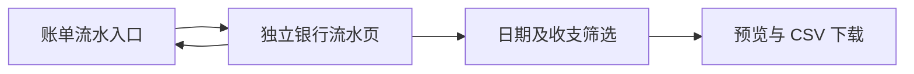
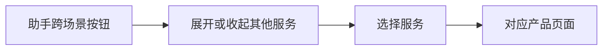
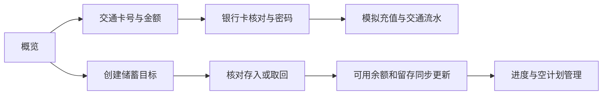
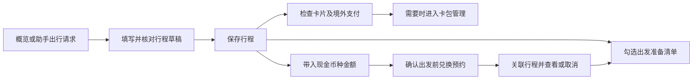
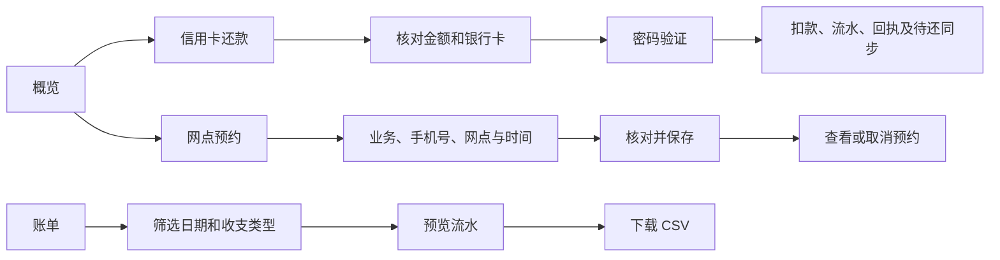
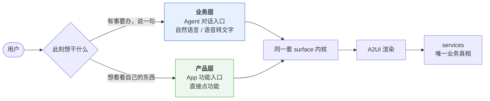
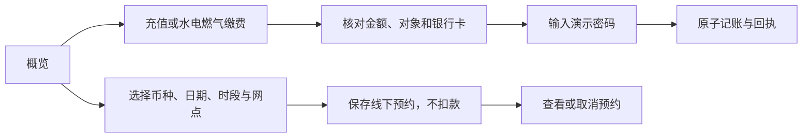
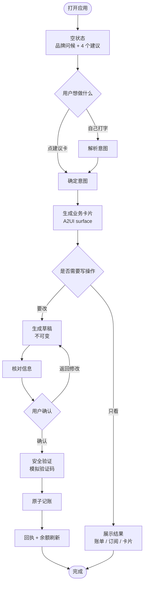
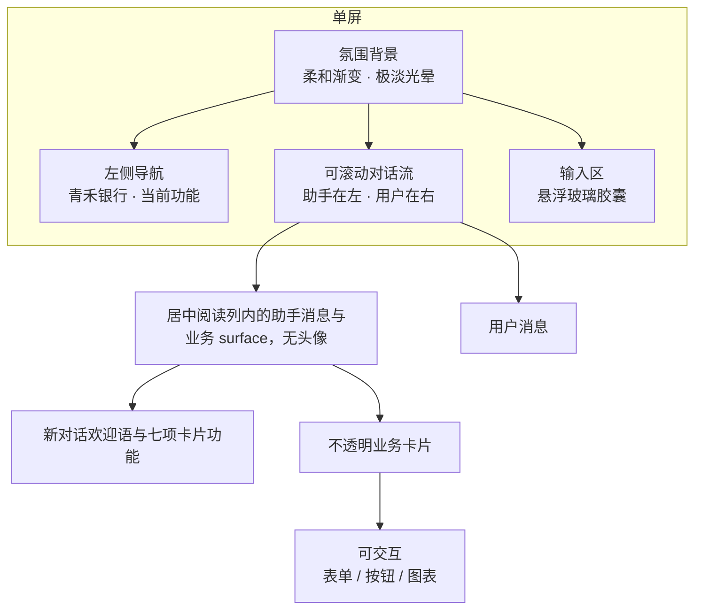
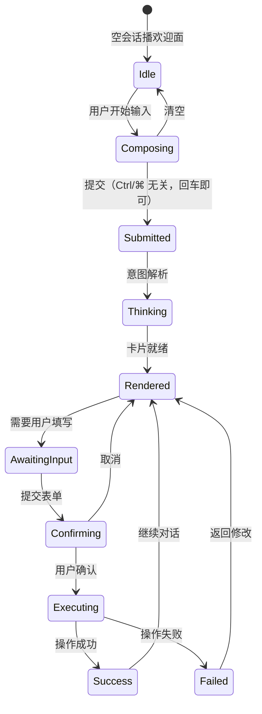

# PRD — 青禾 · AI Banking ChatBox

讨论资料补充：[2026-10-13 产品讨论整理](research/2026-10-13-product-discussion.md)。该文档归纳聊天截图中的双入口、可视化交互及数据建议，包含待明确项，不直接改变本文的已实现需求。

## 2026-10-16 已实现：前后端统一运行

安装依赖后通过 `npm start` 启动当前前端与原后端：页面、资源和 `/api` 同源，默认本机 8080；旧预览地址仍可使用。启动不重置数据库，原热更新开发入口保留。GitHub 交付源码、迁移、依赖锁文件、测试和运行说明，不上传本机配置、数据库与缓存。业务及 Agent 范围不扩大。

## 2026-10-16 已实现：银行公开体验拆解后的前端改版

依据 [REA 与银行界面研究](research/2026-10-16-banking-interface-reconstruction.md)，保留十三项业务、原授权流程和聊天能力。本轮不新增 Agent。

| 场景 | 验收行为 |
| --- | --- |
| 概览 | 标题和账户区相对整个页面居中；桌面与手机均避开助手问候和悬浮操作区 |
| 服务查找 | 名称或水费、挂失等别名筛选；不自动跳转；无结果有反馈；Escape 清空并留在输入框 |
| 资金直达 | 转账、银行卡、待扣订阅、在途及计划留存进入对应原有页面 |
| 收支摘要 | 从实际账本选取最近有记录的月份，标明年月；显示收入、支出和分类；无数据不编造趋势 |
| 隐藏金额 | 同步遮住账户、资金安排、收支与动态金额，并收起占比图 |
| 付款卡 | 显示卡名和尾号，原生选择器可键盘操作；原冻结状态、付款校验及确认流程不变 |
| 银行卡 | 切卡后直接看到原管理动作；桌面四列、手机两列；原回执及授权路径保留 |

## 2026-10-14 已实现：业务可视化与手动流程

用户随后要求依据该讨论完善 UI，暂不开发 Agent。本轮实现以下验收项：

| 场景 | 用户动作与结果 |
| --- | --- |
| 生活缴费 | 直接选择水/电/燃气；查看每月已缴总额、构成和六个月趋势；点击类别筛选记录，展开查看户号、编号和状态 |
| 再次缴费 | 带回原户号及类型，清空金额；仍须填写、核对和输入密码，不自动扣款 |
| 服务办理 | 手机/交通卡充值、缴费、信用卡还款、兑换和网点预约显示填写、核对、完成三步，错误与未知结果恢复复用原流程 |
| 银行卡 | 点击与键盘左右/Home/End 切换等价；卡名、状态、档案、渠道和交易随选择更新；隐私模式隐藏相关数字 |
| 储蓄计划 | 已存/目标、进度、差额、期限分层显示；修改定位输入，达成/到期状态明确，存取沿用现有确认 |
| 账单 | 实际交易类别均可筛选，净支出显示负号 |

数据口径：缴费统计汇总账本中生活缴费的支出记录；退款不抵扣该“已缴支出”口径。缺历史不填虚构趋势，未知类型归入其他。卡片近期交易仅按明确 cardId 或支付流水的精确尾号关联，无归属交易仍在总账单中。全部十三个业务入口继续保留。

验证入口：`npm test`、`npm run test:ui:product`、`npm run test:e2e:backend`。浏览器验证使用独立会话，不向使用者的已有账户写测试数据。

本轮未实施 Agent、对话接管及上下文衔接、自由生成 UI、大型虚构数据集和真实水电燃气账单查询。

## 转账方式统一选项

选择转账方式时只呈现一组四个圆角选项，包含方式名称、用途、到账时间、限额和费用；点击任意选项进入选人步骤，不再呈现第二组对比列表。

## 转账页面内容收敛

转账页不再附带收款人统计、往来名录或新增收款人管理区域。选择收款人在转账流程内部完成。

## 独立流水下载

账单页只显示银行流水入口，不展示导出表单和预览表。点击“查看并下载流水”进入银行流水页面，可按日期和收支类型筛选，预览前十笔并下载全部筛选结果，点击“返回账单”回到账单页。

## 助手跨场景入口

欢迎区点击“跨场景”展开手机充值、生活缴费、交通卡、外币兑换、信用卡还款、网点预约、出行钱袋和储蓄计划。再次点击收起；点击服务进入已实现的功能页面，不生成特殊日子建议。自然语言的场景建议保留原有处理。

## 交通卡与储蓄计划

交通卡号为 8–20 位数字，核对后记住，支持 20/50/100/200/500 元及自定义金额。使用可用银行卡和演示密码 123456，成功后记入交通流水，不写入真实交通卡。

储蓄目标包含名称、金额和日期，展示已存进度与剩余时间的月度参考金额（不自动扣款、不计息）。存入减少可用余额，取回增加可用余额，两者与留存合计保持守恒。取回不能超过已存金额；修改目标不能低于已存；删除前必须清空资金。目标元数据保存在浏览器，余额来自账本；未确认的后端请求保留原编号并查询结果。

## 2026-10-11 出行钱袋

出行钱袋从概览进入，也支持助手通过明确的出行语句生成待核对草稿。用户填写目的地、未来的往返日期、出行银行卡、现金币种及整数金额（0–100000，0 表示不准备现金）。保存多行程，切换、修改及刷新保留；修改关键字段后重新核对准备清单。

银行卡从现有卡包取状态和境外渠道，冻结、关闭、无额度均提示前往卡包处理。渠道开启不承诺目的地商户受理。兑换入口带入币种、金额和行程编号，用户填写手机号、核对时间及网点并确认；预约限未来 30 天且必须在出发前。预约关联回行程，可取消，不自动标记现金已兑换。预约时间、币种、金额不再匹配修改后的行程时明确提示调整。

清单含自动卡片检查及用户勾选的出行证件、备用支付、银行联系方式和现金准备。所有勾选仅记录准备状态；无实时汇率、不扣款、不向真实网点提交，不提供目的地证件政策。

## 2026-10-11 精简回执页面

移除独立回执页以及概览、侧栏入口；充值、缴费和信用卡还款完成后进入账单查看交易。交易编号、支付幂等记录及转账结果确认仍为记账流程的数据，不作为独立功能页。

## 2026-10-11 日常银行功能补充

信用卡还款使用一期演示账单（尾号 6642、金额 ¥4,520.00、还款日 2026-10-26），全额或自定义金额，选择付款卡、核对并验证密码 123456；还款金额必须大于零且不超过待还金额，余额不足、冻结卡或错误密码不扣款。已还金额来自统一流水，刷新保留，重复请求不重复记账。不是实际信用卡还款。

流水导出在账单页，日期范围和收支类型独立于图表账期；即时预览前十笔并下载全部筛选结果，CSV 包含日期、名称、类别、元金额、备注和编号。不产生盖章证明。无交易或日期倒置时不能下载。

网点预约选择业务、联系手机号、未来 30 天日期、营业时段和演示网点；核对、保存编号、刷新查看、取消。与兑换预约使用同一预约记录，分页面展示；同一时段已有有效预约时不重复预约，不扣款，不向真实网点发起预约。

> 本 PRD 描述**当前阶段**的产品需求，替代 [PRD_银行AI资金管家_v2.0.md](./PRD_银行AI资金管家_v2.0.md)（后者是前端 mock 之前的完整构想，保留作历史参考，**不代表已实现**）。
> 本 PRD 描述**当前实现**的产品需求。
> 早期那套 v2.0 构想（六模块、现金流预警、目标资金计划）**已由作者裁决搁置**，
> 移入 [archive/](archive/README.md) 作历史材料 —— 它是**更早的计划**，不是被本文替代。
> 维护义务见 [AGENTS.md](../AGENTS.md) §2。
>
> 最后更新：2026-09-28 · 状态：重构中

---

## 1. 一句话定义

**一个优雅到让人愿意打开的银行对话界面。** 用户用一句话说出想做的事，青禾把它变成一个可以核对、可以确认、可以追溯的操作。

## 2. 为什么现在要改

当前实现是一个**三栏功能性后台**：左侧业务导航、中间聊天、右侧资金面板。功能齐全，但它表达的是"这里有很多功能"，而不是"这件事很简单"。

本次重构把产品从**功能导航**转为**对话本身**：

| 维度 | 现状（功能后台） | 目标（优雅 ChatBox） |
|---|---|---|
| 信息架构 | 三栏并列，业务靠侧边栏导航 | 单列对话流，业务由对话生成卡片 |
| 视觉基调 | 深绿 + 米白，扁平不透明，266 个硬编码色值 | 柔和蓝紫渐变 + 磨砂玻璃，全部走设计令牌 |
| 心理态 | "工具很多" | "值得信任、不费力、有点好看" |
| 交互范式 | 点导航 → 填表单 | 说一句话 → 卡片浮现 → 确认 |
| 代码结构 | `main.jsx` 275 行单组件 | 分层：协议层 / 领域层 / 视图层 |

## 3. 设计原则

### 3.1 极简 ≠ 空白

用户明确要求："极简不是代表完全空白，而是代表心理态的感觉"。

极简是**克制的丰富**：页面元素少，但每个元素都有质感和层次。参考基调为柔和浅蓝/雾蓝渐变背景、悬浮的磨砂玻璃卡片、轻微立体感、大量留白、极细的图表。

**判定标准**：截掉所有文字后，界面仍然好看——那才是做对了。

交易头像只用主图标、形状和颜色表达类别，不在角上叠加微型文字或徽标；交易名称、类别与状态由行内文字承担。

### 3.2 三条不可退让的底线

1. **可核查**：任何金额相关的结果，都能追溯到具体交易。
2. **先确认后执行**：写操作必须经过核对与确认，绝不静默执行。
3. **诚实**：界面必须明确告知这是演示环境、数据为虚构、无真实交易。

### 3.3 苹果式设计取向

> **事实更正（2026-09-28 实查）**：常被引用的 Clarity / Deference / Depth 三根支柱是 iOS 7–18 时代的框架，**Apple 已在当前 HIG 中替换为 8 组新原则**（抓 `developer.apple.com/tutorials/data/design/human-interface-guidelines/design-principles.json` 得到的正文里这三个词已检索不到）。以下按新原则执行。

对本案影响最大的三条新原则：

| 官方原则（原文标题） | 对本项目的约束 |
|---|---|
| **Include just what's necessary.** 原句：*"Simplicity isn't minimalism. Aim for a focused, useful experience that keeps the important things close by and lets the others fall away."* | **直接否定了「极简＝少放东西」。** 所以资金面板不是"删掉"而是"重新定位"；业务卡片该留，靠层级而不是靠数量取胜 |
| **Stay out of the way.** | 界面外壳不抢戏；次要功能收进 progressive disclosure，不要一次全铺 |
| **Quality sets the tone.** | 每个细节都要刻意；动效、措辞、留白都算 |

#### 3.3.1 两层模型（2025 年最重要的结构变化）—— 硬约束

> Apple 的材质模型只有两层：
> 1. **内容层**（文字、列表、媒体、**业务卡片**、聊天区）→ 需要层次时用**标准材质**，**绝不能用 Liquid Glass**。
> 2. **功能层**（顶栏、工具栏、侧栏、导航栏、sheet、popover、alert）→ **玻璃只属于这里。**

**因此本项目规定：**

| 层级 | 元素 | 材质 |
|---|---|---|
| 功能层 ✅ 可用玻璃 | 顶栏、底部输入框、TransferDialog / DeleteConversationDialog、抽屉 | `blur(20px) saturate(180%)` + 顶部高光 + 边缘影 |
| 内容层 ❌ 禁止玻璃 | **四张业务卡片**、账单表格、订阅清单、卡片列表、资金面板 | 不透明白底 `--bg-surface` + 1px hairline |

**同屏玻璃不超过 3 个。** 把每张业务卡都做成毛玻璃不仅违反 Apple 规则，视觉上也会糊成一团——这正是参考图里"卡片看起来干净"的原因：它们白得很实在，只是浮在渐变背景上。

#### 3.3.2 其他已确认的硬约束

- **排版**：走 HIG 官方 Tracking 表。**12pt 是零点，12–22pt 为负字距（17pt 正文最紧，−0.026em），24pt 以上转正字距。** 不要套用"大标题用负字距"的网页教程（那是 apple.com 营销页做法）。
- **主色**：全站单一 `--accent: #0071e3`，每屏最多 1–2 个填充色按钮。
- **玻璃参数**：Apple 只公布过一个数字（clear 变体 35% 暗化层），其余为社区近似；采用四层模型 tint + blur/saturate + **顶部高光** + 边缘/浮动影。
- **圆角**：CSS 正圆角与超椭圆视觉差约 20%，故 **CSS 半径 = 设计半径 × 1.2**。不引入 Houdini squircle（Safari/Firefox 不支持，且 Chromium 禁止用于带 `href` 的 `<a>`）。
- **动效**：Apple 出货配对 move 1.0/0.4、sheet 0.8/0.3。**house rule：只在手势带速度时才允许过冲。**
- **无障碍是三个独立信号**：`prefers-reduced-motion`、`prefers-reduced-transparency`（仅 Chromium）、`prefers-contrast`。原文强调 *"reduced motion means gentler, not none"* → 去位移缩放，但**必须保留静态的「生成中」指示**。

## 4. 目标用户与场景

**主用户**：25–35 岁、习惯用对话式产品处理事务的个人银行客户。
**核心场景**：临时想起一件事（要转钱、想看看这个月花了多少），希望**不进入任何菜单**就能完成。

## 5. 两个入口（核心架构约束）

产品有两个入口，**它们不是两套界面**：

| | 业务层（Agent 对话） | 产品层（App 功能） |
|---|---|---|
| 入口 | 打字或语音转文字说一句 | 点欢迎页的功能卡 |
| 经过 | 意图理解 + 槽位抽取 | 跳过意图理解 |
| 产出 | **同一种 surface** | **同一种 surface** |
| 典型场景 | "给张三转 100 元" | "我想看看这个月的账单" |

**为什么必须共用内核**：如果两条路各写一套界面，业务逻辑会分叉、可靠性规则会漏一边。共用之后，**产品层天然继承了业务层的全部可靠性保证**（见 [ARCHITECTURE](ARCHITECTURE.md) §3）。

### 5.1 可靠性要求

用户明确提出：*"怎么确保你召回回来的这些东西是真实的、可靠的，而且确实能够去接到业务的逻辑里面"*。这不是提示词问题，是结构问题。硬性要求：

- **planner（含将来的 LLM）不得产出任何事实数字**，只能产出 `{path:'/x'}` 引用。
- **dataModel 只能由 `services/banking.js` 写入。**
- 引用解析不到 → 显示 `—`，**绝不显示 undefined**，也绝不退回猜测值。
- 槽位抽不到就留空让用户补，**不编造**。
- 每个 surface 携带 provenance（来源 + 数据截止时间）；助手对话中不显示来源页脚。

## 6. 功能范围

### 概览生活服务

手机充值：输入有效手机号后记住；选择金额、可用银行卡，核对信息后输入演示支付密码 `123456`。生活缴费：选择水、电或燃气，输入户号、金额及银行卡，以相同方式支付。演示卡共享账户余额，冻结卡不可选，支付成功进入账单和回执，失败不扣款。

外币兑换：选择美元、欧元、港币或日元，填写外币金额、联系手机号，选择未来 30 天内日期、时段及演示网点。确认后保存线下预约，可查看和取消；预约不扣款，汇率与可兑换金额到店确认。交通卡与储蓄计划继续为原有占位入口。

### 5.1 P0（本次必须做到）

| 编号 | 功能 | 说明 |
|---|---|---|
| F0 | **极简 ChatBox 外壳** | 桌面宽侧栏；单列居中对话流与透明外层浮动的自增高输入框；优雅空状态 |
| F1 | **智能转账** | 转账页内查看、搜索和管理收款人；选人或输卡号 → 核对 → 确认/验证码 → 记账回执 |
| F2 | **账单分析** | 月度收支概览、分类分布、明细筛选追溯；切换分类时读数区与滚动位置保持稳定 |
| F3 | **订阅管理** | 自动续费清单与预计扣费，模拟取消 |
| F4 | **卡片管理** | 卡片状态查看，模拟冻结与解冻 |
| F5 | **多会话历史** | 本地保存，自动命名，可删除，刷新恢复 |
| F6 | **设计令牌层** | 单一来源的 tokens.css，零硬编码颜色 |
| F7 | **A2UI 表面协议** | 对话内的业务 UI 由结构化 surface 消息描述 |

### 5.2 P1（时间允许才做）

- 流式输出模拟（逐字显示，为将来接真 LLM 铺路）
- 深色模式（令牌已分层，切换成本低）
- 键盘命令面板

### 5.3 明确不做

| 不做 | 原因 |
|---|---|
| 接入真实 LLM | 本阶段目标是**协议与界面**，后端替换要零成本，但不是现在 |
| 真实银行/支付对接 | 演示项目，安全与合规成本极高 |
| 引入组件库（Ant Design / MUI / shadcn） | 见 [AGENTS.md](../AGENTS.md) §1 依赖白名单；手写 CSS 更可控 |
| TypeScript 迁移 | 当前明确决策；重构规模已经很大，不叠加编译器迁移 |
| 国际化、多用户、权限 | YAGNI |

## 7. 核心交互流程

## 7A. 交互模型（本轮重定的核心）

### 7A.1 最小操作原则

**信息要被送到用户面前，而不是让用户去翻。** 这条原则推翻了之前的三处做法：

| 之前 | 现在 | 为什么 |
|---|---|---|
| 每办一件事往对话里贴一张卡 | 工作区放当前这件事的**统合视图**，历史折成一行可切换 | 贴到第三张就要往上滑 |
| 界面上放一个「动线面板」 | 删除 | **动线是用户体验的顺滑度，不是给用户看的流程图** |
| 转账一进来就问金额 | 先问「你想怎么转」，四步流程 | 上来就问金额是冒犯 |

### 7A.2 已经说过的信息不重复问

| 用户说 | 从哪一步开始 |
|---|---|
| 「给章明远转 100 元」 | **直接进核对步**（人和钱都有了） |
| 「我要转 50 块」 | 从「转给谁」开始 |
| 「我要转账」 | 才从「你想怎么转」开始 |

### 7A.3 跨域统合

**这是 AI Native 与软件时代银行的分界线。** 软件时代按「产品」切信息，用户自己拼；
Agent 时代按「用户此刻要办的事」把跨产品的信息合起来。

| 统合视图 | 跨了哪些域 |
|---|---|
| 首页状态板 | 账户 + 账单 + 订阅 + 卡片 + 待处理事项 |
| 账单结论 | 账单 + 订阅（「订阅占了支出的 X%」） |
| 转账核对 | 转账 + 账户（转后余额）+ 账单（本月支出变化）+ 订阅（扣完还剩多少安全垫） |
| 转账回执 | 转账 + 账户 + 账单 + 下一步可做什么 |

### 7A.4 不可逆操作要可撤销

转账确认后不立刻记账，给 **5 秒窗口 + 倒计时条 + 撤销按钮**（来自众安银行的「錯手轉賬」解决方案）。

## 8. 界面结构

## 9. 消息状态机

## 10. 验收标准

### 9.1 视觉
- [ ] 全站**零硬编码颜色字面量**：`grep -rEn '#[0-9a-f]{3,8}|rgba?\(' src --include=*.css` 只在 `tokens.css` 内有命中
- [ ] **内容层无玻璃**：四张业务卡片、账单/订阅/卡片列表、资金面板均为不透明白底 + hairline；同屏玻璃元素 ≤ 3 个
- [ ] 排版符合 HIG Tracking 表（12–22pt 负字距，34pt 正字距）
- [ ] 磨砂玻璃效果在 Chrome / Edge / Safari 均可见，不支持时优雅降级
- [ ] 375px 宽度下无横向滚动，输入框不被软键盘遮挡
- [ ] `prefers-reduced-motion: reduce` 下所有动效关闭

### 9.2 结构
- [ ] 无单文件超过 300 行（`main.jsx` 必须拆解）
- [ ] 业务模块与界面外壳解耦：新增一个业务 surface 不需要改外壳代码
- [ ] 依赖清单不新增任何包

### 9.3 功能
- [ ] 四项业务全部可用，与原实现行为一致
- [ ] 转账闭环：核对 → 确认 → 回执 → 余额与账单同步
- [ ] 多会话：新建、切换、删除、刷新恢复
- [ ] **两个入口产出同一种 surface**（单测守着）
- [ ] **卡片结构里不含任何写死的事实数字**，只含 `{path}` 引用（单测守着）
- [ ] 引用解析不到时显示 `—` 而不是 `undefined`
- [ ] 每个 surface 显示数据来源与截止时间
- [ ] 新对话先显示左侧青禾欢迎消息及七项功能；助手消息不显示头像，用户消息以浅蓝气泡在右侧；消息下方没有复制或编辑图标，刷新后对话原样恢复
- [ ] 输入框上方不出现重复的历史横条和功能入口
- [ ] 回车提交；Shift+Enter 换行；中文选字期间回车不误发
- [ ] 新消息后停在底部；**用户上滑后不被强行拽回**
- [ ] `npm run build`、`npm test`、`npm run test:e2e` 全部通过

### 9.4 无障碍
- [ ] 全流程可键盘操作，焦点可见
- [ ] 弹窗焦点锁定与归还正确
- [ ] 新消息通过 `aria-live` 播报
- [ ] 中文输入法回车不误提交

## 11. 风险

| 风险 | 缓解 |
|---|---|
| 视觉重做导致功能回归 | 领域逻辑 `bank.js` / `conversations.js` 保持不动，只换视图层 |
| 磨砂玻璃性能 | `backdrop-filter` 限制在少量层级，避免大面积滚动区域使用 |
| 极简到"空" | 用空状态的设计密度做锚点，而非删元素 |
| 文档与代码脱节 | AGENTS.md §2 强制同步义务 |
