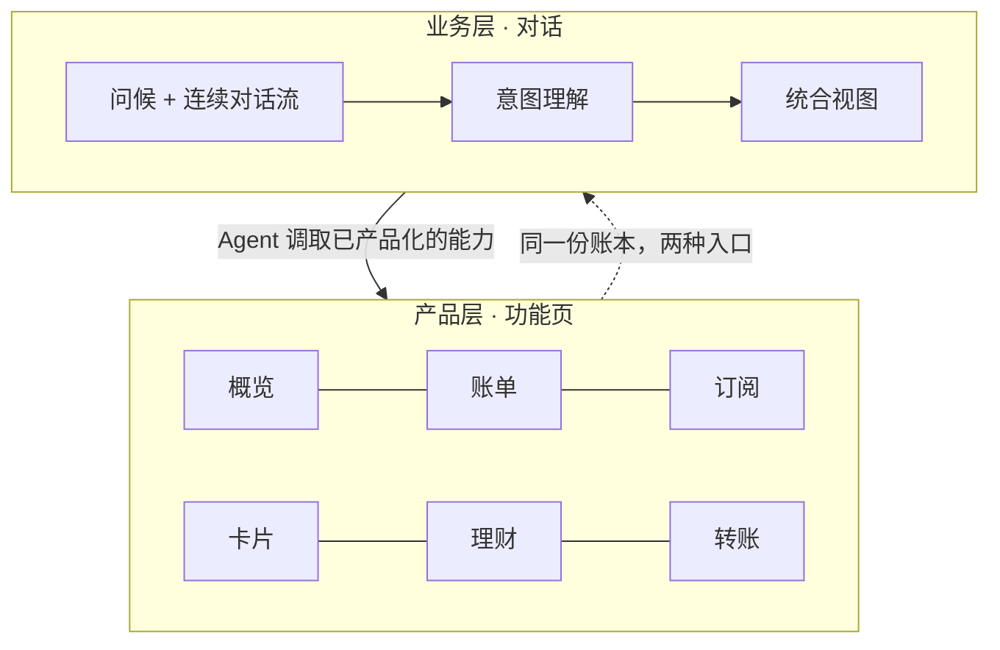
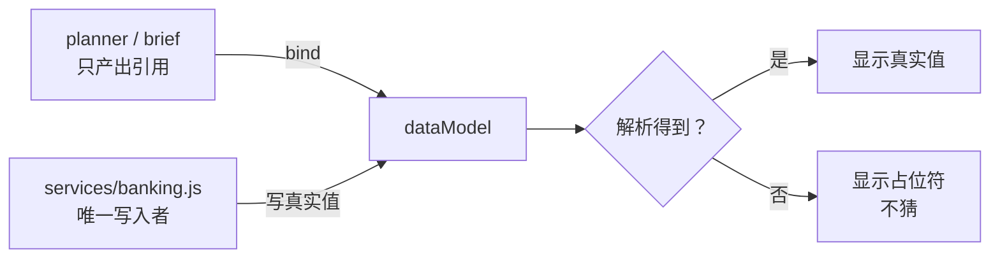
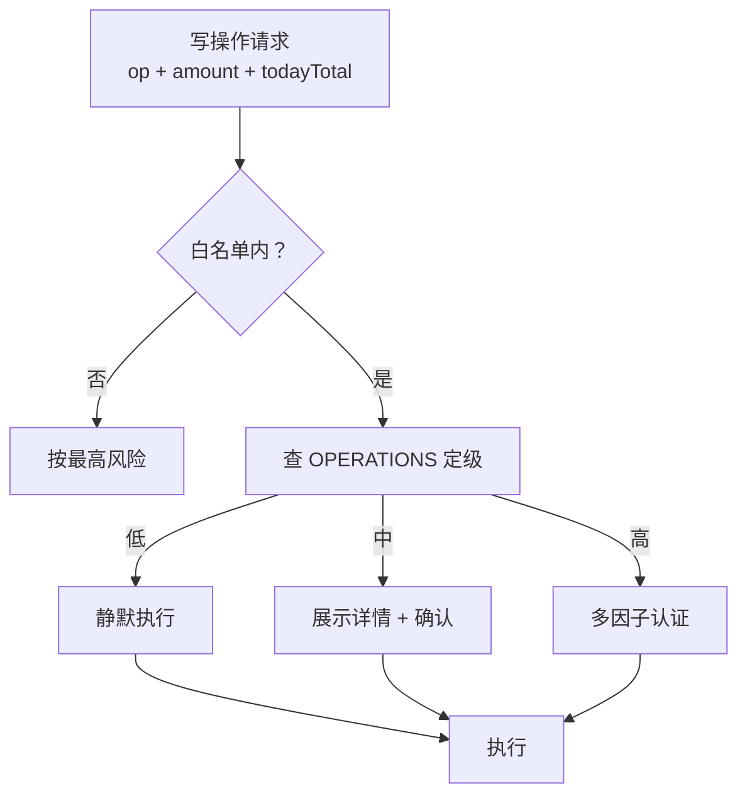
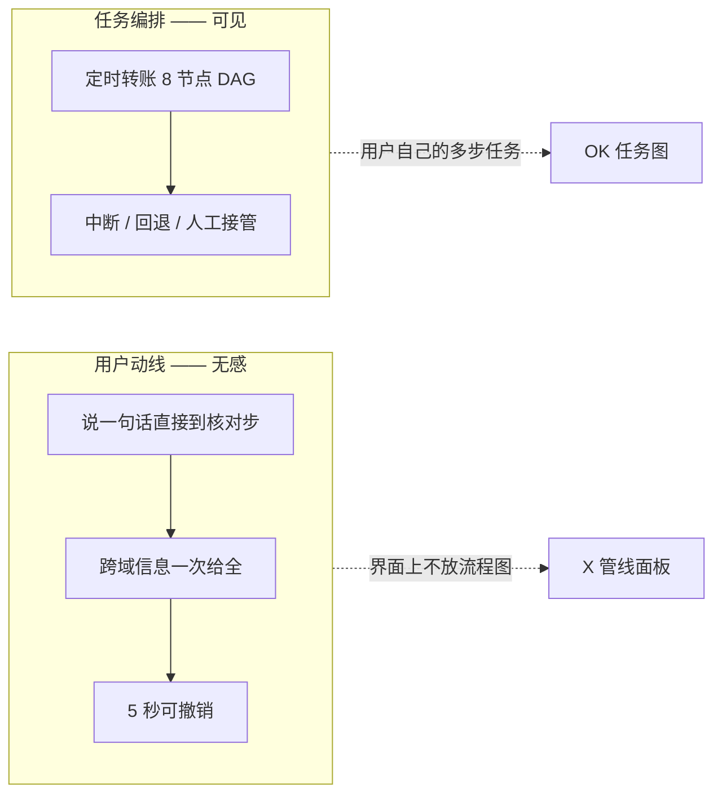
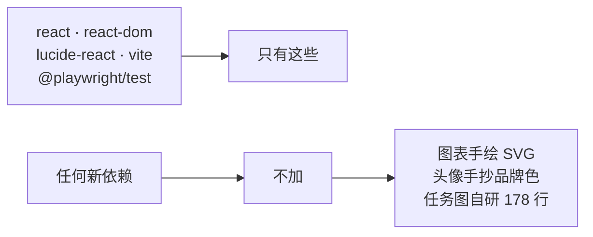
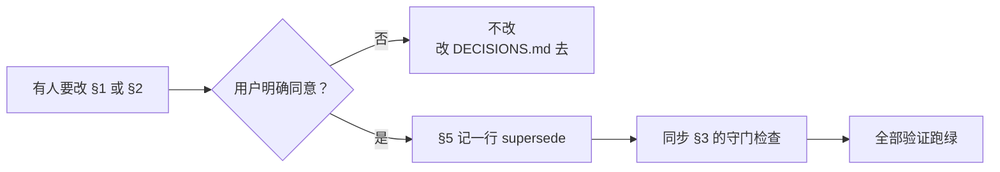

# PRODUCT-ARCHITECTURE — 产品架构（受保护）

> **本文记录「不许轻易改」的产品架构与不变量。**
> 改这里的任何一条，必须：**用户明确同意 → 在 §5 记录 supersede 关系 → 同步 §3 的守门检查。**
>
> 与 [DECISIONS.md](DECISIONS.md) 的分工：**本文 = 骨架（改了会塌）**；DECISIONS.md = 血肉（可以改）。
>
> 最后更新：2026-09-29

---

## §1 产品是什么

**两个并列目标**（缺一不成立）：技术上是**银行所有业务的统一入口**；业务上是**个人资产管家**。

**不变量**：
- **A-01** ChatBox **只是一个功能**，不取代产品层。两者并存，共用同一本账。
- **A-02** 业务能力**先产品化，Agent 才调得动**。不做只有对话能到达的功能。

---

## §2 不变量（Invariants）

### A-03 · Agent 不产出事实

Agent 只产出 `{path}` 引用；**只有 service 能写 dataModel**。解析不到就显示占位符，绝不猜。

**为什么是骨架**：这是幻觉防护的实现方式。破坏它 = 数字可能是编的。

### A-04 · 权限分级是唯一门禁

风险等级**由操作类型 + 金额 + 日累计推出**，调用方只能报「做什么」，不能报「多危险」。

**为什么是骨架**：降级这个动作在 API 上不存在，所以任何 Prompt 都无法伪造降级。破坏它 = 注入防御失效。
### A-05 · 动线无感，任务编排可见

这是两个不同的东西，曾经混淆过。

### A-06 · 依赖白名单

---

## §3 守门检查（改了架构就会红）

| 不变量 | 守它的命令 | 它检查什么 |
| --- | --- | --- |
| A-03 只产出引用 | `npm test` | 组件结构里不含写死的事实数字 |
| A-04 风险不可声明 | `npm test` | 传 level:low 仍判高风险；分两笔绕不过日累计 |
| A-05 动线无感 | `npm run test:e2e` | 界面上不得出现 `.inspector` |
| A-06 无新依赖 | 人工 | 依赖白名单 |
| 单页 ≤150 字 | `npm run test:text` | 界面文案口径（数据不计） |
| 界面无演示备注 | `npm run test:copy` | 渲染层含 title / aria-label / placeholder |
| 文档 Mermaid 可渲染 | `npm run test:docs` | 真实 Mermaid 解析器逐块 parse |

---

## §4 变更协议

**规则**：
- §1 / §2 的每一条都有编号（A-xx），**引用时用编号**，不要凭印象描述
- 被推翻的条目不删除，在 §5 标 `A-03 → A-11`，保留可追溯性
- **任何 agent 都不得自行修改本文** —— 只有用户点头才能改

---

## §5 变更记录

| 日期 | 变更 | 谁同意 |
| --- | --- | --- |
| 2026-09-29 | 建立本文档：A-01..A-06 六条不变量 + 守门检查 + 变更协议 | 用户要求「有一个专门记录产品 architecture 的地方，确保其不被轻易改变」 |
