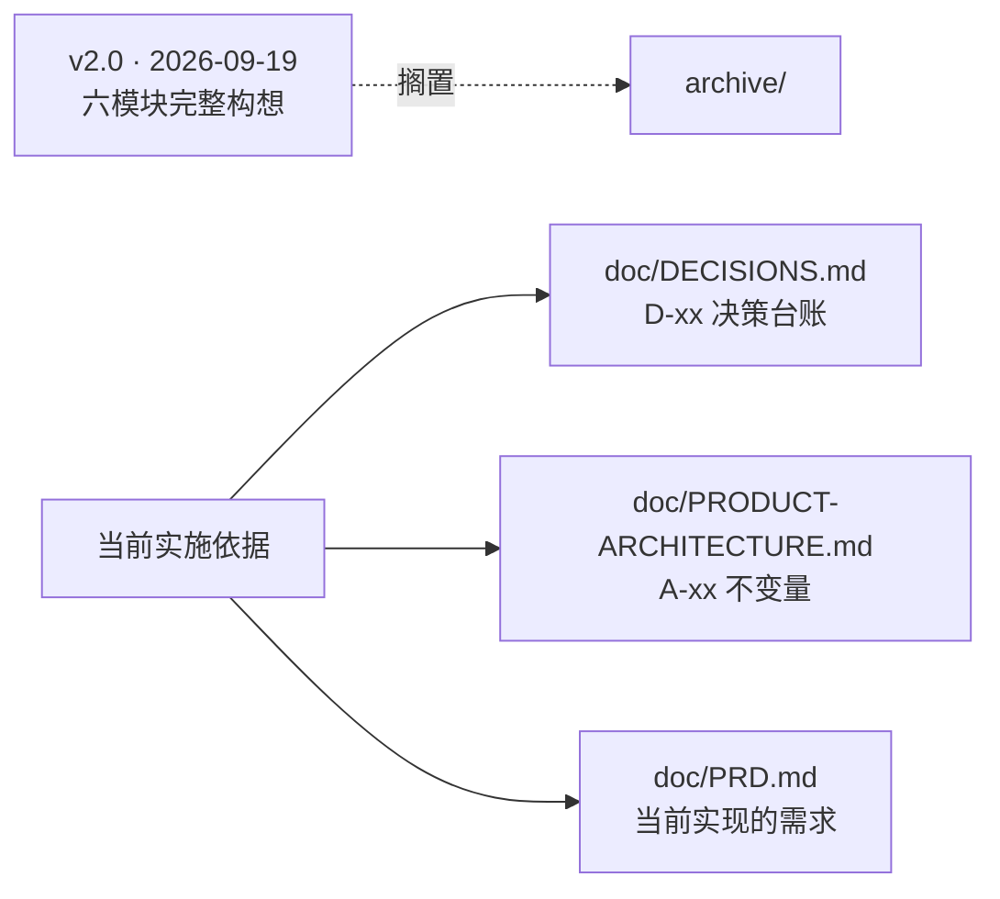

# archive —— 历史材料

> **这里的文档不作当前需求。** 保留只为两件事：万一以后要捡回来，以及冲突本身要留痕。

## 里面是什么

| 文件 | 日期 | 是什么 |
| --- | --- | --- |
| `PRD_银行AI资金管家_v2.0.md` | 2026-09-19 | 早期完整 PRD：六个 P0 模块（F1..F6） |
| `Agent设计框架_v2.0.md` | 2026-09-19 | 早期 Agent 与系统框架 |
| `AI_Banking_Agent_技术方案_v2.0.md` | 2026-09-19 | 早期技术方案：API 契约、权限矩阵、状态机 |
| `Web低保真原型与页面流程_v2.0.md` | 2026-09-19 | 早期页面线框与流程 |
| `开发任务与验收清单_v2.0.md` | 2026-09-19 | 早期任务拆分 |

## 为什么搁置

作者原话（2026-09-29）：**「那个是最老的东西，是最早期的计划，这个不着急去做，先放一放。」**

## 它与现在的三处冲突（已裁决）

| 冲突 | v2.0 说 | 后来什么变了 | 取舍 |
| --- | --- | --- | --- |
| 理财申购赎回 | 不纳入本版 | 赛题明确列了「理财操作」 | 按赛题做（已做） |
| 生日购物联动 | 不做独立联动，融入资金计划 | 赛题要求「跨场景联动」 | 按赛题做（已做） |
| 助手形态 | 辅助侧栏，不占整屏 | 作者后来选了全屏对话流 | 按后者 |

完整清单见 [../DECISIONS.md](../DECISIONS.md) §4。

## 注意

这五份文档**互相用相对路径引用**（如 `PRD_银行AI资金管家_v2.0.md`），
它们一起被移进本目录，所以**目录内部的引用仍然有效**；
但**从目录外指向它们的旧链接已失效** —— 需要时按 `doc/archive/` 前缀补全。
