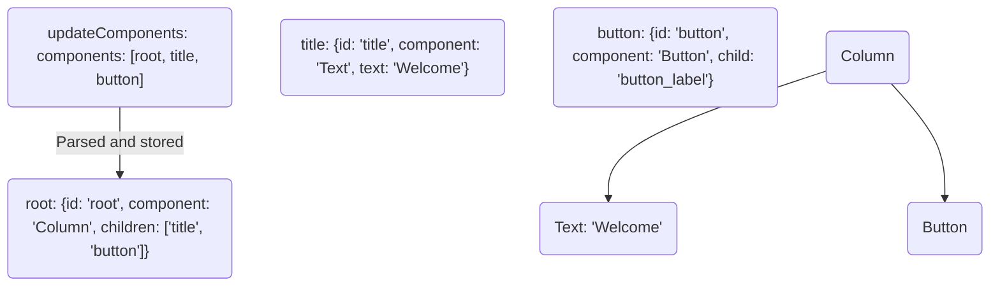

# 调研主题 A：A2UI / Agent-to-UI（生成式 UI）协议

> 调研范围：A2UI 官方协议（v0.9.1 生产版 / v1.0 候选版）、AG-UI、MCP-UI / OpenAI Apps SDK、Vercel AI SDK Generative UI、Thesys OpenUI、vercel-labs/json-render、CopilotKit、assistant-ui。
> 面向项目：bk-agent /「青禾 · 银行 AI 资金管家」（React 19 + Vite 7 + 纯 JSX + 手写 CSS，无真 LLM 的纯前端 mock）。
> 所有 star / license / 时间均为本次调研用 `gh api` / `gh search` 实际查询所得，查询日期 **2026-09-28**。
> 抓取到的原始资料留档在 `doc/research/_raw/`（协议全文、JSON Schema、各仓库 README），可逐条复核。

---

## 0. 结论速览（TL;DR）

1. **用户说的 "A to UI" 就是 A2UI**（Agent-to-User Interface）。官方仓库已从 `google/A2UI` 迁移到 **`a2ui-project/a2ui`**；`gh api repos/google/A2UI` 返回 `full_name: a2ui-project/a2ui`（GitHub 301 重定向），证明两者是同一个仓库。
2. A2UI 的**当前生产版本是 v0.9.1**，**v1.0 是 release candidate**（官方 README 原文："A2UI's current production release is **v0.9.1** … The v1.0 specification is a release candidate, while v0.8 is legacy"）。
3. 四类信封消息 **v0.9.1 与 v1.0 完全同名**：`createSurface` / `updateComponents` / `updateDataModel` / `deleteSurface`。v1.0 的增量是：单消息建面（`createSurface` 内联 `components` + `dataModel`）、双向函数调用、**移除 `theme`**、catalog schema 收紧、UAX #31 命名规则。
4. **核心机制是「邻接表 + 组件目录（catalog）+ 数据模型（data model）」**：UI 是一堆扁平组件对象，靠 `id` 互相引用；`root` 是唯一根节点；客户端只渲染自己 catalog 里预先批准的组件——这就是「**safe like data, but expressive like code**」。
5. **流式增量渲染不需要新协议**：因为组件是扁平列表、允许前向引用，渲染器可以收到第一条消息就开始渲染，缺失引用先占位。这对本项目极友好。
6. **对本项目的正确用法（关键结论）**：**不要把 A2UI 当运行时依赖引入**（会违反 AGENTS.md 的依赖白名单），而是**把 A2UI 当作「消息契约」**——前端只实现一个约 60 行的纯函数渲染器 + 一个 catalog 常量表，mock 层按 A2UI 信封产出消息。这样将来接真 LLM 后端时，**只需把消息来源从 `intent()` 换成 SSE/WebSocket，前端渲染层零改动**。这就是「协议先行、后端替换为零成本」。
7. 现有 `src/surfaces/` 目录方向是对的（catalog + registry 模式），但目前是**只注册了导出、没被 main.jsx 使用**的死代码——这是本次改造最该利用的既有资产。

---

## 1. A2UI 官方项目事实核验

### 1.1 仓库元数据（`gh api` 实测）

| 项目 | 值 |
|---|---|
| 完整 URL | https://github.com/a2ui-project/a2ui |
| 别名 | https://github.com/google/A2UI （GitHub 301 重定向到上面那个） |
| star | **16530** |
| License | **Apache-2.0** |
| 创建时间 | 2025-09-24T23:14:02Z |
| 最近 push | 2026-09-26T02:01:33Z |
| 默认分支 | main |
| 官网 / 首页 | https://a2ui.org/ |
| 描述 | （仓库 description 字段为空，非我遗漏） |

最近 5 次 commit（`gh api repos/a2ui-project/a2ui/commits`）：

```
2026-09-26T01:12:31Z | feat(angular): add native angular container component sample to explorer (#2274)
2026-09-26T00:19:38Z | fix(release): fix artifact upload and pending release discovery in Python release workflows (#2811)
2026-09-25T23:09:09Z | Add Jetpack Compose renderer (#2781)
2026-09-25T22:52:03Z | docs: add Material 3 Expressive renderer to ecosystem renderers (#2629)
2026-09-25T22:29:18Z | feat(angular): support markdown in universal basic catalog (#2604)
```

→ 该仓库**仍在高频活跃开发**（提交节奏为天级，PR 编号已到 #2811），不是归档项目。

### 1.2 仓库目录结构（`gh api .../contents/` 实测）

```
a2ui-project/a2ui/
├── specification/          # 协议规范（按版本分目录）
│   ├── v0_8/               # 0.8.2  legacy，已封闭
│   ├── v0_9/               # 0.9
│   ├── v0_9_1/             # 0.9.1  ← 当前生产版本
│   ├── v1_0/               # 1.0    ← release candidate
│   ├── inference_formats/
│   └── proposals/
├── catalogs/
│   ├── basic/v1/           # 官方基础组件目录 catalog.json (45034 bytes)
│   └── mcp/
├── renderers/              # angular / lit / markdown / react
├── samples/                # agent / client / community
├── swift/ dart/ kotlin/ python/ typescript/   # 各语言 SDK
├── docs/                   # 站点与公开文档
├── conformance/ eval/ blueprints/ tools/
└── mkdocs.yaml  package.json  pubspec.yaml  pyproject.toml
```

**渲染器现状**（`renderers/` 下实测）：`angular/`、`lit/`、`markdown/`、`react/`。
**没有 Vue / Svelte 官方渲染器**（社区有 `shawnwang15/a2ui-vue`，97 star，MIT）。React 渲染器对应 npm 包 `@a2ui/react`。

### 1.3 版本状态原文（`specification/v0_9_1/README.md`、`v1_0/README.md`）

- **v0.9.1**：`**This specification is closed.**` / 协议头 `**Version:** 0.9.1`、`**Status:** Current Production`、`**Created:** Nov 20, 2025`、`**Last Updated:** Dec 3, 2025`
- **v1.0**：`This version was previously known as version 0.10 when it was in draft.` / `**This specification is currently a candidate for becoming stable.**` / 协议头 `**Version:** 1.0`、`**Status:** Candidate`、`**Created:** Nov 20, 2025`、`**Last Updated:** Jun 8, 2026`
- **v0.8.2**：`no longer under active development`（legacy）

> ⚠️ 一个容易踩的坑：**v1.0 的前身叫 v0.10**。如果你在网上看到 "v0.10"，指的就是现在的 v1.0。

### 1.4 官方 README 的核心设计哲学（原文摘录）

> **Security first**: Running arbitrary code generated by an LLM may present a security risk. A2UI is a declarative data format, not executable code. Your client application maintains a "catalog" of trusted, pre-approved UI components (e.g., Card, Button, TextField), and the agent can only request to render components from that catalog.
>
> **LLM-friendly and incrementally updatable**: The UI is represented as a flat list of components with ID references which is easy for LLMs to generate incrementally, allowing for progressive rendering and a responsive user experience.
>
> **Framework-agnostic and portable**: A2UI separates the UI structure from the UI implementation.
>
> This approach ensures that agent-generated UIs are **safe like data, but expressive like code**.

---

## 2. A2UI 协议详解

### 2.1 信封（Envelope）：四种消息，逐字对照

v1.0 协议原文：

> every message streamed by the agent must be a JSON object containing **exactly one** of the following keys: `createSurface`, `updateComponents`, `updateDataModel`, `deleteSurface`, `callRendererFunction`, or `agentFunctionResponse`.

v0.9.1 协议原文：

> every message streamed by the server must be a JSON object containing exactly one of the following keys: `createSurface`, `updateComponents`, `updateDataModel`, or `deleteSurface`.

所以**公共子集 = 4 条消息**。v1.0 额外加了 2 条双向函数调用消息（本项目的 mock 场景完全用不到）。

**真实示例 JSON（v1.0，来自 `specification/v1_0/docs/a2ui_protocol.md`）**：

```json
{
  "version": "v1.0",
  "createSurface": {
    "surfaceId": "user_profile_card",
    "catalogId": "https://a2ui.org/specification/v1_0/catalogs/basic/catalog.json",
    "sendDataModel": true,
    "components": [
      { "id": "root", "component": "Column", "children": ["user_name"] },
      { "id": "user_name", "component": "Text", "text": {"path": "/name"} }
    ],
    "dataModel": { "name": "John Doe" }
  }
}
```

```json
{ "version": "v1.0", "updateDataModel": { "surfaceId": "user_profile_card", "path": "/user/name", "value": "Jane Doe" } }
```

```json
{ "version": "v1.0", "deleteSurface": { "surfaceId": "user_profile_card" } }
```

**v1.0 完整流式交互示例（官方 JSONL 片段，真实抓取，此处截断超长行）**：

```jsonl
{"version": "v1.0", "createSurface":{"surfaceId":"contact_form_1","catalogId":"https://a2ui.org/specification/v1_0/catalogs/basic/catalog.json"}}
{"version": "v1.0", "updateComponents":{"surfaceId":"contact_form_1","components":[{"id":"root","component":"Card","child":"form_container"},{"id":"form_container","component":"Column","children":["header_row","name_row","email_group","phone_group","pref_group","divider_1","newsletter_checkbox","submit_button"],"justify":"start","align":"stretch"}, ... ]}}
{"version": "v1.0", "updateDataModel":{"surfaceId":"contact_form_1","path":"/contact","value":{"firstName":"John","lastName":"Doe","email":"john.doe@example.com","phone":"1234567890","preference":["email"],"subscribe":true}}}
{"version": "v1.0", "deleteSurface":{"surfaceId":"contact_form_1"}}
```

### 2.2 组件模型：**邻接表（adjacency list）**

v1.0 原文：

> The A2UI protocol defines the UI as a flat list of components. The tree structure is built implicitly using ID references. This is known as an adjacency list model.
> There must be exactly one component with the ID `root` … Until that component is defined, other component updates will have no visible effect, and they will be buffered until a root component is defined.

组件对象的形状：

| 字段 | 必需 | 说明 |
|---|---|---|
| `id` | ✅ | 组件实例唯一 ID，用于父子引用 |
| `component` | ✅ | 组件类型名，如 `"Text"` |
| `catalogId` | ✖ | 覆盖 surface 默认 catalog |
| 其余属性 | — | **直接平铺在对象上**（如 `text`、`children`、`action`） |

**本地渲染器实现只需一个 `Map<id, component>` + 一次从 `root` 开始的递归。** v1.0 的 Mermaid 原文：



### 2.3 Catalog 机制：为什么它天然安全

Catalog 是一个 **JSON Schema 文档**，同时承担三个职责：① 声明可用组件集合；② 声明可用函数集合；③ **给 LLM 的生成指令**（`instructions` 字段）。

Catalog 结构（v1.0 原文）：

| 字段 | 必需 | 说明 |
|---|---|---|
| `catalogId` | ✅ | 唯一字符串 ID。约定写成 URI 形式防撞名，**但不需要真的可解析** |
| `instructions` | ✖ | Markdown 格式的设计规范，用于指导 LLM 生成布局 |
| `components` | ✖ | 组件名 → JSON Schema 的 map |
| `functions` | ✖ | 函数名 → 定义的 map |

**catalogId 解析顺序（v1.0 严格规定，无回退）**：
1. 组件/函数级显式 `catalogId` →
2. surface 默认 `catalogId`（`createSurface` 时指定）→
3. **立即报错，组件不渲染**

> [!IMPORTANT] 原文：There is **no fallback** to the list of catalogs declared in `rendererCapabilities`.

**官方基础 catalog（v1.0）实测内容**（`catalogs/basic/v1/catalog.json`，45034 bytes）：

- `catalogId` = `https://a2ui.org/specification/v1_0/catalogs/basic/catalog.json`
- `protocolVersion` = `1.0`
- **组件（18 个）**：`Text, Image, Icon, Video, AudioPlayer, Row, Column, List, Card, Tabs, Modal, Divider, Button, TextField, CheckBox, ChoicePicker, Slider, DateTimeInput`
- **函数（13 个）**：`required, regex, length, numeric, email, formatString, formatNumber, formatCurrency, formatDate, pluralize, openUrl, and, or, not`

几个关键组件的真实 Schema（原样抓取）：

```jsonc
// Text
{"type":"object","properties":{
  "component":{"const":"Text"},
  "text":{"$ref":"common_types.json#/$defs/DynamicString","description":"The text content to display. While simple Markdown formatting is supported (i.e. without HTML, images, or links) ..."},
  "variant":{"type":"string","enum":["caption","body"],"default":"body"},
  "weight":{"type":"number"}},
 "required":["component","text"]}

// Card
{"type":"object","properties":{
  "component":{"const":"Card"},
  "child":{"$ref":"common_types.json#/$defs/Child","description":"The ID of the single child component ... To display multiple elements, you MUST wrap them in a layout component (like Column or Row)"},
  "weight":{"type":"number"}},
 "required":["component","child"]}

// Button
{"type":"object","allOf":[{"$ref":"common_types.json#/$defs/Checkable"},{"type":"object","properties":{
  "component":{"const":"Button"},
  "child":{"$ref":"common_types.json#/$defs/Child"},
  "variant":{"type":"string","enum":["default","primary","borderless"],"default":"default"},
  "action":{"$ref":"common_types.json#/$defs/Action"},
  "weight":{"type":"number"}},"required":["component","child","action"]}]}
```

**catalog 的硬约束（v1.0 新增，值得本项目照抄的工程纪律）**：

1. 所有组件 schema 必须在顶层 `components` map 下；`$defs` **只允许** `anyComponent` 和 `anyFunction` 两个键，禁止自定义 helper。原文：`All helper properties ... MUST be inlined directly inside the properties block of each supporting component schema rather than referenced from a shared helper.`
2. 每个组件 schema 必须有 `"component": {"const": "<与 key 同名>"}`，用于 `discriminator` 路由分发。
3. 结构化引用必须用标准类型：单子节点用 `$ref: common_types.json#/$defs/ComponentId`，子列表用 `ChildList`。**用裸 `"type":"string"` 会让校验器无法验证引用完整性**——原文：`the validator will treat it as static text (like a URL or label) and will not check if the target component exists`。
4. 组件/函数/参数名必须符合 **UAX #31**：`^[\p{XID_Start}_][\p{XID_Continue}]*$`。合法：`UserProfileCard`、`submit_form`；非法：`User Card`（空格）、`1stItem`（数字开头）、`submit-form`（连字符）。
5. 组合约束：`allowedParents` / `allowedChildren` 声明在 catalog 里，渲染期校验；违规产生 `UNALLOWED_PARENT` / `UNALLOWED_CHILD` 错误码。
6. `"Surface"` 是**保留组件名**，catalog 不许定义。

### 2.4 数据模型与绑定

- **`Dynamic*` 类型**（`DynamicString` / `DynamicNumber` / `DynamicBoolean` / `DynamicStringList`）：要么是字面量，要么是 `{"path": "/json/pointer"}`，要么是 `FunctionCall`。

```json
{"description":"Represents a string","oneOf":[{"type":"string"},{"$ref":"#/$defs/DataBinding"},{"$ref":"#/$defs/FunctionCall"}]}
```

- **`DataBinding`**：`{"type":"object","properties":{"path":{"type":"string","description":"A JSON Pointer path to a value in the data model."}},"required":["path"],"additionalProperties":false}`
- **`ChildList`**：静态数组 **或** 模板对象（从数据列表生成子节点）：

```json
{"oneOf":[
  {"type":"array","items":{"$ref":"#/$defs/ComponentId"}},
  {"type":"object","properties":{"componentId":{"$ref":"#/$defs/ComponentId"},"path":{"type":"string"}},"required":["componentId","path"],"additionalProperties":false}]}
```

- **无障碍是规范级强制要求**（`ComponentCommon.accessibility`）：`label`、`description`、`live`（`off|polite|assertive`，映射 WAI-ARIA `aria-live`）、`hidden`。原文：`Catalog and renderer implementations MUST: Plumb Accessibility Attributes … Map all relevant A2UI AccessibilityAttributes to the underlying UI framework's accessibility APIs`。**这一点和本项目 AGENTS.md 的「无障碍是底线不是加分项」完全一致。**

### 2.5 交互：action

```jsonc
// 触发 agent 事件
{"id":"submit_button","component":"Button","child":"submit_button_label",
 "action":{"event":{"name":"submit_form","context":{"itemId":"123"}}}}

// 执行本地函数
{"id":"open_link_button","component":"Button","child":"open_link_button_label",
 "action":{"functionCall":{"call":"openUrl","args":{"url":"${/url}"}}}}
```

`Action` 的 oneOf 原文：`{"event": {...}}` 或 `{"functionCall": {...}}`，二者互斥。

---

## 3. v0.9.1 → v1.0 逐条差异（含对本项目的影响）

v1.0 协议原文列出的变更（`## Changes from previous versions`）：

> - **Bidirectional Function Calls**: Supports explicit, typed function invocation messages (`callRendererFunction`, `callAgentFunction`, `rendererFunctionResponse`, and `agentFunctionResponse`) verified against runtime catalog definitions.
> - **Single-Message UI Instantiation**: Allows initial component trees and data models to be embedded directly within `createSurface`, enabling complete UI composition in a single payload.
> - **Decoupled Branding**: Removes rigid theme properties (removing hardcoded brand colors) to defer visual styling entirely to the target framework's native theme.
> - **Enhanced Catalog Schemas**: Refactors function definitions into object maps for direct O(1) lookups and supports standard JSON Schema metadata fields (`$schema`, `$id`) on inline catalogs.
> - **Strict Identifier & Context Standards**: Enforces Unicode (UAX #31) naming rules across all catalog entities and reserves the `@` namespace for universal system context evaluations (such as `@index`).

| 维度 | v0.9.1（生产版） | v1.0（候选版） | 对本项目 |
|---|---|---|---|
| 4 条核心消息 | `createSurface` / `updateComponents` / `updateDataModel` / `deleteSurface` | **完全相同** | ✅ 用谁都一样，**建议按 v1.0 写、兼容 v0.9.1 读取** |
| `createSurface` 是否可内联组件 | ❌ 必须再发 `updateComponents` | ✅ 可内联 `components` + `dataModel` | ✅ **对本项目是刚需**：mock 一次给出完整卡片，一条消息搞定 |
| `theme` 字段 | ✅ 有（如 `{"primaryColor":"#00BFFF"}`） | ❌ **移除**，样式交给目标框架原生主题 | ✅ **强烈支持用 v1.0 子集**：本项目设计令牌唯一来源是 `src/styles/tokens.css`，协议层绝不能带颜色 |
| `catalogId` 在 `createSurface` | **required** | optional（可继承/后续指定） | 无所谓，始终显式带上 |
| 双向函数调用 | ❌ | ✅ `callRendererFunction` / `callAgentFunction` / `*FunctionResponse` | ❌ 本项目用不到，**不实现** |
| 函数定义结构 | — | 改成 object map，O(1) 查找 | ❌ 不涉及 |
| 命名规则 | — | UAX #31 强制 | ✅ 我们的组件名照此命名（PascalCase）即可 |
| 版本字符串 | `"version": "v0.9.1"` | `"version": "v1.0"` | 渲染器应忽略 version 或只做宽松校验 |

**判断依据（原文位置可复核）**：
- v0.9.1 `createSurface` 属性表：`surfaceId (required)`、`catalogId (required)`、`theme (optional)`、`sendDataModel (optional)` —— **没有 `components` / `dataModel`**。
- v1.0 `createSurface` 属性表：`surfaceId`、`catalogId (optional)`、`sendDataModel`、`components (optional)`、`dataModel (optional)` —— **没有 `theme`**。
- `@a2ui/react` README 的官方 Quick Start 用的仍是 v0.9 三消息流程（`createSurface` → `updateComponents` → `updateDataModel`），说明**生态渲染器目前主要落在 v0.9**。

### 3.1 历史包袱提醒：v0.8 用的是完全不同的消息名

`@a2ui/react` README 的 "Key Differences (v0.8 vs v0.9)" 表格原文：

> | **Protocol** | Uses `BeginRendering`, `SurfaceUpdate`. | Uses `createSurface`, `updateComponents`, `updateDataModel`. |

→ 网上大量早期 A2UI 文章讲的是 `surfaceUpdate` / `beginRendering` / `dataModelUpdate` / `deleteSurface` 这**另一套名字**。**那是 v0.8.2 legacy，已封闭，不要参考。** 这是本次调研中混淆风险最高的一点。

---

## 4. 流式增量渲染：机制与本项目可复用点

### 4.1 协议层的三条规定（v1.0 原文）

1. **传输契约**：`Reliable delivery`（必须保序，因为 A2UI 是有状态更新，乱序会破坏 UI 状态）；`Message framing`（必须能切分消息：JSONL 换行 / WebSocket 帧 / SSE 事件）；`Metadata support`；`Bidirectional capability (optional)`。
2. **渐进渲染**：`Because components may reference children or data bindings that do not yet exist, renderers should handle missing references gracefully by rendering placeholders (progressive rendering).`
3. **缓冲语义**：`Until that component is defined, other component updates will have no visible effect, and they will be buffered until a root component is defined.`

### 4.2 传输绑定（官方支持）

| 传输 | 说明 |
|---|---|
| **AG-UI** | v1.0 原文称其为 `the standard transport binding for Agent-to-User Interaction` |
| **A2A** | 有专门的 `extensions/a2a/docs/a2ui_extension_specification.md`，定义 Agent Card 元数据与双向数据模型同步 |
| **MCP** | `A2UI can be carried over MCP tool calls, tool outputs, or resource subscriptions` |
| SSE + JSON-RPC | 支持流式的 Web 集成 |
| WebSocket | 双向实时 |
| REST | 可用，但无流式能力 |

### 4.3 对本项目的可复用点

本项目**没有真 LLM，但「渐进渲染」的收益依然真实存在**：业务卡片（转账核对、账单分析）有「先出卡片骨架、再算数字」的天然需要；mock 里可以用 `await sleep(120)` 拆成两条消息演示。**渲染器写成「消息数组 → UI」的纯函数后，增长消息数量是零成本的**——这正好是流式渲染器与一次性渲染器成本相同的原因。

---
## 5. 生态横向调研（每条都有真实抓取证据）

### 5.1 AG-UI（`ag-ui-protocol/ag-ui`）

| 项 | 值 |
|---|---|
| URL | https://github.com/ag-ui-protocol/ag-ui |
| star | **16073** |
| License | **MIT** |
| 创建 / 最近 push | 2025-05-07 / 2026-09-25 |
| 官网 | https://ag-ui.com |

**实测事件类型全集（从 `spec/1.0/schema.json` 的 `$defs.EventType.enum` 提取，该文件 94359 bytes）**：

```
TEXT_MESSAGE_START, TEXT_MESSAGE_CONTENT, TEXT_MESSAGE_END, TEXT_MESSAGE_CHUNK,
TOOL_CALL_START, TOOL_CALL_ARGS, TOOL_CALL_END, TOOL_CALL_CHUNK, TOOL_CALL_RESULT,
STATE_SNAPSHOT, STATE_DELTA, MESSAGES_SNAPSHOT,
ACTIVITY_SNAPSHOT, ACTIVITY_DELTA,
RAW, CUSTOM,
RUN_STARTED, RUN_FINISHED, RUN_ERROR,
STEP_STARTED, STEP_FINISHED,
REASONING_START, REASONING_MESSAGE_START, REASONING_MESSAGE_CONTENT,
REASONING_MESSAGE_END, REASONING_MESSAGE_CHUNK, REASONING_END, REASONING_ENCRYPTED_VALUE,
SUBAGENT_STARTED, SUBAGENT_FINISHED, SUBAGENT_ERROR
```

对应 `$defs` 中的事件对象：`TextMessageStartEvent` / `TextMessageContentEvent` / `TextMessageEndEvent` / `TextMessageChunkEvent` / `ToolCallStartEvent` / `ToolCallArgsEvent` / `ToolCallEndEvent` / `ToolCallChunkEvent` / `ToolCallResultEvent` / `StateSnapshotEvent` / `StateDeltaEvent` / `MessagesSnapshotEvent` / `ActivitySnapshotEvent` / `ActivityDeltaEvent` / `RunStartedEvent` / `RunFinishedEvent` / `RunErrorEvent` / `StepStartedEvent` / `StepFinishedEvent` / `RawEvent` / `CustomEvent` / `ReasoningMessage*Event` / `Subagent*Event`。

**AG-UI 与 A2UI 的分工（关键区别）**：

| | AG-UI | A2UI |
|---|---|---|
| 层级 | **传输/事件层**（「agent 和前端之间怎么对话」） | **UI 描述层**（「UI 长什么样」） |
| 粒度 | 每个 token、每次 tool call 一个事件 | 整棵组件树 / 数据更新 |
| 是否定义 UI 组件 | ❌ 不定义 | ✅ 定义 catalog 与组件树 |
| 关系 | A2UI 官方称 AG-UI 为 `the standard transport binding` | A2UI 跑在 AG-UI 之上 |

**实证：AG-UI 仓库里直接有 A2UI 的一等公民支持。** `sdks/typescript/packages/` 实测包含：`a2ui-toolkit`、`cli`、`client`、`core`、`encoder`、`proto`。
`@ag-ui/a2ui-toolkit` README 全文（原样抓取）：

> # @ag-ui/a2ui-toolkit
> Framework-agnostic helpers for building A2UI subagent tools.
> ## Surface
> - Constants: `A2UI_OPERATIONS_KEY`, `BASIC_CATALOG_ID`, `DEFAULT_SURFACE_ID`, `GENERATE_A2UI_TOOL_NAME`, `GENERATE_A2UI_TOOL_DESCRIPTION`, `GENERATE_A2UI_ARG_DESCRIPTIONS`
> - Op builders: `createSurface`, `updateComponents`, `updateDataModel`
> - `RENDER_A2UI_TOOL_DEF` — JSON schema for the inner structured-output tool
> - State + history helpers: `buildContextPrompt`, `findPriorSurface`
> - Prompt composer: `buildSubagentPrompt`
> - High-level orchestration: `prepareA2UIRequest`, `buildA2UIEnvelope`
> - Output wrappers: `assembleOps`, `wrapAsOperationsEnvelope`, `wrapErrorEnvelope`

→ **`assembleOps` / `wrapAsOperationsEnvelope` 这个设计极其值得本项目抄**：把多个 op 打包成一个「operations 信封」。这正是 mock 层最需要的形状。

### 5.2 MCP-UI（`MCP-UI-Org/mcp-ui`）

| 项 | 值 |
|---|---|
| URL | https://github.com/MCP-UI-Org/mcp-ui （注意：**不是** `mcp-ui/mcp-ui`，后者 404） |
| star | **5182** |
| License | **Apache-2.0** |
| 创建 / 最近 push | 2025-05-13 / 2026-09-16 |
| 官网 | https://mcpui.dev |

**路线完全不同：MCP-UI 返回的是 HTML，塞进 sandbox iframe 渲染**，而不是声明式组件树。

实测 wire format（`docs/src/guide/protocol-details.md`）：

```typescript
export interface UIResource {
  type: 'resource';
  resource: {
    uri: string;                              // 'ui://<component-name>/<instance-id>'
    mimeType: 'text/html;profile=mcp-app';
    text?: string;
    blob?: string;
  };
}
```

Tool → UI 的挂接方式：

```typescript
{
  name: 'show_widget',
  description: 'Show an interactive widget',
  inputSchema: { ... },
  _meta: { ui: { resourceUri: 'ui://my-server/widget' } }
}
```

host ⇄ guest 通信用 **JSON-RPC over `postMessage`**，通知/方法名实测：

- host → guest：`ui/notifications/tool-input`、`ui/notifications/tool-input-partial`、`ui/notifications/tool-result`、`ui/notifications/host-context-changed`、`ui/notifications/size-changed`、`ui/notifications/tool-cancelled`、`ui/resource-teardown`
- guest → host：`tools/call`、`ui/message`、`ui/open-link`、`notifications/message`、`ui/notifications/size-changed`

**OpenAI Apps SDK 的关系**：mcp-ui 文档里有专门的 `docs/src/guide/apps-sdk.md`；其 protocol-details 明确写 `MCP Apps uses JSON-RPC over postMessage`，并在 `apps-sdk.md` 中说明与 Apps SDK 的兼容。**两者都把 UI 当「外部 HTML 资源」托管**，与 A2UI 的「客户端原生组件」路线是正交的两个流派。

**对 bk-agent 的判断：不适用。** 理由：① 安全模型不匹配（HTML/iframe 对银行场景是负债，而 A2UI 的组件白名单才是资产）；② 会污染本项目的设计令牌体系与手写 CSS 体系；③ 需要 MCP server，本项目没有。

### 5.3 Vercel AI SDK 的 Generative UI：两条路线，其中一条已官方劝退

| 项 | 值 |
|---|---|
| URL | https://github.com/vercel/ai |
| star | **27001** |
| License | NOASSERTION（GitHub 未识别，实际为 Apache-2.0 系列） |
| 创建 / 最近 push | 2023-05-23 / 2026-09-28 |
| 官网 | https://ai-sdk.dev |

**路线 A（RSC 路线，`streamUI` + `createStreamableUI`）—— 官方已标记 experimental 且不推荐生产使用。**

`content/docs/05-ai-sdk-rsc/10-migrating-to-ui.mdx` 原文：

> However, given we're pushing the boundaries of this technology, AI SDK RSC currently faces significant limitations that make it unsuitable for stable production use.
> - It is not possible to abort a stream using server actions …
> - When using `createStreamableUI` and `streamUI`, components remount on `.done()`, causing them to flicker (vercel/ai#2939).
> - Many suspense boundaries can lead to crashes (vercel/ai#2843).
> - Using `createStreamableUI` can lead to quadratic data transfer …
> - Closed RSC streams cause update issues (vercel/ai#3007).
>
> Due to these limitations, AI SDK RSC is marked as **experimental**, and we do not recommend using it for stable production environments.

**路线 B（tool-call 路线，AI SDK 5 的官方推荐）——「LLM 返回组件名 + props」**。

`content/docs/04-ai-sdk-ui/04-generative-user-interfaces.mdx` 原文的核心模式：

> At the core of generative UI are tools … Generative UI is the process of connecting the results of a tool call to a React component.
> In AI SDK 5.0, tool parts use typed naming: `tool-{toolName}` instead of generic types.

真实的客户端渲染代码（原样抓取）：

```tsx
messages.map(message => (
  <div key={message.id}>
    {message.parts.map((part, index) => {
      if (part.type === 'text') return <span key={index}>{part.text}</span>;

      if (part.type === 'tool-displayWeather') {
        switch (part.state) {
          case 'input-available':
            return <div key={index}>Loading weather...</div>;
          case 'output-available':
            return <div key={index}><Weather {...part.output} /></div>;
          case 'output-error':
            return <div key={index}>Error: {part.errorText}</div>;
        }
      }
      return null;
    })}
  </div>
))
```

工具定义用 Zod schema 约束入参：

```ts
export const weatherTool = createTool({
  description: 'Display the weather for a location',
  inputSchema: z.object({ location: z.string().describe('The location to get the weather for') }),
  execute: async function ({ location }) { /* ... */ return { weather: 'Sunny', temperature: 75, location }; },
});
```

**两条路线的本质区别**（务必不要混为一谈）：

| | RSC 路线 | tool-call 路线 |
|---|---|---|
| LLM 输出什么 | **React Server Component 树**（真代码，服务端渲染） | **组件名 + JSON props**（纯数据） |
| 谁能决定组件形态 | LLM 可以组合任意服务端组件 | 只能用开发者预先注册的组件 |
| 安全模型 | 依赖 RSC 边界 | 天然白名单 |
| 官方态度 | experimental，不推荐生产 | **AI SDK 5 官方主推** |
| 与本项目 | ❌ 需要 Next.js/RSC，本项目是 Vite 纯 SPA | ✅ **与 A2UI 同构，是本项目唯一可借鉴的一条** |

> 结论：**AI SDK 5 的 `tool-<name>` + `part.state` 三段式（input-available / output-available / output-error）非常值得本项目照抄**——它恰好对应「卡片骨架 → 卡片数据 → 错误态」。而我们不用引入 `ai` 包，只需要在消息对象上保留 `state` 字段。

### 5.4 Thesys OpenUI（`thesysdev/openui`）

| 项 | 值 |
|---|---|
| URL | https://github.com/thesysdev/openui |
| star | **9863** |
| License | **MIT** |
| 创建 / 最近 push | 2024-12-02 / 2026-09-27 |
| 官网 | https://www.openui.com |

**核心：OpenUI Lang，一种「行式」UI 语言**（不是 JSON）。v0.5 规范原文：

> The language consists of **assignment statements** - one per line.
> `identifier = Expression`
> Three types of statements: Component `name = Component(args...)` / State declaration `$name = defaultValue` / Data statement `name = Query(...)` 或 `name = Mutation(...)`

真实语法示例：

```text
$days = "7"
data = Query("list", {}, {rows: []})
tbl = Table([Col("Title", data.rows.title)])
kpi = TextContent("" + data.total)
submitBtn = Button("Create", Action([@Run(mutation), @Run(query), @Reset($title)]))
root = Stack([chart])
```

关键规则原文：`Root entry point: root = Root([children]). If missing, nothing renders.` / `Forward references allowed: root = Stack([chart]) can appear before chart = ... is defined.` / `Positional only: Write Stack([children], "row", "l") NOT Stack([children], direction: "row", gap: "l").`

有意思的是，**OpenUI 官方自己写了与 A2UI 的对比页**（`docs/content/docs/openui-lang/comparison.mdx`），原文数据：

| | OpenUI | json-render (Vercel) | A2UI (Google) | CopilotKit OpenGenUI |
|---|---|---|---|---|
| **Tokens** | **1x** | 3x | 3x | 4x |
| **Latency (60 tok/s)** | **4.9s** | 14.2s | 14.2s | ~20s |
| Streaming | Yes | Yes | Yes | Partial |
| Design system | Yes | Yes | Yes | No |
| Components | Library + custom | Library + custom | **Custom only** | None |
| Built-in data fetching | Yes | No | No | No |
| Chat UI included | Yes | No | No | Yes |
| Multi-platform | Web, mobile, email | Web, mobile, PDF, email, video | Web, iOS, Android | Web |
| Security risk | Minimal | Minimal | Minimal | Medium |
| License | MIT | Apache 2.0 | Apache 2.0 | MIT |

（注：该页面里 A2UI 的链接仍写作 `github.com/google/A2UI`，是旧链接，会 301 到 `a2ui-project/a2ui`——又一次印证仓库迁移。）

> `Components: Custom only` 这一行特别值得注意：**A2UI 不提供开箱组件库，你必须自己写 catalog**。这既是「必须自己动手」的负担，也正是它适合本项目的理由——本项目的 6 个 surface 本来就是自定义的。

对 bk-agent 的判断：**OpenUI Lang 的「1x token / 短延迟」优势只对真 LLM 有意义**（本项目没有 LLM，token 成本恒为 0），而它要求引入 `@openui/lang` 之类运行时与 Zod 依赖，**违反本项目依赖白名单**。但它有个思路值得抄：**`root = ...` 前向引用 + 「一行一个赋值」的扁平结构**，和 A2UI 邻接表是同一个洞见——**扁平 + ID 引用 = 可增量流式**。

### 5.5 vercel-labs/json-render

| 项 | 值 |
|---|---|
| URL | https://github.com/vercel-labs/json-render |
| star | **18346** |
| License | **Apache-2.0** |
| 创建 / 最近 push | 2026-01-14 / 2026-09-25 |
| 官网 | https://json-render.dev |

**这是与 A2UI 最像的一个**，而且它的 spec 形状**比 A2UI 更接近本项目需要的「极简」**。README 原文的 flat spec 格式：

```json
{
  "root": "card-1",
  "elements": {
    "card-1":   { "type": "Card",   "props": { "title": "Hello" }, "children": ["button-1"] },
    "button-1": { "type": "Button", "props": { "label": "Click me" }, "children": [] }
  }
}
```

与 A2UI 对照：

| | A2UI | json-render |
|---|---|---|
| 扁平表容器 | `components`（数组） | `elements`（对象 map） |
| 类型字段 | `component` | `type` |
| 属性 | **直接平铺**（`"text": "..."`） | **包一层 `props`**（`"props": {"text": "..."}`） |
| 根节点 | `id: "root"` 约定 | 显式 `root: "<id>"` 字段 |
| 目录（catalog） | JSON Schema + `instructions` | Zod schema，`catalog.prompt()` 自动生成系统提示 |
| 数据绑定 | `{"path": "/x"}` | `{"$state": "/x"}`、`{"$cond":...}`、`{"$template":...}`、`{"$computed":...}` |
| 流式 | 逐消息 | `createSpecStreamCompiler`（JSONL patch 增量） |
| 出品 | Google | Vercel Labs |

它的流式 API 实测（README）：

```typescript
import { createSpecStreamCompiler } from "@json-render/core";
const compiler = createSpecStreamCompiler<MySpec>();
const { result, newPatches } = compiler.push(chunk);
setSpec(result);                   // 用部分结果更新 UI
const finalSpec = compiler.getResult();
```

Catalog 定义与渲染注册分离（`defineCatalog` / `defineRegistry`），这一点和本项目 `catalog.js` 的意图一致。
缺点：**需要安装 `@json-render/core` + `@json-render/react` + zod**，同样违反本项目依赖白名单；且它是「框架」而非「协议」，绑定了它的 spec 方言。

### 5.6 CopilotKit 与 assistant-ui

| 项目 | URL | star | License | 最近 push |
|---|---|---|---|---|
| CopilotKit | https://github.com/CopilotKit/CopilotKit | **37568** | MIT | 2026-09-28 |
| assistant-ui | https://github.com/assistant-ui/assistant-ui | **12331** | MIT | 2026-09-28 |
| CopilotKit/generative-ui（示例集） | https://github.com/CopilotKit/generative-ui | 841 | （未标注） | 2026-09-25 |

- **CopilotKit** 是 AG-UI 协议的发起方（仓库描述原文：`The Frontend Stack for Agents & Generative UI. React, Angular, Mobile, Slack, and more. Makers of the AG-UI Protocol`），并且有官方 A2UI runtime（`docs.copilotkit.ai/generative-ui/a2ui`），其 generative-ui 示例仓库描述明确写着 `Generative UI examples for: AG-UI, A2UI/Open-JSON-UI, and MCP Apps`——**三种生成式 UI 路线它都做示例，这本身就说明书里没有银弹**。
- **assistant-ui** 是纯 React 聊天 UI 库（`TypeScript/React Library for AI Chat`）。它对本项目的价值不在生成式 UI，而在**聊天交互细节**（auto-scroll、composer、虚拟列表）——`doc/research/_tmp/` 里已经有从它和 lobe-chat、AI Elements 抽取的参考实现。

**判断：两者都不引入**（依赖白名单 + 本项目 UI 已自成体系）。但它们印证了一件事：**主流方案最终都收敛到「开发者注册组件库 + agent 只填数据」**，没有一家走「LLM 生成任意代码」。
---

## 6. 对比总表

| 协议/框架 | 出品方 | 消息/产物格式 | 前端支持 | 成熟度（可验证） | 适合本项目吗 |
|---|---|---|---|---|---|
| **A2UI** | Google / a2ui-project | JSON 信封 + 邻接表组件树 + 数据模型 | 官方 React / Angular / Lit / Markdown；社区 Vue / RN / Compose / Swift / Blazor | 16530★ · Apache-2.0 · 生产版 v0.9.1，v1.0 RC，2026-09-26 仍在日级提交 | ✅ **只借协议，不装依赖** |
| **AG-UI** | ag-ui-protocol（CopilotKit 发起） | 事件流（31 种事件：TEXT_MESSAGE_* / TOOL_CALL_* / STATE_* / ACTIVITY_* / RUN_* …） | TS / Python / .NET SDK | 16073★ · MIT · 2026-09-25 | ⚠️ 概念可借（三段式 tool 状态），**不引入** |
| **MCP-UI / MCP Apps** | MCP-UI-Org | `UIResource`，`text/html`，`ui://` URI，sandbox iframe + postMessage JSON-RPC | TS / Python / Ruby SDK | 5182★ · Apache-2.0 · 2026-09-16 | ❌ iframe/HTML 与银行安全模型和现有 CSS 体系冲突 |
| **OpenAI Apps SDK** | OpenAI | 与 MCP Apps 同族（mcp-ui 有专章 `apps-sdk.md`） | 依赖 MCP host | 闭源宿主，生态文档在 mcp-ui 仓库中 | ❌ 需 MCP server |
| **Vercel AI SDK UI（tool-call 路线）** | Vercel | `UIMessage.parts`，`part.type === 'tool-<name>'` + `part.state` | React / Vue / Svelte / Angular | 27001★ · 2026-09-28 · **AI SDK 5 官方主推** | ✅ **模式借鉴**（三段式状态机），不装 `ai` 包 |
| **Vercel AI SDK RSC（streamUI / createStreamableUI）** | Vercel | RSC 树 | 仅支持 RSC 的框架（Next.js） | 同仓库，但**官方标注 experimental**，`10-migrating-to-ui.mdx` 明列 5 条缺陷 | ❌ **明确排除**（需 RSC + 官方劝退） |
| **Thesys OpenUI** | Thesys | OpenUI Lang（行式 DSL） | React / Svelte / Vue / RN / email | 9863★ · MIT · 2026-09-27 | ❌ 需装运行时 + Zod；token 优势对无 LLM 项目为零 |
| **vercel-labs/json-render** | Vercel Labs | `{root, elements}` flat spec + Catalog（Zod） + SpecStream | React / Vue / Svelte / Solid / RN / Next / PDF / email / 3D / Ink | 18346★ · Apache-2.0 · 2026-01-14 建仓，2026-09-25 仍活跃 | ❌ 同为框架需装包；但 spec 形状**可作 A2UI 子集的简化参考** |
| **CopilotKit** | CopilotKit | AG-UI + 注册 React 组件 + A2UI runtime | React / Angular / Mobile / Slack | 37568★ · MIT · 2026-09-28 | ❌ 体量过大 |
| **assistant-ui** | assistant-ui | 纯 React 聊天 UI 组件 | React | 12331★ · MIT · 2026-09-28 | ❌ 不装；但交互细节已有参考实现留档 |

---

## 7. 关键问题：**纯前端 mock（无真 LLM）项目里，A2UI 的正确用法是什么？**

### 7.1 先纠正一个常见误解

A2UI 的价值**不在于「用 LLM 生成 UI」**，而在于**「把 UI 描述和 UI 实现解耦」**。官方 README 把架构拆得很清楚：

> The A2UI flow disconnects the generation of UI from the execution of UI:
> 1. **Generation:** An Agent (using Gemini **or another LLM**) generates **or uses a pre-generated** `A2UI Response` …
> 2. **Transport** … 3. **Resolution** … 4. **Rendering** …

原文里 **`or uses a pre-generated A2UI Response`** 这一句是决定性的：**协议允许 UI 描述是预先写好的，而不是当场生成的。** 所以「没有 LLM」**不是**不能使用 A2UI 的理由——恰恰相反，**没有 LLM 时 A2UI 变成了一份纯粹的、可测试的 UI DSL**。

### 7.2 三条落地原则

1. **协议先行，不引依赖。** A2UI 是一个**消息格式规范**，不是一个必须安装的库。本项目只需要：
   - 一份 catalog 常量（哪些组件存在）；
   - 一个约 60 行的渲染器（`messages[] → React 元素`）；
   - mock 层（`src/domain/`）按 A2UI 信封产出消息。
   **零新增 npm 依赖**，完全符合 AGENTS.md 的依赖白名单。
2. **后端替换为零成本的三个前提**：
   - ① 消息对象里**不含任何 React 元素、函数、组件实例**——必须是纯 JSON（可 `JSON.stringify` 往返）；
   - ② 所有交互走 `action.event.name` **字符串**，由渲染器回调给上层 dispatch（而不是组件内部直接调业务函数）；
   - ③ 渲染器**不关心消息来源**——它只是一个 `applyMessages(prevState, messages)` 纯函数。
   满足这三点后，接真后端时改动只有一行：**把 `applyMessages(intent(text))` 换成 `stream.onmessage = e => applyMessages(JSON.parse(e.data))`。**
3. **严格白名单 = 同时拿到安全性与设计一致性。** 组件不在 catalog 里 → 渲染成 `UnknownSurface`（本项目已有该组件）。这既是安全边界，也保证 LLM（或手写 mock）**不可能产出违反设计令牌体系的 UI**——因为 catalog 里根本没有「颜色」这种字段（这也正是 v1.0 移除 `theme` 的原因）。

### 7.3 为什么选 v1.0 子集 而不是 v0.9.1

| 理由 | 证据 |
|---|---|
| **单消息建面**让 mock 层的每个「回复」只需一条消息 | v1.0 `createSurface` 支持内联 `components` + `dataModel` |
| **没有 `theme`**，天然不会污染 `src/styles/tokens.css` | v1.0 变更说明 `Decoupled Branding: Removes rigid theme properties` |
| 未来后端若升级到 v0.9.1 兼容层，只需把 `createSurface` 拆成 3 条消息 | 4 条核心消息名在两版完全一致，拆分是纯机械操作 |

**实施建议**：写 v1.0 形状，但在渲染器里**对两条路径都容错**——`createSurface` 带 `components` 就一次建好，不带就走 `updateComponents`。这样 v0.9.1 后端接进来也能跑。

---

## 8. 本项目现状核对（基于实际读码，不是猜测）

| 事实 | 证据 |
|---|---|
| 依赖白名单：`react`、`react-dom`、`lucide-react`、`vite`、`@playwright/test` | `bk-agent/package.json` 的 `dependencies` / `devDependencies` 实测 |
| `src/surfaces/catalog.js` **已经是 catalog 模式的雏形** | 11 行，导出 `actions`（4 个业务模块：transfer / bills / subscriptions / cards，各带 `id/label/hint/icon/tone`）与 `workflowKinds: Set` |
| `src/surfaces/` 下有 6 个 surface 组件 | `WelcomeSurface.jsx`、`TransferSurface.jsx`、`BillsSurface.jsx`、`SubscriptionsSurface.jsx`、`CardsSurface.jsx`、`UnknownSurface.jsx` |
| **但 surface 组件是死代码** | `grep "surfaces/" src/` 只命中 `components/ChatHeader.jsx` 和 `components/Sidebar.jsx` 对 **`catalog.js`** 的引用，**没有任何文件 import 那 6 个 `*Surface.jsx`** |
| 业务卡片仍内联在 main.jsx | `main.jsx` 第 253–266 行：`{m.kind === 'welcome' && …}`、`{m.kind === 'transfer' && …}`、`{m.kind === 'bills' && …}` 等一长串三元表达式（单行超长） |
| 消息形状 | `addMessage(role, kind, text)` → `{ id, role, kind, text, time }`（main.jsx:142），`kind` 即 surface 类型 |
| 已有 intent 分发（未来 LLM 的替身） | `src/domain/bank.js` 的 `export function intent(text)`：正则匹配 → `'transfer' \| 'subscriptions' \| 'cards' \| 'bills' \| 'unknown'` |

**结论：改造不是「从零引入 A2UI」，而是「把已经存在的 catalog + surface 结构补完」**——把 `main.jsx` 里的内联 JSX 搬进已有的 `*Surface.jsx`，让 `kind` 从「组件分支条件」变成「catalog 组件名」。**净行数极可能是负的**，符合 AGENTS.md 的 ultra 要求。
---

## 9. 最小 A2UI 子集 JSON Schema 提案

### 9.1 设计目标与取舍

| 目标 | 手段 |
|---|---|
| 覆盖欢迎页 / 文本气泡 / 业务卡片 / 确认操作 | 6 个组件类型：`Text` / `Icon` / `Row` / `Column` / `Card` / `ActionGroup` |
| 不引入任何新依赖 | 纯 JSON Schema 文档 + 一个渲染 `switch` |
| 不污染 tokens.css | **结构中不含任何颜色/尺寸字段**；`tone` 只能是 catalog 里定义的枚举 |
| 零成本换后端 | 消息 100% 可 JSON 往返；交互只走 `event.name` |
| 无障碍达标 | 每个组件带可选 `accessibility`，`Text` 用 `live` 映射 `aria-live` |
| 保留 v0.9.1 兼容路径 | 渲染器同时接受 `createSurface`（带/不带 `components`）与 `updateComponents` |

**相对完整 A2UI 的删减（明确列出，避免投机性设计）**：

- 删 `functionCall` action（本项目交互全部走 `event` → dispatch）
- 删 `functions` 目录（`formatString` 等格式化用 JS 在渲染层做，不用 DSL）
- 删 `List` 模板（`ChildList` 对象形式）——本项目列表都是静态数组，用 `children: []` 足够
- 删 `Tabs` / `Modal` / `TextField` / `CheckBox` / `ChoicePicker` / `Slider` / `DateTimeInput`（表单类；转账表单已由 `TransferDialog` 用原生 `<dialog>` 承担，符合 AGENTS.md「原生平台能力优先」）
- 删 `theme`（v1.0 也已删）
- 删双向函数调用（`callRendererFunction` / `callAgentFunction`）

### 9.2 信封 Schema（`a2ui-envelope.schema.json`）

```json
{
  "$schema": "https://json-schema.org/draft/2020-12/schema",
  "$id": "https://qinghe.bank/a2ui/v1/envelope.json",
  "title": "青禾 A2UI 最小信封",
  "description": "A2UI v1.0 的严格子集：仅 createSurface / updateComponents / updateDataModel / deleteSurface。",
  "type": "object",
  "properties": {
    "version": { "type": "string", "const": "v1.0" },
    "createSurface": {
      "type": "object",
      "properties": {
        "surfaceId": { "$ref": "#/$defs/SurfaceId" },
        "catalogId": { "type": "string", "const": "https://qinghe.bank/a2ui/v1/catalog.json" },
        "components": { "$ref": "#/$defs/ComponentList" },
        "dataModel": { "type": "object" }
      },
      "required": ["surfaceId", "catalogId"],
      "additionalProperties": false
    },
    "updateComponents": {
      "type": "object",
      "properties": {
        "surfaceId": { "$ref": "#/$defs/SurfaceId" },
        "components": { "$ref": "#/$defs/ComponentList" }
      },
      "required": ["surfaceId", "components"],
      "additionalProperties": false
    },
    "updateDataModel": {
      "type": "object",
      "properties": {
        "surfaceId": { "$ref": "#/$defs/SurfaceId" },
        "path": { "type": "string", "default": "/" },
        "value": {}
      },
      "required": ["surfaceId", "value"],
      "additionalProperties": false
    },
    "deleteSurface": {
      "type": "object",
      "properties": { "surfaceId": { "$ref": "#/$defs/SurfaceId" } },
      "required": ["surfaceId"],
      "additionalProperties": false
    }
  },
  "oneOf": [
    { "required": ["createSurface"] },
    { "required": ["updateComponents"] },
    { "required": ["updateDataModel"] },
    { "required": ["deleteSurface"] }
  ],
  "unevaluatedProperties": false,

  "$defs": {
    "SurfaceId": { "type": "string", "pattern": "^[A-Za-z_][A-Za-z0-9_]*$" },
    "ComponentId": { "type": "string", "pattern": "^[A-Za-z_][A-Za-z0-9_]*$" },
    "Child":      { "$ref": "#/$defs/ComponentId" },
    "ChildList": {
      "oneOf": [
        { "type": "array", "items": { "$ref": "#/$defs/ComponentId" } }
      ]
    },
    "Tone":  { "type": "string", "enum": ["mint", "blue", "peach", "lilac"] },
    "DynamicString": {
      "oneOf": [
        { "type": "string" },
        { "type": "object", "properties": { "path": { "type": "string" } },
          "required": ["path"], "additionalProperties": false }
      ]
    },
    "Accessibility": {
      "type": "object",
      "properties": {
        "label":       { "$ref": "#/$defs/DynamicString" },
        "description": { "$ref": "#/$defs/DynamicString" },
        "live":        { "type": "string", "enum": ["off", "polite", "assertive"], "default": "off" }
      },
      "additionalProperties": false
    },
    "Event": {
      "type": "object",
      "properties": {
        "name":        { "type": "string" },
        "userMessage": { "$ref": "#/$defs/DynamicString" },
        "context":     { "type": "object" }
      },
      "required": ["name"],
      "additionalProperties": false
    },
    "Action": {
      "type": "object",
      "properties": { "event": { "$ref": "#/$defs/Event" } },
      "required": ["event"],
      "additionalProperties": false
    },
    "Common": {
      "type": "object",
      "properties": {
        "id":            { "$ref": "#/$defs/ComponentId" },
        "accessibility": { "$ref": "#/$defs/Accessibility" }
      },
      "required": ["id"]
    },
    "Text": {
      "allOf": [{ "$ref": "#/$defs/Common" }],
      "type": "object",
      "properties": {
        "component": { "const": "Text" },
        "text":      { "$ref": "#/$defs/DynamicString" },
        "variant":   { "type": "string", "enum": ["caption", "body", "title", "amount"], "default": "body" }
      },
      "required": ["component", "text"]
    },
    "Icon": {
      "allOf": [{ "$ref": "#/$defs/Common" }],
      "type": "object",
      "properties": {
        "component": { "const": "Icon" },
        "name":      { "type": "string", "description": "lucide-react 图标名，白名单见 catalog.instructions" },
        "tone":      { "$ref": "#/$defs/Tone" }
      },
      "required": ["component", "name"]
    },
    "Row": {
      "allOf": [{ "$ref": "#/$defs/Common" }],
      "type": "object",
      "properties": {
        "component": { "const": "Row" },
        "children":  { "$ref": "#/$defs/ChildList" },
        "justify":   { "type": "string", "enum": ["start", "center", "end", "spaceBetween"], "default": "start" },
        "align":     { "type": "string", "enum": ["start", "center", "end", "stretch"], "default": "center" }
      },
      "required": ["component", "children"]
    },
    "Column": {
      "allOf": [{ "$ref": "#/$defs/Common" }],
      "type": "object",
      "properties": {
        "component": { "const": "Column" },
        "children":  { "$ref": "#/$defs/ChildList" },
        "justify":   { "type": "string", "enum": ["start", "center", "end", "spaceBetween"], "default": "start" },
        "align":     { "type": "string", "enum": ["start", "center", "end", "stretch"], "default": "stretch" }
      },
      "required": ["component", "children"]
    },
    "Card": {
      "allOf": [{ "$ref": "#/$defs/Common" }],
      "type": "object",
      "properties": {
        "component": { "const": "Card" },
        "child":     { "$ref": "#/$defs/Child" },
        "tone":      { "$ref": "#/$defs/Tone" },
        "action":    { "$ref": "#/$defs/Action" }
      },
      "required": ["component", "child"]
    },
    "ActionGroup": {
      "allOf": [{ "$ref": "#/$defs/Common" }],
      "type": "object",
      "description": "业务卡片底部的操作按钮组（本项目用：确认转账 / 取消订阅 / 冻结卡片 / 查看明细）。",
      "properties": {
        "component": { "const": "ActionGroup" },
        "items": {
          "type": "array", "minItems": 1, "maxItems": 2,
          "items": {
            "type": "object",
            "properties": {
              "label":       { "$ref": "#/$defs/DynamicString" },
              "variant":     { "type": "string", "enum": ["primary", "default"], "default": "default" },
              "destructive": { "type": "boolean", "default": false },
              "disabled":    { "type": "boolean", "default": false },
              "action":      { "$ref": "#/$defs/Action" }
            },
            "required": ["label", "action"],
            "additionalProperties": false
          }
        }
      },
      "required": ["component", "items"]
    },
    "anyComponent": {
      "oneOf": [
        { "$ref": "#/$defs/Text" },
        { "$ref": "#/$defs/Icon" },
        { "$ref": "#/$defs/Row" },
        { "$ref": "#/$defs/Column" },
        { "$ref": "#/$defs/Card" },
        { "$ref": "#/$defs/ActionGroup" }
      ],
      "discriminator": { "propertyName": "component" }
    },
    "ComponentList": {
      "type": "array",
      "items": {
        "allOf": [
          { "$ref": "#/$defs/Common" },
          { "$ref": "#/$defs/anyComponent" }
        ]
      }
    },
    "Messages": { "type": "array", "items": { "$ref": "#" } }
  }
}
```

> 注意 `anyComponent` 里的 `discriminator`：这是 A2UI v1.0 明确要求的机制（`This enables route-dispatch matching via the discriminator block inside anyComponent (designating "propertyName": "component")`）。加了它，校验器和渲染器都能 O(1) 按组件名分发——**对本项目就是渲染器里一个 `switch (node.component)`**。

> 关于 `allOf` + `ComponentCommon` 的写法：A2UI v1.0 规定基础属性（`id`、`catalogId`、`accessibility`）在**信封层**通过 `allOf` 组合，**不允许**在各组件定义里重复包裹 `ComponentCommon`。上面正是照此办理。
### 9.3 四类场景的真实消息（可直接当 mock 数据）

#### ① 欢迎页

```json
[
  {
    "version": "v1.0",
    "createSurface": {
      "surfaceId": "welcome",
      "catalogId": "https://qinghe.bank/a2ui/v1/catalog.json",
      "components": [
        { "id": "root", "component": "Column",
          "children": ["eyebrow", "headline", "lede", "grid", "safety"],
          "align": "start" },
        { "id": "eyebrow", "component": "Text", "variant": "caption",
          "text": "YOUR FINANCES, IN FOCUS" },
        { "id": "headline", "component": "Text", "variant": "title",
          "text": "你好，小禾。\n今天想先处理什么？" },
        { "id": "lede", "component": "Text", "variant": "body",
          "text": "一句话就可以开始。转账、看账单、整理订阅，或管理你的卡片。" },
        { "id": "grid", "component": "Row",
          "children": ["card_transfer", "card_bills", "card_subs", "card_cards"],
          "justify": "spaceBetween" },

        { "id": "card_transfer", "component": "Card", "tone": "mint", "child": "col_transfer",
          "action": { "event": { "name": "nav.transfer", "userMessage": "智能转账" } } },
        { "id": "card_bills", "component": "Card", "tone": "blue", "child": "col_bills",
          "action": { "event": { "name": "nav.bills", "userMessage": "账单分析" } } },
        { "id": "card_subs", "component": "Card", "tone": "peach", "child": "col_subs",
          "action": { "event": { "name": "nav.subscriptions", "userMessage": "订阅管理" } } },
        { "id": "card_cards", "component": "Card", "tone": "lilac", "child": "col_cards",
          "action": { "event": { "name": "nav.cards", "userMessage": "卡片管理" } } },

        { "id": "col_transfer", "component": "Column", "children": ["ic_transfer", "lb_transfer"], "align": "start" },
        { "id": "col_bills",    "component": "Column", "children": ["ic_bills", "lb_bills"], "align": "start" },
        { "id": "col_subs",     "component": "Column", "children": ["ic_subs", "lb_subs"], "align": "start" },
        { "id": "col_cards",    "component": "Column", "children": ["ic_cards", "lb_cards"], "align": "start" },

        { "id": "ic_transfer", "component": "Icon", "name": "ArrowUpRight", "tone": "mint" },
        { "id": "ic_bills",    "component": "Icon", "name": "BarChart3",    "tone": "blue" },
        { "id": "ic_subs",     "component": "Icon", "name": "RotateCcw",    "tone": "peach" },
        { "id": "ic_cards",    "component": "Icon", "name": "CreditCard",   "tone": "lilac" },

        { "id": "lb_transfer", "component": "Text", "text": "智能转账" },
        { "id": "lb_bills",    "component": "Text", "text": "账单分析" },
        { "id": "lb_subs",     "component": "Text", "text": "订阅管理" },
        { "id": "lb_cards",    "component": "Text", "text": "卡片管理" },

        { "id": "safety", "component": "Text", "variant": "caption",
          "text": "安全演示空间 · 所有信息均为模拟数据，不产生真实交易" }
      ]
    }
  }
]
```

> 欢迎页的 4 张卡片是 **`Card` + 可选 `action`**（对应 §9.2 schema 里 `Card` 的 `action` 字段），而不是 `ActionGroup`——后者留给业务卡片底部的按钮组。4 个 `tone` 值正好与现有 `catalog.js` 里的 `tone` 字段一一对应（mint / blue / peach / lilac）。
>
> ⚠️ **注意 `\n` 换行**：A2UI 的 `Text.text` 支持 "simple Markdown formatting"，本项目渲染 `Text` 时按 `white-space: pre-line` 处理即可，**不要引入 markdown 解析库**。

#### ② 纯文本气泡（用户消息 / 助手成功提示）

```json
[
  {
    "version": "v1.0",
    "createSurface": {
      "surfaceId": "bubble_1",
      "catalogId": "https://qinghe.bank/a2ui/v1/catalog.json",
      "components": [
        { "id": "root", "component": "Text", "variant": "body",
          "text": "帮我看看这个月花了多少",
          "accessibility": { "live": "polite" } }
      ]
    }
  }
]
```

```json
[
  {
    "version": "v1.0",
    "createSurface": {
      "surfaceId": "bubble_2",
      "catalogId": "https://qinghe.bank/a2ui/v1/catalog.json",
      "components": [
        { "id": "root", "component": "Row", "children": ["ok_icon", "ok_text"] },
        { "id": "ok_icon", "component": "Icon", "name": "Check", "tone": "mint" },
        { "id": "ok_text", "component": "Text",
          "text": "已模拟转账 ¥1,200.00 给 张伟。余额和账单已更新。",
          "accessibility": { "live": "polite", "label": "转账结果" } }
      ]
    }
  }
]
```

> 这就是「纯文本气泡」的全部：**一个 `Text`（或 `Row + Icon + Text`）作为 `root`**。流式场景下可以只发 `createSurface` 建面，再用 `updateDataModel` 反复改 `/text`——**但本项目不必要**，一次给全更简单（符合 ultra 的「删除优先于新增」）。
>
> `accessibility.live: "polite"` 直接映射到 `aria-live="polite"`，恰好满足 AGENTS.md 里「流式内容用 `aria-live`」的强制要求。

#### ③ 业务卡片（以账单分析为例，含真实数据绑定 + 渐进渲染）

```json
[
  {
    "version": "v1.0",
    "createSurface": {
      "surfaceId": "bills",
      "catalogId": "https://qinghe.bank/a2ui/v1/catalog.json",
      "components": [
        { "id": "root", "component": "Card", "tone": "blue", "child": "body" },
        { "id": "body", "component": "Column", "children": ["head", "summary", "split", "actions"] },
        { "id": "head", "component": "Row", "children": ["head_icon", "head_title"], "justify": "start" },
        { "id": "head_icon", "component": "Icon", "name": "BarChart3", "tone": "blue" },
        { "id": "head_title", "component": "Text", "text": "九月收支概览" },
        { "id": "summary", "component": "Row", "children": ["sum_in", "sum_out"], "justify": "spaceBetween" },
        { "id": "sum_in",  "component": "Text", "variant": "amount", "text": { "path": "/incomeText" } },
        { "id": "sum_out", "component": "Text", "variant": "amount", "text": { "path": "/spendingText" } },
        { "id": "split", "component": "Column", "children": [] },
        { "id": "actions", "component": "ActionGroup", "items": [
          { "label": "查看明细", "variant": "primary",
            "action": { "event": { "name": "bills.detail", "context": { "filter": "all" } } } }
        ] }
      ],
      "dataModel": {
        "incomeText": "收入 ¥15,000.00",
        "spendingText": "支出 ¥4,742.00"
      }
    }
  },
  {
    "version": "v1.0",
    "updateComponents": {
      "surfaceId": "bills",
      "components": [
        { "id": "split", "component": "Column",
          "children": ["cat_transfer", "cat_food", "cat_shop", "cat_traffic", "cat_subs"] },
        { "id": "cat_transfer", "component": "Text", "text": { "path": "/categories/0/label" } },
        { "id": "cat_food",     "component": "Text", "text": { "path": "/categories/1/label" } },
        { "id": "cat_shop",     "component": "Text", "text": { "path": "/categories/2/label" } },
        { "id": "cat_traffic",  "component": "Text", "text": { "path": "/categories/3/label" } },
        { "id": "cat_subs",     "component": "Text", "text": { "path": "/categories/4/label" } }
      ]
    }
  },
  {
    "version": "v1.0",
    "updateDataModel": {
      "surfaceId": "bills",
      "path": "/categories",
      "value": [
        { "label": "转账 ¥3,000.00" },
        { "label": "餐饮 ¥856.00" },
        { "label": "购物 ¥628.00" },
        { "label": "交通 ¥186.00" },
        { "label": "订阅 ¥72.00" }
      ]
    }
  }
]
```

> 这三条消息恰好演示了**渐进渲染**：先出卡片骨架 + 标题 + 汇总（第一条即可渲染），分类明细随后由 `updateComponents` + `updateDataModel` 补齐。**渲染器在收到第一条时就应该画出卡片**，而不是等三条到齐。
>
> 数据可直接来自 `src/domain/bank.js` 的 `totals(state)`：它已经返回 `{ income, spending, categories: [{name, amount}] }`，用现成的 `money(n)` 格式化即可，**无需在协议层做数字格式化**。这就是为什么本提案删掉了 A2UI 的 `formatCurrency` / `formatNumber` 函数。
>
> `split` 的 `children: []` 是合法的——协议要求渲染器对「引用了但还不存在的子节点」优雅降级（progressive rendering），空数组等价于「先占位」。
#### ④ 确认操作（转账核对 → 确认 → 结果）

```json
[
  {
    "version": "v1.0",
    "createSurface": {
      "surfaceId": "transfer_confirm",
      "catalogId": "https://qinghe.bank/a2ui/v1/catalog.json",
      "components": [
        { "id": "root", "component": "Card", "tone": "mint", "child": "body" },
        { "id": "body", "component": "Column", "children": ["intro", "payee", "amount", "note", "actions"] },
        { "id": "intro", "component": "Text",
          "text": "好的，我们来转一笔账。请确认收款人和金额，我会先展示核对信息。" },
        { "id": "payee", "component": "Row", "children": ["payee_icon", "payee_text"], "justify": "start" },
        { "id": "payee_icon", "component": "Icon", "name": "ArrowUpRight", "tone": "mint" },
        { "id": "payee_text", "component": "Text", "text": { "path": "/payeeLabel" } },
        { "id": "amount", "component": "Text", "variant": "amount", "text": { "path": "/amountLabel" } },
        { "id": "note",   "component": "Text", "variant": "caption", "text": { "path": "/noteLabel" } },
        { "id": "actions", "component": "ActionGroup", "items": [
          { "label": "确认转账", "variant": "primary",
            "action": { "event": { "name": "transfer.confirm",
              "userMessage": "确认转账",
              "context": { "contactId": "zhang", "amount": 120000 } } } },
          { "label": "取消", "destructive": true,
            "action": { "event": { "name": "transfer.cancel", "userMessage": "取消转账" } } }
        ] }
      ],
      "dataModel": {
        "payeeLabel": "收款人 · 张伟",
        "amountLabel": "¥1,200.00",
        "noteLabel": "备注：房租"
      }
    }
  }
]
```

**确认完成后的结果面（先 `deleteSurface` 再建新面）**：

```json
[
  { "version": "v1.0", "deleteSurface": { "surfaceId": "transfer_confirm" } },
  { "version": "v1.0", "createSurface": {
      "surfaceId": "transfer_done",
      "catalogId": "https://qinghe.bank/a2ui/v1/catalog.json",
      "components": [
        { "id": "root", "component": "Row", "children": ["done_icon", "done_text"] },
        { "id": "done_icon", "component": "Icon", "name": "Check", "tone": "mint" },
        { "id": "done_text", "component": "Text",
          "text": "已模拟转账 ¥1,200.00 给 张伟。余额和账单已更新。",
          "accessibility": { "live": "polite", "label": "转账完成" } }
      ] } }
]
```

> **关键设计**：`ActionGroup.items[].action.event.name` 是**纯字符串**（`transfer.confirm`）。渲染器不执行任何业务逻辑，只把事件回调给上层：

```jsx
<button onClick={() => onEvent(item.action.event)}>{item.label}</button>
```

> 上层（`main.jsx` 里已有的 `applyConfirmation`）按 `event.name` 分发。**这就是「后端替换为零成本」的关键**：将来换成真 agent 时，`onEvent` 的实现从「本地 dispatch」改成「POST 给后端 / 通过 AG-UI 发事件」，**渲染器一行不改**。
>
> 注意 `context.amount: 120000` 是**分**（与 `bank.js` 的 `amount` 单位一致，`money(n)` 除以 100），不要在协议里传元。

### 9.4 渲染器实现骨架（约 60 行，零依赖）

```jsx
// src/surfaces/render.jsx —— A2UI 最小渲染器
import { actions } from './catalog.js';   // 复用现有 catalog

// 消息模型：{ surfaces: Map<id, {components: Map<id, node>, dataModel}> }
export function applyMessages(state, messages) {
  const next = { surfaces: new Map(state.surfaces) };
  for (const msg of messages) {
    if (msg.createSurface) {
      const { surfaceId, components = [], dataModel = {} } = msg.createSurface;
      next.surfaces.set(surfaceId, {
        components: new Map(components.map(c => [c.id, c])),
        dataModel,
      });
    } else if (msg.updateComponents) {
      const s = next.surfaces.get(msg.updateComponents.surfaceId);
      if (s) for (const c of msg.updateComponents.components) s.components.set(c.id, c);
    } else if (msg.updateDataModel) {
      const s = next.surfaces.get(msg.updateDataModel.surfaceId);
      if (s) s.dataModel = setPath(s.dataModel, msg.updateDataModel.path, msg.updateDataModel.value);
    } else if (msg.deleteSurface) {
      next.surfaces.delete(msg.deleteSurface.surfaceId);
    }
  }
  return next;
}

// JSON Pointer 解析（RFC 6901），约 8 行
function setPath(root, path, value) {
  if (!path || path === '/') return value;
  const keys = path.split('/').filter(Boolean);
  const clone = structuredClone(root);
  let node = clone;
  for (const k of keys.slice(0, -1)) node = node[k] ??= {};
  node[keys.at(-1)] = value;
  return clone;
}

function get(obj, path) {
  return path.split('/').filter(Boolean).reduce((o, k) => (o == null ? o : o[k]), obj);
}

// 渲染：从 root 开始递归
export function renderSurface(surface, { onEvent }) {
  const { components, dataModel } = surface;
  const dyn = v => (v && typeof v === 'object' && 'path' in v ? get(dataModel, v.path) : v);
  const node = id => {
    const c = components.get(id);
    if (!c) return null;                       // 前向引用 → 占位
    const aria = { 'aria-label': dyn(c.accessibility?.label), 'aria-live': c.accessibility?.live };
    switch (c.component) {
      case 'Text':   return <p key={id} className={'a2ui-text ' + (c.variant || 'body')} {...aria}>{dyn(c.text)}</p>;
      case 'Icon':   return <Icon key={id} name={c.name} className={c.tone} {...aria} />;
      case 'Row':    return <div key={id} className={'a2ui-row j-' + (c.justify || 'start')}>{c.children.map(node)}</div>;
      case 'Column': return <div key={id} className="a2ui-col">{c.children.map(node)}</div>;
      case 'Card':   return <section key={id} className={'module-card ' + (c.tone || '')} {...aria}>{node(c.child)}</section>;
      case 'ActionGroup':
        return <div key={id} className="a2ui-actions">{c.items.map((it, i) => (
          <button key={i} className={it.variant || 'default'} disabled={it.disabled}
                  onClick={() => onEvent(it.action.event)}>{dyn(it.label)}</button>))}</div>;
      default:       return <UnknownSurface key={id} actions={actions} open={() => {}} />;
    }
  };
  return node('root');   // root 缺失 → null，等价于协议要求的「缓冲」
}
```

> ⚠️ 整体 `render.jsx` ≤ 80 行（含 `get` / `setPath`）。**没有任何新依赖**。
>
> ⚠️ `Icon` 的 `name` 若直接当 lucide-react 动态名用，会丢失 tree-shaking 且增加体积；本项目实际只用 4 个图标，**建议 `Icon.name` 用受控枚举映射到 `import` 进来的具名组件**（`catalog.js` 里已有的 `icon` 字段就是这个用途）。
>
> ⚠️ `structuredClone` 是浏览器原生 API（Node 17+ / 所有现代浏览器），**不需要引入 lodash 之类的库**。

### 9.5 落地步骤（按 ultra 原则，净行数应为负）

1. **把 `catalog.js` 从「4 个业务 action」升级为「组件白名单 + 业务 action」**（+10 行）。
2. **新增 `src/surfaces/render.jsx`**（+80 行）。
3. **把 `main.jsx` 第 253–266 行的 4 段内联 JSX 替换为一处 `renderSurface(...)`**（**−200 行左右**）。
4. **`src/domain/` 新增一个 `toMessages(intent, state)` 纯函数**，产出 §9.3 的 JSON（这是未来 LLM 的替身，边界清晰）。
5. **同步更新 `doc/ARCHITECTURE.md`（Mermaid 数据流）、`doc/PRD.md`、`doc/CHANGELOG.md`** —— AGENTS.md 强制要求。
6. **验证**：`npm run build` + `npm test` + `npm run test:e2e`（本项目已有 Playwright e2e，改造后必须仍绿）。
7. **加一个纯函数单测**：给定 §9.3 的固定消息数组，断言 `applyMessages` 产出的 surface 结构与预期一致。**这是 A2UI 带来的最大工程红利——UI 生成逻辑从此可单测，不需要渲染。**

---

## 10. 明确不做的事（防止过度工程）

| 不做 | 原因 |
|---|---|
| 不安装 `@a2ui/react` / `@a2ui/web_core` | 违反 AGENTS.md 依赖白名单；且它们面向 TS + Zod + CSS Modules，与本项目纯 JSX + 手写 CSS 不匹配 |
| 不安装 `ai` / `@ai-sdk/react` | 无真 LLM；只需要借鉴 `part.state` 三段式 |
| 不安装 `@json-render/*` / `@openui/*` | 同上；且引入 spec 方言锁定 |
| 不实现 `callRendererFunction` / `callAgentFunction` | v1.0 新特性，mock 场景零收益 |
| 不实现 `functions` 目录（`formatString` / `formatCurrency` 等） | 格式化用 `bank.js` 现成的 `money()`，放在渲染层比放在协议层更易测 |
| 不实现 `List` 模板 / `ChildList` 对象形式 | 本项目列表均为静态，子节点数量已知 |
| 不实现表单类组件（TextField/CheckBox/ChoicePicker/Slider/DateTimeInput） | 转账表单已由原生 `<dialog>` 承担（`TransferDialog.jsx`），符合 AGENTS.md「原生平台能力优先」 |
| 不引入 `theme` | v1.0 已移除；本项目颜色唯一来源是 `src/styles/tokens.css` |
| 不做 iframes / HTML 注入（MCP-UI 路线） | 银行场景安全负债；且破坏设计令牌体系 |
| 不做 markdown 渲染 | A2UI 只承诺 "simple Markdown"；本项目用 `white-space: pre-line` 处理换行即可 |
| 不接入 MCP server / OpenAI Apps SDK | 与「纯前端 mock + 零依赖」目标直接冲突 |
---

## 11. 证据索引（可逐条复核）

本地留档（本次实际抓取，非二手转述）：

| 文件 | 来源 | 说明 |
|---|---|---|
| `doc/research/_raw/a2ui_README.md` | `a2ui-project/a2ui@main:README.md` | 官方 README，含状态声明与设计哲学 |
| `doc/research/_raw/v1_0_protocol.md` | `specification/v1_0/docs/a2ui_protocol.md` (86327 B) | v1.0 完整协议 |
| `doc/research/_raw/v0_9_1_protocol.md` | `specification/v0_9_1/docs/a2ui_protocol.md` (48863 B) | v0.9.1 完整协议 |
| `doc/research/_raw/agent_to_renderer.json` | `specification/v1_0/json/` | 信封 JSON Schema |
| `doc/research/_raw/common_types.json` | 同上 | Dynamic* / ChildList / Action / Accessibility |
| `doc/research/_raw/renderer_to_agent.json` | 同上 | 渲染器 → agent 消息 schema |
| `doc/research/_raw/catalog_definition.json` | 同上 | catalog 结构的 meta-schema |
| `doc/research/_raw/basic_catalog_v1.json` | `catalogs/basic/v1/catalog.json` (45034 B) | 官方 18 组件 / 13 函数 |
| `doc/research/_raw/basic_catalog_guide.md` | `catalogs/basic/v1/basic_catalog_implementation_guide.md` | 官方实现指南 |
| `doc/research/_raw/react_renderer_README.md` | `renderers/react/README.md` | `@a2ui/react` 用法 + v0.8/v0.9 差异表 |
| `doc/research/_raw/agui_schema.json` | `ag-ui-protocol/ag-ui:spec/1.0/schema.json` (94359 B) | 31 种事件类型 |
| `doc/research/_raw/agui_spec_README.md` | `ag-ui-protocol/ag-ui:spec/README.md` | AG-UI spec 说明 |
| `doc/research/_raw/agui_a2ui_toolkit_README.md` | `sdks/typescript/packages/a2ui-toolkit/README.md` | AG-UI 官方 A2UI 工具包 |
| `doc/research/_raw/mcpui_protocol_details.md` | `MCP-UI-Org/mcp-ui:docs/src/guide/protocol-details.md` | MCP Apps / MCP-UI wire protocol |
| `doc/research/_raw/mcpui_apps_sdk.md` | 同仓库 `guide/apps-sdk.md` | OpenAI Apps SDK 关系 |
| `doc/research/_raw/vercel_generative_ui.mdx` | `vercel/ai:content/docs/04-ai-sdk-ui/04-generative-user-interfaces.mdx` | AI SDK 5 tool-call 生成式 UI |
| `doc/research/_raw/vercel_rsc_migration.mdx` | `vercel/ai:…/05-ai-sdk-rsc/10-migrating-to-ui.mdx` | `streamUI` 官方劝退原文 |
| `doc/research/_raw/openui_spec_v05.mdx` | `thesysdev/openui:docs/content/docs/openui-lang/specification-v05.mdx` | OpenUI Lang v0.5 语法 |
| `doc/research/_raw/openui_comparison.mdx` | 同目录 `comparison.mdx` | **OpenUI 官方自己做的四方案对比表** |
| `doc/research/_raw/jsonrender_README.md` | `vercel-labs/json-render:README.md` (25237 B) | flat spec + Catalog + SpecStream |

复核命令（本次实际执行过）：

```bash
gh api repos/a2ui-project/a2ui --jq '{full_name,html_url,stargazers_count,license:.license.spdx_id,pushed_at,created_at,homepage}'
gh api repos/ag-ui-protocol/ag-ui --jq '{...}'
gh api repos/MCP-UI-Org/mcp-ui   --jq '{...}'      # 注意: mcp-ui/mcp-ui 是 404
gh api repos/thesysdev/openui    --jq '{...}'
gh api repos/vercel-labs/json-render --jq '{...}'
gh api repos/CopilotKit/CopilotKit   --jq '{...}'
gh api repos/assistant-ui/assistant-ui --jq '{...}'
gh api repos/vercel/ai           --jq '{...}'
gh api repos/a2ui-project/a2ui/contents/specification --jq '.[] | "\(.type)\t\(.name)"'
gh api repos/a2ui-project/a2ui/contents/catalogs/basic/v1 --jq '.[] | "\(.type)\t\(.name)\t\(.size)"'
gh api 'search/code?q=repo:vercel/ai+generative+ui+in:path' --jq '.items[].path'
```

**没能拿到的信息（诚实标注）**：

- A2UI 仓库的 GitHub Release 编号：`gh api repos/a2ui-project/a2ui/releases` 返回空，说明官方**不打 GitHub Release**，版本以目录（`specification/v0_9_1`、`v1_0`）为准。
- a2ui.org 站点内容未抓取（本机 schannel 证书链问题，`web_fetch` 未尝试；协议原文已从仓库原文取得，结论不受影响）。

---

## 12. 一页话总结

A2UI 是「**agent 说 UI**」的开放协议：客户端持有一份预先批准、受信任的组件目录（catalog），agent 只发 JSON（扁平组件邻接表 + 数据模型），客户端用自己的原生组件渲染。它的三条设计哲学——**安全第一（声明式而非可执行代码）、LLM 友好可增量更新（扁平 + ID 引用）、框架无关可移植**——对本项目全部成立。

对「青禾」而言，A2UI 的真正价值**不在于生成，而在于解耦**：把「消息 → UI」变成一个可单测的纯函数，把「业务动作」变成协议里的字符串事件。当前 `main.jsx` 里内联的卡片分支，正是这次解耦的靶子；已存在的 `src/surfaces/catalog.js` 和 6 个 `*Surface.jsx` 是这个方向的半成品。

**建议采用 v1.0 的 4 消息子集 + 6 组件子集**（`Text` / `Icon` / `Row` / `Column` / `Card` / `ActionGroup`），**零新增依赖**，净代码量减少，并为将来接真 LLM 后端预留了零成本的替换点。