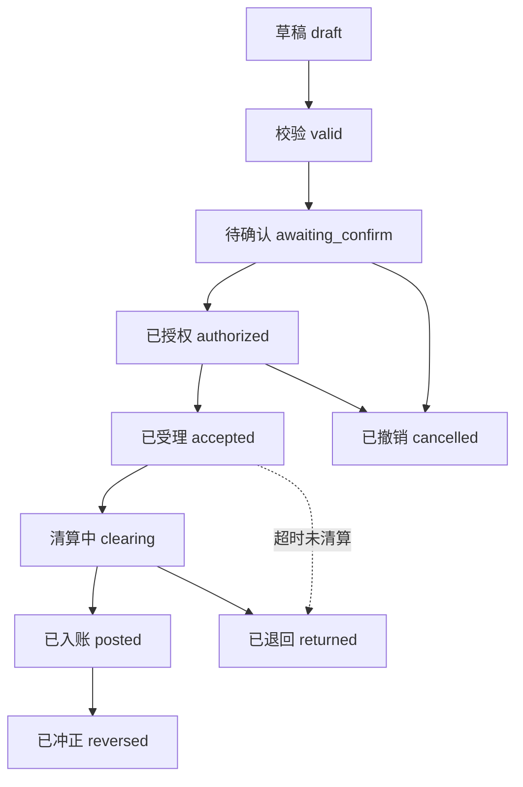
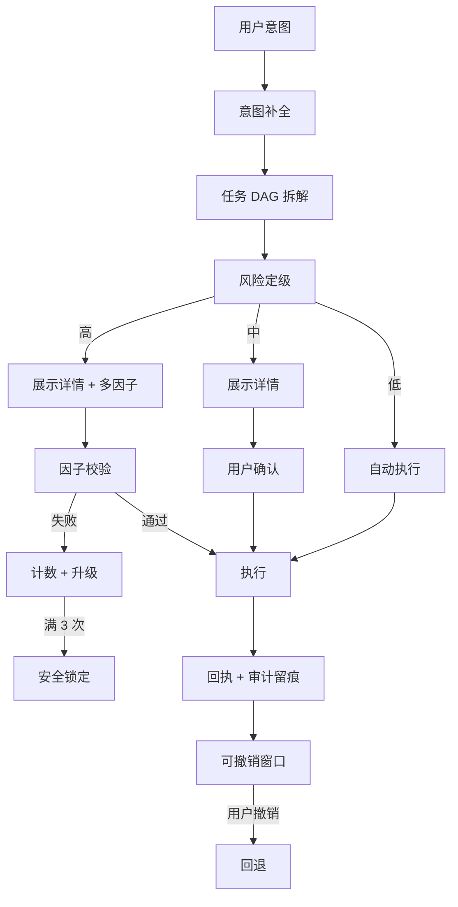

# 银行个人零售业务域地图（Banking Domain Map）

> **文档定位**：本文件是 bk-agent「业务层」的基础清单。目标是把「银行所有业务的统一入口」这句话拆成**可实现的域、可判定的规则、可验证的数值**。
> **写给谁**：写 `src/services/`、`src/domain/` 的人（本文件只做研究，不改任何 src 代码）。
> **证据等级标注**（全文统一）：
> - **【实证】** 有权威来源 URL，可点开复核；数值已抄录原文。
> - **【惯例】** 行业通行做法，多行一致但无单一权威条文；已给具体数值，落地时当作默认可配值。
> - **【演示值】** 本项目建议值，**必须在代码里标注为演示数据**，不得对外声称是真实银行参数。
> 抓取时间：2026-09-28 ~ 2026-09-29。

---

## 0. 结论速览（TL;DR）

1. **个人零售银行 = 9 个域**：账户、转账与支付、卡片、账单与对账、代扣与订阅、理财、安全与合规、通知与提醒、跨场景联动。前 8 个是「产品域」，第 9 个是 Agent 才有的「合成域」——它不属于任何单一产品，是把前 8 个合起来用的那一层。
2. **域与域之间只有一个真正的耦合点：钱的状态**。真实银行把「一笔钱」拆成 4 个状态：**可用 / 预授权冻结（pending）/ 在途 / 已入账**。TigerBeetle 的两阶段转账（pending → post / void / expire）就是这套语义的工程化实现【实证】。**bk-agent 现在只有 `balance` 一个数字，这是业务层第一个必须补的洞。**
3. **权限分级不是「金额分档」，是「金额 × 账户类型 × 渠道 × 客户风险等级」四维**。【实证】工行 2026 版协议原文：Ⅰ类户「实施分级管理，对应不同非柜面渠道支出限额……乙方**根据客户的风险等级**，以尽职调查为依托，为不同风险等级的客户开立**不同限额账户**」。
4. **中国的多因子分档有一条硬红线**：【实证】非柜面转账**单日累计超过 5 万元**，必须用**数字证书或电子签名**（UKEY、电子口令牌），**短信验证码不能替代**。这条直接决定赛题「高风险必须人脸/短信/U盾」里 U 盾的触发线。
5. **异常交易识别可以完全用规则引擎落地**，不需要 ML。本文件给出 16 条可判定规则 + 阈值 + 评分合成 + 误报抑制（第 4 节）。
6. **最大的差异化机会**：【实证】Revolut AIR（2026-09-01 起在法国及欧洲大陆上线）目前**不能替用户发起一笔转账，也不能给理财建议**，只能做消费分类跟踪、定期支付管理、快速冻结卡片、查行情、规划旅行。→ **「能安全地执行」正是本项目的空位**，而执行的前提就是权限分级 + 审计 + 可回退。

---

## 1. 业务域总览

### 1.0 域清单

| # | 域 | 核心对象 | 主要操作 | 风险面 | bk-agent 现状 |
|---|---|---|---|---|---|
| 1 | 账户 | Account / 账户分类 | 开立/升级降级/余额/明细/冻结/销户 | 高 | 部分 —— `bank.js` 仍是单一 `balance`，无可用/冻结/在途分解 |
| 2 | 转账与支付 | Transfer / Payee / 清算通道 | 转账/定时/批量/AA/跨境/收款 | 高 | 部分 —— 行内即时已通；定时/AA 已在 `OPERATIONS` 登记但无实现；跨境/批量无 |
| 3 | 卡片 | Card / 额度 / 渠道开关 | 申请/激活/限额/冻结/挂失/换卡 | 高 | 部分 —— 卡包 + 冻结/解冻/挂失/额度操作已登记，渠道开关无 |
| 4 | 账单与对账 | Statement / 账单周期 | 月结单/对账/分期/最低还款 | 中 | 部分 —— 消费分类 + `monthReview()`；缺期初余额/费用/预测 |
| 5 | 代扣与订阅 | Mandate / Subscription | 签约/解约/扣费预告/续费提醒 | 中 | 部分 —— 订阅列表 + 取消；**无授权（mandate）对象** |
| 6 | 理财 | Product / Holding / Order | 风险测评/申购/赎回/持仓/收益 | 高 | **缺** —— `policy.js` 已登记 `wealth.purchase/redeem`，但无产品/持仓/订单数据 |
| 7 | 安全与合规 | Limit / RiskRule / AuditLog | 限额/反欺诈/争议/上报 | 极高 | 部分 —— ✅ 权限分级/审计/注入防御已有；**缺限额体系与异常交易识别** |
| 8 | 通知与提醒 | Alert / Preference | 动账/还款/到期/异常确认 | 低 | **缺** —— `pendingItems()` 是雏形 |
| 9 | 跨场景联动 | Event / Suggestion | 生日/旅行/发薪日触发 | 中 | **缺** |

> **现状口径**：本表的「现状」列是 2026-09-29 实测 `src/` 得出的，**不是**项目简报里的旧描述。实测已有的安全与任务编排资产：`src/services/policy.js`（三级风险 + 日累计判定 + 未知操作按高风险）、`src/services/audit.js`（审计 + 连续失败/可疑触发锁定）、`src/services/guard.js`（注入防御 + 样本）、`src/agent/taskGraph.js`（`buildTaskGraph` / `interrupt` / `rollback` / `handoff` / `nextRunnable` / `progressOf`）。**赛题三个高优先级安全项已经落地，本文件的价值在于补「业务域」这一半。**

### 1.1 账户域

#### 子功能

| 子功能 | 说明 | 风险等级 |
|---|---|---|
| 开户 | 柜面/智能设备/电子渠道；需尽职调查（KYC） | 高 |
| 账户分类管理 | Ⅰ/Ⅱ/Ⅲ 类户开立、升级、降级、绑定 | 高 |
| 余额查询 | 可用 / 冻结 / 在途 / 预授权 / 授信额度 | 低 |
| 明细查询 | 按日期、金额、对方、类目筛选；导出 | 低 |
| 账户限额升降级 | 按风险等级申请提额/降额 | 高 |
| 睡眠户唤醒 | 长期不动户恢复 | 中 |
| 销户 | 需无未结债务、无司法冻结 | 高 |

#### 业务规则（含数值）

**账户分类限额**（这是个人零售最硬的一组数字）：

| 项 | Ⅰ类户 | Ⅱ类户 | Ⅲ类户 |
|---|---|---|---|
| 功能 | 全功能，余额与使用范围无限制 | 存款、买理财、限额消费缴费、限额向非绑定账户转出 | 限额消费缴费、限额向非绑定账户转出 |
| 出入金限制 | 入金无特殊限制；出金按**非柜面渠道支出限额**分级 | 非绑定账户转入+存现：日累计 ¥10,000 / 年累计 ¥200,000；消费缴费+向非绑定转出+取现：日累计 ¥10,000 / 年累计 ¥200,000 | 出金（消费缴费+向非绑定转出）：日累计 ¥2,000 / 年累计 ¥50,000 |
| 余额上限 | 无 | 无 | ¥1,000（PBC 2016 口径） |
| 数量上限 | 同一银行 **1 个** | ≤5 个 | ≤5 个 |
| 实体卡 | 可 | 面签后可配发 | 不可 |
| 面签增强 | — | 面签后可存取现金、非绑定账户转入 | 面签或绑定账户验证后，可非绑定账户转入 |

**证据与口径冲突（必须知道，否则会写错）**：
- 工行《个人银行结算账户管理协议（2026 年版）》原文给出上表 Ⅱ/Ⅲ 类限额与数量。【实证】https://media.icbc.com.cn/agreement/1256821515131965448.html
- 人民银行广州分行《央行新政，将如何影响你的生活？》给出 2016 年口径：Ⅲ类户**余额不得超过 1000 元，单日转入转出限额分别为 5000 元，年使用限额分别为 10 万元**。【实证】https://www.pbc.gov.cn/guangzhou/129196/3207913/3210320.html
- **差异解释**：Ⅲ类户限额经后续文件（银发〔2018〕16 号等）调整，各行协议已按新口径执行。**落地结论：不要把这类数字写死在业务逻辑里，要做成「账户产品」上的可配字段**（见本节末尾的产品字段清单）。

**其他关键规则**：

| 规则 | 数值 / 条件 | 证据 |
|---|---|---|
| 睡眠户管控 | 开户之日起 **6 个月**内无交易记录 → 暂停账户**非柜面**业务（支付账户暂停所有业务）；重新核实身份可恢复。起始时间＝开户之日**次日**；待激活账户自激活之日起算 | 【实证】PBC 广州分行解读 |
| 睡眠户降级 | 连续一段时长未主动发起交易**且**账户余额低于一定金额 → 可降级/限制服务/调整非柜面限额/销户，但须提前公告或短信通知 | 【实证】工行 2026 协议第十五条 |
| 同行异地免费 | 自 2016-12-31 起，同一法人内**行内异地存取现、转账**不得收费（含同名与非同名） | 【实证】PBC 广州分行解读 |
| 手机号唯一 | 留存手机号应与身份证件号一一对应；无法证明多人共用合理性的，可**中止办理业务** | 【实证】工行 2026 协议第十八条 |
| 司法冻结 | 冻结、扣划未执行结束前不予销户 | 【实证】工行 2026 协议第十七条 |
| 销户前提 | 尚未清偿在本行债务的，不得撤销账户 | 【实证】工行 2026 协议第十六条 |

#### 余额构成（bk-agent 必须先补的模型）

真实账户的「余额」不是一个数，是五个数：

| 字段 | 含义 | 谁占用它 |
|---|---|---|
| `available` 可用余额 | 现在真的能动的钱 | 转账/消费校验就看它 |
| `frozen` 冻结金额 | 司法冻结、账户管控、保证金 | 银行/司法/风控 |
| `pending` 预授权/在途冻结 | 已发起但未清算的交易占款 | 卡片预授权、跨行在途、定时转账预留 |
| `posted` 已入账 | 清算完成的金额 | 记账 |
| `creditLimit` 授信额度 | 信用卡/透支可用额度 | 发卡行 |

**权威对齐**：TigerBeetle 的账户模型把「预授权/在途」命名为 `debits_pending`（"Money in debits_pending is reserved — that is, **it cannot be spent until the corresponding pending transfer resolves**"），已入账为 `debits_posted`；两阶段转账的三条出路是 **post（确认）/ void（撤销）/ expire（超时自动退回）**。【实证】源码原文见第 6 节 F-1。

> **给 bk-agent 的直接结论**：`src/domain/bank.js` 里的 `state.balance` 应升级为 `{ available, frozen, pending }`，并且**任何转账草稿只校验 `available - 本次会话已占用的 pending`**。否则「同时发起两笔转账，两笔都显示余额够」这个 bug 一定会出现。

#### 前置条件

| 操作 | 前置 |
|---|---|
| 电子渠道开 Ⅱ/Ⅲ 类户 | 需提供本人在本行或其他银行开立的**同名Ⅰ类户或信用卡**账户用于核验绑定 |
| Ⅲ类户非绑定账户入金 | 面签或绑定账户转入验证；电子渠道非面对面**同一客户只能开 1 个**允许非绑定账户入金的Ⅲ类户 |
| 开立 | 通过反洗钱客户尽职调查，提交基本信息与证明文件，接受审核 |
| 销户 | 无未结债务、无未结束的冻结/扣划 |

#### 存款产品字段清单（直接照抄 Fineract 的建模）

Fineract `SavingsProductData.java` 的产品级字段是一份现成的 checklist，建议 bk-agent 的「账户产品」对象按它建模【实证，源码见 6-F2】：

`nominalAnnualInterestRate`（年利率）、`interestCompoundingPeriodType`（计息复利周期）、`interestPostingPeriodType`（结息周期）、`interestCalculationType`、`interestCalculationDaysInYearType`（年天数口径 365/360）、**`minRequiredOpeningBalance`（起存金额）**、**`lockinPeriodFrequency` + `lockinPeriodFrequencyType`（锁定期）**、**`withdrawalFeeForTransfers`（转账是否收手续费）**、**`allowOverdraft` + `overdraftLimit`（是否允许透支及限额）**、**`minRequiredBalance` + `enforceMinRequiredBalance`（最低留存余额及是否强制）**、**`maxAllowedLienLimit` + `lienAllowed`（质押/留置额度）**、`minBalanceForInterestCalculation`（计息起点余额）、`withHoldTax` + `taxGroup`（代扣税）、`accountMappingForPayment`（支付渠道对账映射）、`charges`（费用集合）、**`isDormancyTrackingActive` + `daysToInactive` + `daysToDormancy` + `daysToEscheat`（睡眠户全生命周期）**。

> 注意最后四个字段：Fineract 把「不活跃 → 睡眠 → 上缴」做成了产品级可配的三个天数阈值。这与央行「6 个月无交易暂停非柜面」是同一个业务概念的不同粒度。

---

### 1.2 转账与支付域

#### 子功能

| 子功能 | 说明 | 风险等级 |
|---|---|---|
| 行内转账 | 本行账户间，实时 | 低/中/高（按金额） |
| 跨行转账 | 经清算通道，可选实时/普通/次日到账 | 中/高 |
| 跨境汇款 | SWIFT，需购汇、需申报 | 高 |
| 定时/预约转账 | 指定日期或周期自动执行 | 中（签约时高） |
| 批量转账 | 一次多笔（代发工资、房租+水电） | 高 |
| AA 拆分收款 | 一借多贷 / 多借多贷 | 中 |
| 收款 | 收款码、收款链接、AA 收款发起 | 中 |
| 转账撤销 | ATM 转账 24h 内可撤销 | 中 |

#### 支付清算通道（决定到账时间与限额）

| 通道 | 运行时间 | 清算方式 | 限额 | 到账 | 证据 |
|---|---|---|---|---|---|
| 行内支付系统 | 7×24 | 行内实时 | 行内限额 | 实时 | 【实证】海通国际研报：2023H1 行内笔均约 ¥10.3 万 |
| **大额实时支付系统 HVPS** | 5×21 | 实时全额清算 | **金额起点为 0**（实质无上限）；2023H1 笔均 >¥2,200 万 | 实时 | 【实证】海通国际研报 |
| **小额批量支付系统 BEPS** | 7×24 | 定期净额清算 | **工作日转账限额 ¥5 万；法定节假日 ¥50 万** | 批量，非实时 | 【实证】山西农信清算结算业务页 |
| **网上支付跨行清算系统（超级网银）IBPS** | 7×24 | 定期净额清算 | **上限 ¥5 万**；2020–23H1 笔均约 ¥1.5 万 | 准实时 | 【实证】海通国际研报 |
| 银联跨行支付系统 | — | 多边净额 | 卡交易 | — | 【实证】海通国际研报（笔均 ¥1,136） |
| 网联清算平台 | — | 多边定期净额 | 支付机构发起的银行账户网络支付 | — | 【实证】海通国际研报（笔均约 ¥600） |
| 农信银 / 城银清算 | 7×24 | 实时全额 | 农村/城商行体系 | 实时 | 【实证】山西农信页 |
| 境内外币支付系统 | 工作日 8h | 实时全额 | — | — | 【实证】海通国际研报 |
| **CIPS 人民币跨境支付系统** | 二期 5×24+4 | 混合（实时全额 + 定期净额） | 跨境 | T+0~T+2 | 【实证】海通国际研报 |

> **对 bk-agent 的意义**："到账时间 T+0 还是 T+1" 不是一个字段，是**通道属性 × 发起时点**的函数。演示值建议：`instant`（行内）、`same-day`（HVPS/IBPS 在运行窗口内）、`next-day`（BEPS 或超窗口）、`T+1~T+3`（跨境）。

#### 业务规则数值表

| 规则 | 数值 / 条件 | 等级 |
|---|---|---|
| 转账方式选择 | 必须向客户提供**实时到账 / 普通到账 / 次日到账**三种方式，由客户选择 | 【实证】PBC 广州分行解读（261 号文） |
| ATM 转账延迟 | 除本人同行账户转账外，ATM 转账发卡行**受理 24 小时后**才办理资金转账；24 小时内可申请**撤销** | 【实证】PBC 广州分行解读 |
| **非柜面大额强制强认证** | 除向本人同行账户转账外，**单日累计超过 ¥5 万**的非柜面转账，必须采用**数字证书或电子签名**等安全可靠的支付指令验证方式；**短信验证码不属于**数字证书/电子签名，大额转账时不能替代 | 【实证】PBC 广州分行解读 |
| 非柜面笔数/限额约定 | 银行须与客户**协议约定**非柜面渠道转账的日累计限额、笔数和年累计限额；超限须到柜面办理 | 【实证】工行 2026 协议第八条 |
| 行内异地手续费 | 免费（同一法人内） | 【实证】PBC 广州分行解读 |
| 跨行转账手续费 | 由银行自定；演示值：¥0.5 万以下 ¥2/笔，¥0.5–1 万 ¥5/笔，¥1–5 万 ¥7.5/笔，¥5 万以上按 0.015% 收取（¥50 封顶），手机银行免费 | 【演示值】 |
| 手续费承担 | 行内转账由**发起方**承担；跨境汇款由**汇款人**承担并可选择「全额到账」（SHA/OUR/BEN 三选一，OUR 时客户额外承担中转行费用） | 【惯例】 |
| 跨境电报费 | 五份电报以内 ¥200 或等值外币；五份电报以上，从第六份起每份另加 ¥40；另加相关海外代理行收费 | 【实证】汇丰中国《账户及服务费率表》 |
| 跨境汇款到账 | 一般为 T+1 ~ T+3 个工作日（视中转行） | 【惯例】 |
| 个人结汇/购汇便利化额度 | 每人每年等值 **5 万美元** | 【实证】国家外汇管理局个人外汇业务问答 |
| 大额交易报告（现金） | 当日单笔或累计 **¥5 万**（含）/外币等值 US$1 万（含）以上的**现金**收支 | 【实证】《金融机构大额交易和可疑交易报告管理办法》第五条 |
| 大额交易报告（自然人境内划转） | 当日单笔或累计 **¥50 万**（含）以上的境内款项划转 | 【实证】同上 |
| 大额交易报告（自然人跨境划转） | 当日单笔或累计 **¥20 万**（含）以上的跨境款项划转 | 【实证】同上 |
| 大额交易报告（非自然人） | 当日单笔或累计 **¥200 万**（含）以上 | 【实证】同上 |
| 上报时限 | 大额交易：发生之日起 **5 个工作日**内电子方式提交；可疑交易：确认后最迟 **5 个工作日** | 【实证】同上第八条、第十五条 |
| 保存期限 | 报告及分析工作记录**自生成之日起至少保存 5 年**（涉调查则保存至调查结束） | 【实证】同上第二十二条 |
| 可疑交易触发 | **不论金额大小**，只要怀疑与洗钱/恐怖融资相关即须提交 | 【实证】同上第十一条 |

#### 状态机（建议实现）



对应 TigerBeetle 的语义：`authorized` ≈ `pending`（占款但未入账）、`posted` ≈ `post_pending_transfer`（可**部分** post，余款自动退回原账户）、`cancelled/returned` ≈ `void_pending_transfer`、超时 ≈ `expire`（"If the timeout interval passes before the transfer is either posted or voided, the transfer expires and the full amount is returned to the original account"）。

> **赛题要求「执行过程支持中断、回退、人工接管」，上面这张图就是它的完整答案**：中断 = → cancelled；回退 = → reversed / void；人工接管 = awaiting_confirm / 人工复核队列。

#### 前置条件

| 操作 | 前置 |
|---|---|
| 任意转账 | 已登录会话；收款人已添加或现场填写；金额 ≤ 单笔限额；`amount ≤ available − pending` |
| 跨行转账 | 需收款行行号/联行号；大额走 HVPS 需在 5×21 窗口内 |
| 跨境汇款 | 收款人 SWIFT/BIC、IBAN 或账号；购汇额度余量；反洗钱申报 |
| 定时/预约转账 | 签署委托扣款/自动转账协议；约定执行失败重试策略 |
| 批量转账 | 上传收款人清单（逐笔校验）；需更高的风险等级与人工复核 |
| 新增收款人 | 首次向新收款人转账 ≥ 一定金额时，需增强验证（见第 3.4 节动态升级） |

---

### 1.3 卡片域

#### 子功能

| 子功能 | 说明 | 风险等级 |
|---|---|---|
| 卡片申请 | 借记卡/信用卡/虚拟卡 | 中（虚拟卡）/高（实体卡） |
| 激活 | 设置密码、绑定设备 | 中 |
| 额度调整 | 提额/降额；降额可即时，提额需审核 | 中 |
| 交易渠道开关 | 境内/境外、线上/线下、取现、小额免密 | 中 |
| 卡片限额 | 单笔/日累计/月累计 | 中 |
| 冻结/解冻 | 临时管控，可自助恢复 | 中 |
| 挂失 | 永久挂失，不可自助恢复 | 高 |
| 解挂 | 撤销挂失 | 高 |
| 换卡/补卡 | 卡损坏、到期、升级 | 高 |
| 销卡 | — | 高 |
| 预借现金 | 信用卡取现/现金转账/现金充值 | 高 |

#### 业务规则数值表

| 规则 | 数值 / 条件 | 等级 |
|---|---|---|
| 信用卡透支利率 | 实行上下限管理：**上限日利率万分之五（年化 18.25%）；下限为万分之五的 0.7 倍**（约年化 12.775%） | 【实证】银发〔2016〕111 号 |
| 免息还款期 | 持卡人享受免息期的**条件和标准由发卡机构自主确定** | 【实证】同上（行业惯例 20–50 天） |
| 最低还款额 | 条件与标准由发卡机构自主确定 | 【实证】同上（行业惯例为本期应还的 **10%**） |
| 滞纳金→违约金 | **取消滞纳金**；逾期未还款是否收违约金及标准由**协议约定** | 【实证】同上 |
| 超限费 | 提供超授信额度用卡服务的，**不得收取超限费** | 【实证】同上 |
| 服务费不计息 | 违约金、年费、取现手续费、货币兑换费等**不得计收利息** | 【实证】同上 |
| 预借现金 ATM 限额 | 通过 ATM 等自助机具现金提取，**每卡每日累计不超过 ¥1 万** | 【实证】同上 |
| 预借现金其他限额 | 柜面现金提取、各类渠道现金转账的每卡每日限额由发卡机构与持卡人**协议约定** | 【实证】同上 |
| 划转禁止 | **不得**将信用卡预借现金额度内资金划转至**其他信用卡**，或**非持卡人**的银行结算账户/支付账户 | 【实证】同上 |
| 利率调整通知 | 调整信用卡利率标准应**至少提前 45 个自然日**按约定方式通知持卡人；持卡人有权在生效前销户 | 【实证】同上 |
| 利率报送 | 调整透支利率、免息期、最低还款额等标准，应**提前 60 天**向人民银行报告 | 【实证】同上 |
| 挂失生效 | 挂失**即时生效**（口头/线上挂失即冻结卡） | 【惯例】 |
| 补卡时限 | 邮寄 3–7 个工作日；同城加急 1–2 个工作日 | 【演示值】 |
| 挂失手续费 | ¥20/卡（部分银行免费）；补卡工本费 ¥5–15 | 【演示值】 |

#### 前置条件

| 操作 | 前置 |
|---|---|
| 信用卡申请 | 身份核验 + 收入与征信评估 + 面签（部分渠道） |
| 提额 | 用卡时长、还款记录、额度使用率；需二次验证 |
| 挂失 | 卡片归属确认；挂失后所有交易渠道关闭 |
| 解挂 | 仅「临时挂失」可自助解挂；「永久挂失」须补卡 |
| 虚拟卡申请 | 主卡状态正常；设定单卡额度与有效期 |

---

### 1.4 账单与对账域

#### 子功能

| 子功能 | 说明 | 风险等级 |
|---|---|---|
| 账单周期管理 | 账单日、还款日、免息期计算 | 低 |
| 月结单生成 | 期初/期末余额、明细、汇总 | 低 |
| 对账 | 账单 vs 实际交易核对；未达账项 | 低 |
| 最低还款 / 全额还款 | 还款金额计算与提醒 | 中 |
| 账单分期 | 期数、手续费率、每期应还 | 中 |
| 利息计算 | 循环利息、罚息 | 低（计算）/中（执行） |
| 争议处理 | 差错争议、拒付 | 中 |

#### 账单关键日期（免息期算法）

| 概念 | 演示值 | 说明 |
|---|---|---|
| 账单日 | 每月 5 日 | 统计上一周期 |
| 还款日 | 每月 25 日 | 账单日后 20 天 |
| 免息期 | 20–50 天 | 账单日次日消费享最长免息期；账单日当天消费享最短 |
| 账单周期 | 上月 6 日 – 本月 5 日 | 【演示值】 |

#### 信用卡账单域数值

| 项 | 数值 | 等级 |
|---|---|---|
| 最低还款额 | 本期应还的 **10%**（+ 上期未还部分 + 超限部分 + 全部费用） | 【惯例】 |
| 循环利息 | 按**日利率万分之五**（年化 18.25%）从**记账日**起算，不享受免息期 | 【实证口径 + 惯例计息方式】 |
| 违约金 | 最低还款额未还部分的 **5%**，最低 ¥10（各行协议不同） | 【惯例】 |
| 账单分期手续费 | 3 期 0.75%/期、6 期 0.70%/期、12 期 0.66%/期（近似年化 13%–16%） | 【演示值】 |
| 分期提前结清 | 剩余本金 + 剩余手续费（部分银行收违约金） | 【惯例】 |
| 争议受理期限 | 账单日后 30 天内提出 | 【惯例】 |

#### 对账恒等式（实现时必须成立）

```
期初余额 + 本期收入合计 − 本期支出合计 = 期末余额
期末余额 − 未达账项（在途收入 − 在途支出） = 可用余额
```

---

### 1.5 代扣与订阅域

#### 子功能

| 子功能 | 说明 | 风险等级 |
|---|---|---|
| 代扣签约 | 建立付款人授权（mandate） | 中 |
| 代扣解约 | 撤销授权 | 中 |
| 授权查询 | 列出本人全部代收授权 | 低 |
| 扣费预告 | 扣款前 N 天提醒 | 低 |
| 续费提醒 | 会员到期前提醒 | 低 |
| 订阅自动识别 | 从流水中识别周期性扣费商户 | 低 |
| 一键取消订阅 | 解约 + 通知商户 | 中 |
| 异常扣费申诉 | 与授权不符的扣费 | 中 |

#### 业务规则数值表（这一域有明确的监管条文）

> 代收业务定义（原文）：**「经付款人同意，收款人委托代收机构按照约定的频率、额度等条件，从付款人开户机构扣划付款人账户资金给收款人，且付款人开户机构不再与付款人逐笔进行交易确认的支付业务。」**（《中国人民银行关于规范代收业务的通知（征求意见稿）》，银发〔2019〕85 号）【实证】

| 规则 | 内容 | 等级 |
|---|---|---|
| 授权要素 | 授权应明确：**收款人名称、付款用途、付款账号、付款周期或条件、授权期限** | 【实证】85 号文二(一) |
| 逐笔验证 | 开户机构应在交易过程中**对授权事项逐笔验证**；未建立授权关系或与授权事项不符的，**应当拒绝办理**并向付款人提示风险 | 【实证】85 号文二(四) |
| 逐笔提示 | 应通过短信等有效方式**及时向付款人逐笔提示**代收业务信息；对异常交易应及时联系付款人核实 | 【实证】85 号文二(四) |
| 非面对面授权 | 对付款人**非面对面方式**建立授权的，应设置**更高级别**风险防控措施 | 【实证】85 号文二(二) |
| 授权可查 | 应妥善留存、及时更新授权信息，并**支持付款人查询**本人代收业务授权信息 | 【实证】85 号文二(三) |
| 变更/终止便捷 | 应在风险可控前提下，采取**便利化方式**与付款人建立、变更或终止授权，并及时告知授权状态 | 【实证】85 号文二(三) |
| 适用场景限制 | 适用于**收款人固定、付款频率或额度事先约定且相对固定**的特定场景（便民服务、政府服务、通讯、非投资型保险等税费缴纳、公益捐款、信用卡及贷款偿还、资金归集等） | 【实证】85 号文一(一)、四(一) |
| 收款账户 | 原则上应为收款人**同名账户**（连锁/集团资金归集等例外需审核） | 【实证】85 号文三(二) |
| 恶意否认 | 对确认存在恶意否认交易的付款人，可**限制其开办代收业务**并共享信息 | 【实证】85 号文二(五) |
| 高风险收款人 | 可采取审核留存授权协议、**设置交易限额**、保证金、**延迟资金结算**等措施 | 【实证】85 号文三(四) |

> **对 bk-agent 的直接结论**：赛题要求的「自动识别订阅扣费、续费提醒、一键取消订阅」在真实银行里是三件事：**① 识别（规则引擎）② 提醒（通知域）③ 取消 = 撤销授权 + 通知商户 + 保留撤销凭证**。第三件事必须落到「授权（mandate）」对象上，而不是简单地把订阅从列表里删掉。

**演示值**：扣费预告提前 **3 天**；续费提醒提前 **7 天**；静默订阅判定为「连续 **90 天**未产生非订阅类消费且该商户无新增使用行为」；一键取消后 **T+1** 生效并保留 30 天申诉窗口。

---

### 1.6 理财域

#### 子功能

| 子功能 | 说明 | 风险等级 |
|---|---|---|
| 风险测评 | 首次购买前必做；结果 C1–C5 | 中 |
| 产品浏览 | 按风险等级、期限、起购金额筛选 | 低 |
| 申购 | 买入，T+1 确认份额 | **高** |
| 赎回 | 卖出；货基可 T+0 快赎（有限额） | **高** |
| 持仓与收益 | 份额、市值、累计收益、七日年化/业绩比较基准 | 低 |
| 在途查询 | 申购在途、赎回在途 | 低 |
| 定投 | 周期自动申购 | 高（签约时） |
| 到期/开放日提醒 | 封闭式到期、开放式开放日 | 低 |

#### 业务规则数值表

| 规则 | 数值 / 条件 | 等级 |
|---|---|---|
| 产品分类（按投资性质） | 固定收益类（债权类资产 ≥80%）、权益类（权益类 ≥80%）、商品及金融衍生品类（≥80%）、混合类 | 【实证】《商业银行理财业务监督管理办法》第九条 |
| 产品分类（按募集方式） | 公募 / 私募 | 【实证】同上第八条 |
| 产品分类（按运作方式） | 封闭式（有确定到期日，期间不可认购赎回）/ 开放式 | 【实证】同上第十条 |
| 私募合格投资者门槛 | 自然人：具有 **2 年以上投资经历**，且满足 家庭金融净资产 **≥¥300 万**，或 家庭金融资产 **≥¥500 万**，或 近 3 年本人年均收入 **≥¥40 万**；法人：最近 1 年末净资产 **≥¥1,000 万** | 【实证】同上第八条 |
| 登记编码 | 未在全国银行业理财信息登记系统登记并获得编码的产品**不得发行**；销售文件显著位置须列明登记编码 | 【实证】同上第十二条 |
| 登记时限 | 公募：销售前 **10 日**；私募：销售前 **2 日**；终止后 **5 日**内完成终止登记 | 【实证】同上第十二条 |
| 不保本 | 理财产品是**非保本**产品，不保证本金和收益水平 | 【实证】同上第三条 |
| 穿透式监管 | 向上识别最终投资者，向下识别底层资产 | 【实证】同上第七条 |
| 风险等级 | R1 谨慎型 / R2 稳健型 / R3 平衡型 / R4 进取型 / R5 激进型；与投资者 C1–C5 匹配 | 【惯例】 |
| 双录 | 高风险/私募产品销售需录音录像；已有法院判例认定线上逃逸「双录」监管的责任 | 【实证】北京金融法院案例 |
| **货基 T+0 快赎上限** | 单个投资者持有的**单只**货币市场基金，在**单一**基金销售机构，**单日不高于 ¥1 万**的 T+0 赎回提现额度上限；正常赎回不受影响；**非银行支付机构不得垫支** | 【实证】证监会与人民银行《关于进一步规范货币市场基金互联网销售、赎回相关服务的指导意见》，2018-06-01 施行 |
| 申购确认 | 一般 T+1 确认份额，T+2 可查询 | 【惯例】 |
| 赎回到账 | 货基：T+0（限额内）或 T+1；非货基：T+1 ~ T+2 | 【惯例】 |
| 收益口径 | 净值型产品展示「业绩比较基准」而非「预期收益率」；货基展示「七日年化」 | 【惯例】（资管新规打破刚兑） |
| 大额存单提前支取 | 提前支取按**活期利率**计息（不靠档），部分可转让 | 【惯例】 |

#### 前置条件

| 操作 | 前置 |
|---|---|
| 首次申购 | 风险测评完成且未过期（一般 1 年）；风险等级匹配（C 级 ≥ R 级）；签署电子协议 |
| 高风险产品申购 | 双录 / 二次确认 / 冷静期 |
| 赎回 | 开放日；份额已确认（在途份额不可赎回） |
| 私募产品 | 合格投资者认定 |

> **风控要点**：`允许购买 ⟺ 投资者等级 ≥ 产品风险等级`。若不匹配而客户坚持，需签署「风险不匹配警示书」并留痕——这正是赛题「操作审计（决策链路）」的天然场景。

---

### 1.7 安全与合规域

#### 子功能

| 子功能 | 说明 |
|---|---|
| 限额体系 | 单笔/日累计/月累计/年累计/按渠道/按账户类型/按时间窗 |
| 认证与因子 | 会话、密码、短信 OTP、生物识别、硬件令牌、柜面 |
| 反欺诈 | 实时规则引擎（见第 4 节） |
| 异常交易识别 | 规则 + 评分 + 处置 |
| 安全锁定 | 连续失败/可疑行为触发 |
| 争议与拒付 | 差错争议、chargeback |
| 客户尽职调查 | KYC、身份信息有效期、手机号唯一性 |
| 审计 | 决策链路 + 执行日志，保存 ≥5 年 |
| 沙箱隔离 | 演示/生产环境数据隔离 |

#### 限额体系的设计（借 Midaz 的实现）

Midaz 的限额对象是一个**多字段组合**，而不是「一个日累计数字」【实证，源码见 6-F3】：

| 字段 | 取值 | 说明 |
|---|---|---|
| `limitType` | `DAILY` / `WEEKLY` / `MONTHLY` / `PER_TRANSACTION` / `CUSTOM` | 周期类型 |
| `maxAmount` | 十进制金额 | 必须 > 0 |
| `asset` | 3 位大写币种（如 CNY/USD） | 分币种 |
| `scopes` | 1–100 个作用域 | 按账户/产品/渠道 |
| `activeTimeStart` / `activeTimeEnd` | `HH:MM`，如 09:00–17:00 | **按时间段生效**——夜间可自动收紧 |
| `customStartDate` / `customEndDate` | 自定义起止 | 配合 `CUSTOM` |
| usage counter | 按周期重置；`resetAt + CounterRetentionDays` 过期 | **原子 upsert 防 TOCTOU** |

> **必须抄的一点**：Midaz 的 `CheckLimits` 注释明确说 "Uses atomic upsert to **prevent TOCTOU race conditions**"，且允许传入 `*sql.Tx`，使限额校验与扣款在**同一事务**内。bk-agent 的 `validateTransferSlots` 目前是「只读校验、不写余额」，注释里也承认余额校验交给调用方——**演示可接受，但一旦并发就会出现超限**。建议把「限额校验 + 占用 pending」合成一个不可分割的步骤。

#### 合规数值表

| 项 | 数值 | 等级 |
|---|---|---|
| 大额交易报告线 | 现金 ¥5 万 / 自然人境内 ¥50 万 / 自然人跨境 ¥20 万 / 非自然人 ¥200 万 | 【实证】AML 办法第五条 |
| 报告与记录保存 | ≥5 年 | 【实证】AML 办法第二十二条 |
| 联合惩戒 | 出租、出借、出售、购买银行账户/支付账户的个人及组织者，**5 年内暂停**其银行账户非柜面业务、支付账户所有业务，不得新开户 | 【实证】PBC 广州分行解读 |
| 断卡行动依据 | 《电信网络诈骗及其关联违法犯罪联合惩戒办法》（公安部等令第 170 号） | 【实证】工行 2026 协议第一条引用 |
| 尽职调查依据 | 《金融机构客户尽职调查和客户身份资料及交易记录保存管理办法》（人民银行、金融监管总局、证监会令〔2025〕第 11 号） | 【实证】工行 2026 协议第一条引用 |

#### 安全锁定（赛题明确要求）

| 触发条件 | 动作 | 解除方式 |
|---|---|---|
| 5 分钟内验证失败 ≥3 次 | 锁定该操作 30 分钟 | 等待或人脸复核 |
| 24 小时内验证失败 ≥10 次 | 锁定账户非柜面业务 | 柜面/人脸核身 |
| 24 小时内高危交易被拦截 ≥2 次 | 强制升级为人工复核 | 客服外呼核实 |
| 单日触发异常规则 ≥5 次 | 降级非柜面限额至日常的 20% | 次日自动恢复或人工恢复 |
| 设备指纹突变 + 大额发起 | 会话失效，要求重新登录 + 人脸 | 即时 |

---

### 1.8 通知与提醒域

#### 子功能

| 子功能 | 说明 | 默认渠道 |
|---|---|---|
| 动账提醒 | 收入/支出通知 | App 推送（免费）> 微信 > 短信 |
| 余额预警 | 低于阈值提醒 | App |
| 扣费预告 | 代扣前提醒 | App + 短信 |
| 还款提醒 | 账单日、还款日前提醒 | App + 短信 |
| 到期提醒 | 定期存款到期、理财到期、卡片到期 | App |
| 限额预警 | 接近单日/单月限额 | App |
| 异常交易确认 | 命中规则时请客户确认 | 推送 + 短信（可要求回复） |
| 安全提醒 | 新设备登录、密码修改、证件过期 | 短信（强制） |

#### 业务规则数值表

| 规则 | 数值 | 等级 |
|---|---|---|
| 短信动账提醒起点 | 多家银行已将默认动账短信提醒起点上调至 **¥100**（部分 ¥500）；低于起点不发短信 | 【实证】央广网 2025-10-16 报道「100 元以下不通知」 |
| 短信提醒服务费 | **¥2–3/月** | 【实证】同上（受访客服口径） |
| 免费替代渠道 | 手机银行 App、微信公众号推送 | 【实证】同上 |
| 小额免密风险 | 老年人等群体可能失去唯一余额感知渠道 | 【实证】同上（报道中的专家担忧） |
| 提醒去重 | 同一事件 5 分钟内只推一次；同类提醒每日上限 3 条 | 【演示值】 |
| 免打扰 | 22:00–07:00 仅推送安全类提醒 | 【演示值】 |

> **Agent 化机会**：赛题里的「通知」在 Agent 形态下应该升级为「**主动待办**」。项目已有的 `pendingItems()` 就是这个雏形——但真实银行的通知是「广播式」的，Agent 的待办应该是「**按用户此刻要办的事排序**」的。这是第 9 节的内容。

---

### 1.9 跨场景联动域（Agent 独有）

这是赛题举例的那一类：「检测到『我爱人生日』→ 提示订蛋糕」。真实银行做这件事的骨架是**事件驱动 + 日历 + 商户类目**，不是 LLM 拍脑袋：

| 输入源 | 事件 | 触发时机 | 建议动作 | 风险 |
|---|---|---|---|---|
| 日历/用户主动告知 | 生日/纪念日 | 提前 7 天、3 天 | 预算建议 + 蛋糕/鲜花商户类目 + 礼品卡 | 低 |
| 日历 | 旅行出发日 | 提前 3 天 | 境外交易开关提醒 + 旅行卡推荐 + 外汇兑换 | 中 |
| 交易流水 | 发薪日 | 到账后 1 天 | 结余分配建议（转定期/货基） | 低 |
| 交易流水 | 大额支出后 | 即时 | 安全垫检查（未来 30 天固定扣费是否够） | 低 |
| 订阅库 | 涨价检测 | 扣费金额上浮 ≥10% | 涨价提醒 + 是否续订 | 低 |
| 卡片 | 境外首笔交易 | 即时 | 确认是否本人 + 是否开启境外 | 中 |
| 理财 | 定存到期 | 提前 7 天 | 转存/转理财对比 | 低 |

**约束（必须有，否则会变成骚扰）**：每个联动类型有独立的开关与频率上限（建议：每类每周 ≤1 次）；建议必须**可执行且可忽略**；不得推荐与用户风险等级不匹配的理财产品。

---

## 2. 业务规则数值总表（一页速查）

| # | 项目 | 数值 | 口径 | 等级 |
|---|---|---|---|---|
| 1 | Ⅰ类户数量 | 1 个/行 | 全行 | 【实证】 |
| 2 | Ⅱ类户数量 | ≤5 个 | 全行 | 【实证】 |
| 3 | Ⅲ类户数量 | ≤5 个 | 全行 | 【实证】 |
| 4 | Ⅱ类户日累计（入/出各） | ¥10,000 | 非绑定账户 | 【实证】 |
| 5 | Ⅱ类户年累计（入/出各） | ¥200,000 | 非绑定账户 | 【实证】 |
| 6 | Ⅲ类户出金日累计 | ¥2,000 | 消费缴费+非绑定转出 | 【实证】 |
| 7 | Ⅲ类户出金年累计 | ¥50,000 | 同上 | 【实证】 |
| 8 | Ⅲ类户余额上限 | ¥1,000 | PBC 2016 口径 | 【实证】 |
| 9 | 睡眠户判定 | 开户起 6 个月无交易 | 暂停非柜面 | 【实证】 |
| 10 | **非柜面大额强认证线** | **单日累计 > ¥5 万** | 须数字证书/电子签名；短信不可替代 | 【实证】 |
| 11 | ATM 转账延迟 | 24 小时后到账 | 24h 内可撤销 | 【实证】 |
| 12 | 行内异地手续费 | ¥0 | 同一法人 | 【实证】 |
| 13 | 小额批量支付系统限额 | 工作日 ¥5 万 / 节假日 ¥50 万 | 转账 | 【实证】 |
| 14 | 超级网银（IBPS）限额 | ¥5 万 | 单笔 | 【实证】 |
| 15 | 大额支付系统起点 | ¥0（实质无上限） | 单笔 | 【实证】 |
| 16 | 跨境电报费 | ¥200（≤5 份）+¥40/份 | 另加代理行费 | 【实证】 |
| 17 | 个人年度购汇额度 | US$50,000 | 便利化额度 | 【实证】 |
| 18 | 大额报告：现金 | ¥5 万 | 当日单笔或累计 | 【实证】 |
| 19 | 大额报告：自然人境内 | ¥50 万 | 同上 | 【实证】 |
| 20 | 大额报告：自然人跨境 | ¥20 万 | 同上 | 【实证】 |
| 21 | 大额报告：非自然人 | ¥200 万 | 同上 | 【实证】 |
| 22 | 报告/记录保存 | ≥5 年 | — | 【实证】 |
| 23 | 信用卡透支利率 | 上限日万分之五 / 下限 0.7 倍 | 年化 18.25% / 12.775% | 【实证】 |
| 24 | 信用卡 ATM 取现 | ¥10,000/卡/日 | 累计 | 【实证】 |
| 25 | 信用卡利率调整通知 | 提前 45 个自然日 | 生效前 | 【实证】 |
| 26 | 利率调整报央行 | 提前 60 天 | — | 【实证】 |
| 27 | 信用卡免息期 | 20–50 天 | 发卡行自定 | 【惯例】 |
| 28 | 最低还款额 | 10% | 发卡行自定 | 【惯例】 |
| 29 | 循环利息 | 日万分之五 | 记账日起算 | 【惯例】 |
| 30 | 违约金 | 最低还款额未还部分 5% | 协议约定 | 【惯例】 |
| 31 | 货基 T+0 快赎 | ¥10,000/日 | 单只 + 单一销售机构 | 【实证】 |
| 32 | 私募合格投资者 | 净资产 ¥300 万 / 金融资产 ¥500 万 / 年收入 ¥40 万 + 2 年投资经历 | 三者满足其一 | 【实证】 |
| 33 | 理财登记时限 | 公募销售前 10 日 / 私募前 2 日 | — | 【实证】 |
| 34 | 代扣授权要素 | 收款人名/用途/账号/周期/期限 | 5 项 | 【实证】 |
| 35 | 代扣非面对面授权 | 须更高级别风控 | — | 【实证】 |
| 36 | 短信动账提醒起点 | ¥100（部分 ¥500） | 各行不同 | 【实证】 |
| 37 | 短信提醒服务费 | ¥2–3/月 | — | 【实证】 |
| 38 | 欧盟 SCA 低价值豁免 | ≤ €30/笔；累计 ≤ €100 或连续 5 笔 | PSD2 | 【实证】 |
| 39 | 欧盟 TRA 豁免 ETV | 欺诈率 ≤0.13%→€100；≤0.06%→€250；≤0.01%→€500 | RTS (EU) 2018/389 | 【实证】 |
| 40 | 单笔转账上限（本项目） | ¥1,000,000 | 现有 `MAX_TRANSFER` | 【演示值】 |

---

## 3. 权限分级：真实银行怎么落地

### 3.1 真实世界的分档逻辑（不是按金额一条线）

真实银行同时用**四把尺子**决定要不要上强认证：

| 尺子 | 说明 | 证据 |
|---|---|---|
| **金额** | 单笔 + **日累计**双算（注意：是累计，不是单笔） | 【实证】非柜面单日累计 >¥5 万须数字证书 |
| **账户类型** | Ⅰ/Ⅱ/Ⅲ 类户天然不同限额 | 【实证】 |
| **渠道** | 柜面 / 智能设备 / 手机银行 / 网银 / ATM / 代扣，限额各不同 | 【实证】工行协议「对应不同非柜面渠道支出限额」 |
| **客户风险等级** | 同一类户，按客户风险等级开不同限额账户，且可升降级 | 【实证】工行协议第二条 |
| （欧盟另加）**本方欺诈率表现** | 欺诈率越低，可豁免的金额越高 | 【实证】RTS (EU) 2018/389 TRA |

**国际对标（欧盟 PSD2 SCA）的三档豁免**，正好是一个可以直接搬的「低/中」分档模型：

| 豁免类型 | 条件 | 效果 |
|---|---|---|
| 低价值交易 | ≤ €30/笔，且 累计 ≤ €100 或 连续 ≤5 笔 | 免 SCA |
| 交易风险管理（TRA） | 实时风险评分判定为低风险，且金额 ≤ ETV：自身欺诈率 ≤0.13% → €100；≤0.06% → €250；≤0.01% → €500 | 免 SCA（但**责任转移到支付方**） |
| 可信受益人 / 定期交易 / 同名账户间 | 特定场景 | 免 SCA |

【实证】https://solidgate.com/glossary/transaction-risk-analysis-exemption/ ，规则来源 Commission Delegated Regulation (EU) 2018/389。

> **可直接借鉴的一条设计原则**：豁免是「**用责任换体验**」。豁免了认证，欺诈损失就归自己。所以豁免额度必须与**自己实测的欺诈率**挂钩。bk-agent 可以在演示里把这条规则显式写出来（"当前风险评分 12 分，低于阈值 40，故本次 ¥800 转账仅需确认，无需人脸"），这比单纯写"≤1000 元免验证"高级得多。

### 3.2 验证要素强度分级

| 级别 | 要素 | 类别（知识/持有/生物） | 强度 |
|---|---|---|---|
| L0 | 已登录会话（token/设备绑定） | — | 单因素 |
| L1 | 交易密码 / PIN | 知识 | 弱 |
| L2 | 短信 OTP / 邮件 OTP / 软令牌 TOTP | 持有 | 中 |
| L3 | 生物识别（人脸 / 指纹 / 声纹） | 生物 | 中强 |
| L4 | 硬件令牌（U 盾 / 电子密码器 / FIDO2 安全密钥 / 数字证书） | 持有（硬件） | 强 |
| L5 | 柜面人工核身 / 视频座席 | 人工 | 最强 |

**规则（建议写进实现）**：
- 高风险操作必须满足 **两个不同类别** 的要素（知识/持有/生物 三选二），且**不得全部来自 L≤2**。
- 【实证】中国监管红线：非柜面转账**单日累计 >¥5 万**时，L2（短信验证码）**不能**替代 L4（数字证书/电子签名）。
- 生物识别（L3）单独使用时应配合活体检测，且不得作为**唯一**因子用于高风险操作。

### 3.3 完整映射表：操作 → 风险等级 → 验证方式

覆盖赛题列出的全部操作。

| # | 操作 | 风险 | 金额/条件 | 最低要素 | 确认流程 | 可撤销 |
|---|---|---|---|---|---|---|
| 1 | 余额查询 | 低 | — | L0 | 直接执行 | — |
| 2 | 交易流水查询 | 低 | — | L0 | 直接执行 | — |
| 3 | 消费分类统计 / 账单分析 | 低 | — | L0 | 直接执行 | — |
| 4 | 月度账单报告 | 低 | — | L0 | 直接执行 | — |
| 5 | 订阅查询 / 代扣授权查询 | 低 | — | L0 | 直接执行 | — |
| 6 | 卡片列表 / 额度查询 | 低 | — | L0 | 直接执行 | — |
| 7 | 汇率 / 理财行情查询 | 低 | — | L0 | 直接执行 | — |
| 8 | 回执 / 凭证下载 | 低 | — | L0 | 直接执行 | — |
| 9 | 提醒与通知设置 | 低 | — | L0 | 直接执行 | — |
| 10 | 转账（小额） | 中 | ≤ ¥1,000/笔 **且** 日累计 ≤ ¥1,000 | L0 + 显式确认 | 展示详情（收款人/金额/到账时间/手续费/余额变化）→ 用户确认 | 是 |
| 11 | 转账（首次收款人） | 中→**高** | 任何金额 | L2 或 L3 | 详情 + 二次因子 | 是 |
| 12 | AA 拆分收款发起 | 中 | 单笔分摊额 ≤ ¥1,000 | L0 + 确认 | 展示分摊明细 → 确认 | 是 |
| 13 | 订阅解约（撤销代扣授权） | 中 | — | L0 + 确认 | 展示影响（下次扣费日/已付周期）→ 确认 | 是（30 天） |
| 14 | 虚拟卡申请 | 中 | 单卡额度 ≤ ¥5,000 | L0 + 确认 | 展示卡参数 → 确认 | 是 |
| 15 | 卡片冻结 / 解冻 | 中 | — | L0 + 确认 | 展示卡号尾号 → 确认 | 是 |
| 16 | 卡片额度**下调** | 中 | — | L0 + 确认 | 展示新额度 → 确认 | 是 |
| 17 | 交易渠道开关 | 中 | — | L0 + 确认 | 展示影响（境外/线上）→ 确认 | 是 |
| 18 | 定时/预约转账**签约** | 中 | 单笔 ≤ ¥1,000 | L0 + 确认 | 展示执行计划 → 确认 | 是 |
| 19 | 收款人新增/编辑 | 中 | — | L2 | OTP 验证 | 是 |
| 20 | 电子回单申请 | 中 | — | L0 | 直接执行 | — |
| 21 | 转账（大额） | **高** | > ¥1,000/笔 **或** 日累计 > ¥1,000 | **L2 + L3**（或 L4） | 详情 → 二次因子 → 提交 | 可（受理前） |
| 22 | 转账（超监管线） | **高** | 非柜面**日累计 > ¥5 万** | **必须 L4**（U 盾/电子密码器/数字证书）；短信不可替代 | 详情 → U 盾签名 → 提交 | 可（受理前） |
| 23 | 跨境汇款 | **高** | 任何金额 | L2 + L3 | 详情（含购汇汇率、电报费、中转行费、到账日）→ 双因子 → 提交 | 可（受理前） |
| 24 | 密码修改 / 重置 | **高** | — | L2 + L3 | 原密码 + 双因子 | 否（可再改） |
| 25 | 卡片挂失 | **高** | — | L2 + L3 | 展示影响（即时生效、补卡费、邮寄地址）→ 双因子 | 否 |
| 26 | 卡片解挂 | **高** | — | L2 + L3 | 双因子 | 否 |
| 27 | 换卡 / 补卡 | **高** | — | L2 + L3 | 详情 → 双因子 | 否 |
| 28 | 理财申购 | **高** | 任何金额 | L2 + L3 + 风险匹配校验 | 适当性校验 → 详情（风险等级/期限/费率/业绩基准）→ 双因子 → 提交 | 开放期内可 |
| 29 | 理财赎回 | **高** | 任何金额 | L2 + L3 | 同上 | 份额确认前可 |
| 30 | 私募 / R4 以上产品 | **高** | — | L2 + L3 + **双录** | 双录 → 冷静期 → 双因子 | 冷静期内可 |
| 31 | 账户限额提升 | **高** | — | L2 + L3 | 详情（新限额与风险等级匹配）→ 双因子 | 可 |
| 32 | 大额取现 | **高** | > ¥5 万（演示） | L2 + L3 + 预约 | 预约 → 双因子 → 柜面核身 | 可 |
| 33 | 新设备首次登录 + 敏感操作 | **高** | — | L2 + L3 | 设备核验 → 双因子 | 否 |
| 34 | 销户 | **高** | — | L5（柜面） | 柜面人工 | 否 |

### 3.4 动态升级规则（金额之外的加码）

即使金额落在「中风险」，命中下列任一条件即**升级为高风险**：

| 条件 | 升级动作 |
|---|---|
| 首次向该收款人转账 且 金额 ≥ ¥500 | → 高风险（L2 + L3） |
| 转账发起时段在 23:00–06:00 且 金额 ≥ ¥1,000 | → 高风险 |
| 新设备 / 新 IP / 新地理位置（近 30 天未出现） | → 高风险 |
| 近 24 小时触发异常规则 ≥2 次 | → 高风险 |
| 收款人账户为新增（<24h）且金额 ≥ ¥1,000 | → 高风险 |
| 账户近 180 天无交易（睡眠户复活） | → 高风险 |
| 客户风险等级为高（如曾被惩戒、证件即将过期） | 全部操作上浮一档 |
| 风险评分 ≥70（见第 4 节） | → 高风险 + 人工复核 |

### 3.5 状态机（权限分级在交互里的落地）



---

## 4. 异常交易识别：规则引擎可判定条件

### 4.1 设计原则

1. **每条规则都必须能输出「证据」**，而不只是「一个分数」。这是赛题「审计（决策链路）」的要求。
2. **冷启动要有绝对阈值兜底**：新客户没有历史，均值/方差不可用。
3. **误报抑制是一等公民**：没有白名单和频率上限的规则引擎，第一天就会把用户逼疯。
4. **金额基线要用稳健统计量**：用中位数（P50）和 P95，不用均值——一笔大额就会污染均值。

### 4.2 规则表（16 条，全部可判定）

约定：`amt` = 本笔金额（元）；`hist90` = 近 90 天同类目交易；`med90` = 中位数；`p95_90` = 95 分位；`n_hist` = 历史笔数。

| ID | 维度 | 判定条件（可直接写成 if） | 权重 | 动作 |
|---|---|---|---|---|
| **R-AMT-01** | 金额偏离（统计） | `n_hist ≥ 30` 且 `(amt − mean90) / std90 > 3` 且 `amt ≥ 1000` | 25 | 二次确认 |
| **R-AMT-02** | 金额偏离（稳健） | `amt ≥ max(3 × p95_90, 5 × med90)` 且 `amt ≥ 2000` | 25 | 二次确认 |
| **R-AMT-03** | 冷启动绝对阈值 | `n_hist < 30`（或开户 <30 天）且 `amt ≥ 5000` | 20 | 二次确认 |
| **R-AMT-04** | 结构化 / 贴近报告线 | `amt ∈ [49000, 50000)` 或 `[19000, 20000)` 或 `[199000, 200000)` | 35 | 人工复核 |
| **R-AMT-05** | 拆分规避 | 24 小时内 ≥3 笔、单笔均 < ¥50,000、累计 ≥ ¥50,000 | 45 | 人工复核 + 可疑上报评估 |
| **R-TIME-01** | 时间异常 | 当地时间 23:00–06:00 且 `amt ≥ 3000` 且 该用户历史该时段交易占比 < 5% | 20 | 二次确认 |
| **R-TIME-02** | 首次深夜跨境 | 00:00–05:00 且 跨境 且 该用户近 180 天无跨境交易 | 30 | 二次确认 + 卡片境外开关核查 |
| **R-FREQ-01** | 频次异常 | 10 分钟内 ≥3 笔 且 当日笔数 > 4 × 该用户近 30 天日均笔数 | 25 | 二次确认 |
| **R-FREQ-02** | 卡测试（card testing） | 10 分钟内 ≥5 笔 且 单笔 ≤ ¥10 且 商户/类目分散 ≥3 | 55 | **立即拒绝 + 冻结卡** |
| **R-MER-01** | 商户异常（首次类目） | 近 180 天未出现该 MCC/类目 且 `amt ≥ 2000` | 20 | 二次确认 |
| **R-MER-02** | 高风险类目 | MCC ∈ {赌博 7995、加密货币、境外博彩、预付卡} 任意金额 | 60 | 拒绝 + 人工复核 |
| **R-GEO-01** | 位置不可能 | 相邻两笔交易推算速度 > **900 km/h**，或同卡 2 小时内出现在 ≥2 个国家/地区 | 45 | 二次确认 + 卡片冻结建议 |
| **R-DEV-01** | 设备/IP 异常 | 新设备 **且** 新 IP **且** `amt ≥ 3000` | 30 | 二次确认（L3 人脸） |
| **R-ACCT-01** | 睡眠账户复活 | 该账户近 ≥180 天无交易，首笔 `amt ≥ 5000` | 35 | 二次确认 + 人工 |
| **R-BEN-01** | 首次收款人 + 大额 | 首次向该收款人转账 且 `amt ≥ 1000` | 30 | 高风险流程（L2+L3） |
| **R-BIZ-01** | 商业行为特征 | 近 30 天收款笔数 ≥20 且 对手方 ≥15 个（个人账户不得用于经营收款） | 30 | 人工复核 |

### 4.3 合规上报（不是「异常」，是**义务**）

| ID | 条件 | 动作 | 依据 |
|---|---|---|---|
| **R-AML-01** | 当日单笔或累计：现金 ≥¥5 万；自然人境内划转 ≥¥50 万；自然人跨境 ≥¥20 万；非自然人 ≥¥200 万 | 生成大额交易报告，**5 个工作日**内提交 | 【实证】AML 办法第五条、第八条 |
| **R-AML-02** | 命中 R-AMT-05（拆分）或 R-BIZ-01 且人工确认 | 生成可疑交易报告，最迟 **5 个工作日**内提交，并完整记录分析过程 | 【实证】AML 办法第十四、十五条 |
| **R-AML-03** | 交易对手命中恐怖活动组织/人员名单 | 立即提交可疑报告并报当地人民银行 | 【实证】AML 办法第十八条 |

> 注意第十二条：交易监测标准应参考客户身份、行为，交易的**资金来源、金额、频率、流向、性质**等异常情形。上面 16 条规则正是这五个维度的展开，可直接引用来论证规则集的完备性。

### 4.4 评分合成与处置

```
score = min(100, Σ(命中规则权重) × 场景系数)
场景系数：非柜面转账 1.0 / 卡片消费 0.9 / 代扣 0.7 / 登录类 1.2
```

| 分数区间 | 处置 | 用户可见文案 |
|---|---|---|
| 0–39 | 放行 | 无 |
| 40–69 | **二次确认** | 「这笔转账和您平时的习惯不太一样，确认是您本人操作吗？」+ 显示命中的具体证据 |
| 70–89 | **挂起 + 人工复核**（或强制 L3 人脸） | 「为保护您的资金安全，需要人脸核验后才能继续」 |
| ≥90 | **拒绝** + 联系客户 | 「本次操作已被拦截，请拨打客服热线核实」 |

**规则冲突处理**：任何单条权重 ≥55 的规则（R-FREQ-02、R-MER-02）**直接拒绝**，不参与分数合成。

### 4.5 误报抑制（没有这一层，规则引擎不可用）

| 机制 | 内容 |
|---|---|
| 白名单（对手方） | 本人同名账户、雇主工资代发对手方、已签约代扣商户 |
| 白名单（场景） | 用户主动在 App 内发起并完成 L3 认证的操作，24 小时内同类不再触发 |
| 时间衰减 | 命中一次后，同一规则对同一用户 7 天内不重复告警（R-FREQ-02 / R-MER-02 除外） |
| 频率上限 | 每用户每天最多 2 次二次确认；超出则直接转为人工复核（避免「确认疲劳」导致用户无脑点确认） |
| 用户反馈闭环 | 「这是我本人」→ 该规则对该用户/该商户降权 30%，持续 90 天 |
| 规则监控 | 单规则日误报率超过 20% 自动降级并告警 |

### 4.6 为什么不用 ML（以及什么时候该用）

- 赛题要的是**可判定、可解释、可审计**。规则引擎三条都满足，ML 模型第三条很难满足。
- 【实证】《Reproducible Machine Learning for Credit Card Fraud Detection》把评估指标分成 **阈值型（ThresholdBased）/ 无阈值型（ThresholdFree）/ TopK 型（TopKBased）** 三类，并强调真实风控里人工复核能力有限，precision@k 才是业务指标。→ **即使将来上模型，处置层仍然是「评分 → 分档 → 出证据」**，本节的框架不用改。
- 建议路径：**先规则（本文件）→ 再用规则产生的标签训练模型 → 模型作为一条额外的「规则」（权重可学习）插进同一套评分框架**。

---

## 5. 月度账单报告该包含什么

### 5.1 真实银行月结单的结构（逐项对照）

| # | 板块 | 内容 | bk-agent 是否已有 |
|---|---|---|---|
| 1 | 抬头 | 银行、账户名、账号（掩码）、账单周期、出具日期 | 部分 |
| 2 | 账户摘要 | 期初余额、本期收入合计、本期支出合计、期末余额、**可用余额** | 部分（缺期初/可用） |
| 3 | 交易明细 | 日期、摘要、对方名称、对方账号（掩码）、借方、贷方、**余额（逐行）** | 部分（缺逐行余额） |
| 4 | 费用汇总 | 手续费、利息、年费、违约金 | **缺** |
| 5 | 信用卡板块 | 账单日、到期还款日、本期应还、最低还款额、循环利息、可用额度 | **缺** |
| 6 | 理财板块 | 持仓市值、申购/赎回明细、收益 | **缺** |
| 7 | 代扣板块 | 本期代扣明细与授权状态 | 部分 |
| 8 | 重要提示 | 争议提出期限、利率调整通知、隐私与费率变更 | **缺** |
| 9 | 联系方式 | 客服、争议受理渠道 | 缺 |
| 10 | 数据来源与截止时间 | — | **已有**（`provenance()` 是现有的亮点） |

### 5.2 AI Agent 应该额外总结什么（差异化点）

按「越靠后越难被复制」排序：

| # | 增量 | 具体产出 | 为什么真实银行做不到 |
|---|---|---|---|
| 1 | **环比/同比结论** | 每个类目 MoM / YoY 变动额与变动率，只讲**幅度最大的 3 条** | 月结单是固定模板，不做个性化排序 |
| 2 | **结构迁移归因** | 「餐饮涨了 32%，其中 ¥860 来自新增的 4 家外卖商户」——把涨幅**归因到具体商户** | 需要跨商户聚合 + 归因逻辑 |
| 3 | **订阅体检** | N 项订阅、月合计、占支出比、涨价检测（≥10%）、**静默订阅**（90 天未使用）、一键取消入口 | 订阅识别在真实银行是独立产品 |
| 4 | **异常点标注** | 复用第 4 节规则，输出「哪几笔不正常 + 命中了什么 + 证据」 | 风控系统是内部的，不给客户看 |
| 5 | **现金流预测** | 未来 30 天：已知固定扣费、发薪日、还款日 → 月末余额预测（乐观/中性/悲观三档） | 月结单只看过去 |
| 6 | **安全垫检查** | 月末余额能否覆盖未来 30 天固定扣费；不足则给出具体差额 | 项目已有 `safeAfterText` 雏形 |
| 7 | **可执行建议（带一键动作）** | 每条建议绑定一个可执行操作：取消订阅 / 调低限额 / 设预算 / 结余转货币基金 / 提额申请 | **月结单没有动作，这是最大的空位** |
| 8 | **自然语言追问** | 「上个月外卖花了多少」「跟 8 月比呢」「哪家涨得最凶」 | 静态 PDF |
| 9 | **跨场景触发** | 由账单结论触发第 9 节联动（例：连续 3 个月订阅超支 → 建议年付/取消） | 无 |
| 10 | **可解释 + 可回溯** | 每个结论都可点开看底层交易；每个建议都可点开看依据的规则与阈值 | 审计要求 |

### 5.3 建议的报告数据结构（供实现参考，不写进 src）

```
monthlyReport {
  period: { from, to, statementDate, dueDate }
  account: { nameMasked, accountType, openingBalance, closingBalance, availableBalance }
  totals:   { income, expense, net, fees, interest }
  categories: [ { name, amount, prevAmount, momPct, yoyPct, sharePct, topMerchants: [...] } ]
  subscriptions: { count, monthlyTotal, sharePct, priceHikes: [...], silent: [...] }
  anomalies: [ { txId, ruleId, score, evidence, action } ]
  forecast: { next30dFixed, nextPayday, dueDate, closingEstimate: { low, mid, high } }
  insights: [ { id, kind, headline, detail, evidenceRefs, action } ]
  provenance: { source, asOf }
}
```

---

## 6. 开源参考（实际抓取）

### 6.0 候选清单（`gh search repos` + `gh api repos/*`，2026-09-29 抓取）

| 仓库 | ★ | License | 最近 push | 定位 |
|---|---|---|---|---|
| tigerbeetle/tigerbeetle | 17,098 | Apache-2.0 | 2026-08-31 | 金融交易数据库 |
| firefly-iii/firefly-iii | 24,763 | AGPL-3.0 | 2026-09-28 | 个人记账（规则引擎） |
| beancount/beancount | 6,038 | GPL-2.0 | 2026-08-23 | 文本复式记账 |
| apache/fineract | 2,515 | Apache-2.0 | 2026-09-25 | 核心银行（Verified DPG） |
| Fraud-Detection-Handbook | 735 | NOASSERTION | 2024-02-07 | 欺诈检测实践手册 |
| deb-sig/double-entry-generator | 722 | Apache-2.0 | 2026-09-23 | 账单→复式记账规则导入 |
| LerianStudio/midaz | 447 | **Elastic License 2.0**（gh 报 NOASSERTION，源码头声明） | 2026-09-28 | 云原生账本平台（含限额） |
| adorsys/open-banking-gateway | 338 | AGPL-3.0 | 2026-01-09 | 开放银行网关 |
| Mastercard/open-banking-us-openapi | 62 | Apache-2.0 | 2026-09-24 | 开放银行 OpenAPI 规范 |

> **License 使用提醒**：AGPL-3.0（firefly-iii、adorsys）与 Elastic License 2.0（midaz）**不可**直接复制代码进本项目；本报告只借鉴其**领域模型与规则设计**。Apache-2.0 / GPL 的仓库按各自条款使用。

### 6.1 F-1 TigerBeetle —— 两阶段转账（**最值得抄的一个**）

**抓取**：`docs/coding/two-phase-transfers.md`、`docs/reference/account.md`

关键源码片段（原文）：

> "A two-phase transfer moves funds in stages: 1. **Reserve funds** (pending transfer) 2. **Resolve funds** (post, void, or expire)"
>
> "A pending transfer ... reserves its `amount` in the debit/credit accounts' `debits_pending`/`credits_pending` fields ... Pending transfers leave the `debits_posted`/`credits_posted` unmodified."
>
> "Money in `debits_pending` is **reserved** — that is, it cannot be spent until the corresponding pending transfer resolves."
>
> "If the posted `amount` is **less than** the pending transfer's amount, then only this amount is posted, and **the remainder is restored to its original accounts**."
>
> "A pending transfer may optionally be created with a `timeout`. If the timeout interval passes before the transfer is either posted or voided, the transfer **expires and the full amount is returned** to the original account."
>
> "Accounts **cannot be deleted** after creation. This provides a strong guarantee for an **audit trail**."
>
> "The sum of all accounts' `debits_pending` equals the sum of all accounts' `credits_pending`."（全局守恒不变量）

**值得借鉴**：
1. 把「预授权/冻结/在途」直接建模成 `pending`，把「用户点确认」建模成 `post`，把「撤销/超时」建模成 `void`/`expire`。这给赛题的**中断、回退**一个精确、可测试的语义。
2. **支持部分 post，余款自动退回**——这正是「预授权 ¥1,000 实际消费 ¥860，退 ¥140」的通用解法。
3. **账户不可删、pending 全局守恒** = 审计与对账的强保证。bk-agent 的账本应当是 append-only，没有删除。
4. `timeout` 用**相对秒数**而非绝对时间戳 —— 避免时钟漂移造成的语义歧义。这条对本项目的「定时转账」直接适用。

### 6.2 F-2 Apache Fineract —— 存款产品的规则字段清单

**抓取路径**：`gh search code --repo apache/fineract "withdrawalFeeForTransfers"` → `fineract-core/src/main/java/org/apache/fineract/portfolio/savings/data/SavingsProductData.java`

关键源码片段（字段声明原文摘录）：

```java
private final BigDecimal nominalAnnualInterestRate;
private final EnumOptionData interestCompoundingPeriodType;
private final EnumOptionData interestPostingPeriodType;
private final BigDecimal minRequiredOpeningBalance;
private final Integer lockinPeriodFrequency;
private final EnumOptionData lockinPeriodFrequencyType;
private final boolean withdrawalFeeForTransfers;
private final boolean allowOverdraft;
private final BigDecimal overdraftLimit;
private final BigDecimal minRequiredBalance;
private final boolean enforceMinRequiredBalance;
private final BigDecimal maxAllowedLienLimit;
private final boolean lienAllowed;
private final BigDecimal minBalanceForInterestCalculation;
private final EnumOptionData accountingRule;
private final Collection<ChargeData> charges;
private final Boolean isDormancyTrackingActive;
private final Long daysToInactive;
private final Long daysToDormancy;
private final Long daysToEscheat;
```

**值得借鉴**：
1. 这是一份**现成的「账户产品需要哪些字段」checklist**。bk-agent 目前只有一个 `balance`，按这张表补，业务层立刻丰满。
2. `isDormancyTrackingActive / daysToInactive / daysToDormancy / daysToEscheat` —— 把「不活跃 → 睡眠 → 上缴」做成产品级三阈值，与央行「6 个月无交易暂停非柜面」同源。
3. `charges / feeToIncomeAccountMappings / penaltyToIncomeAccountMappings` —— **手续费与罚息是独立对象**，而不是散落在业务逻辑里的 if。赛题问「手续费谁收」，答案就是这张映射表。
4. Apache-2.0，可放心参考代码结构。

### 6.3 F-3 Midaz —— 限额体系（**最值得抄的第二个**）

**抓取**：`components/tracer/internal/adapters/http/in/limit_validation.go`、`components/tracer/internal/services/query/limit_checker.go`

关键源码片段（原文）：

```go
LimitType  model.LimitType  `json:"limitType" validate:"required,limittype"
            swaggertype:"string" enums:"DAILY,MONTHLY,PER_TRANSACTION,WEEKLY,CUSTOM"`
MaxAmount  decimal.Decimal  `json:"maxAmount" validate:"required" example:"1000.00"`
Asset      string           `json:"asset" validate:"required,len=3,uppercase"`
Scopes     []model.Scope    `json:"scopes" validate:"required,min=1,max=100,dive,scopenotempty"`
ActiveTimeStart *model.TimeOfDay `json:"activeTimeStart,omitempty" example:"09:00"`
ActiveTimeEnd   *model.TimeOfDay `json:"activeTimeEnd,omitempty" example:"17:00"`
CustomStartDate *string          `json:"customStartDate,omitempty" example:"2026-11-27T00:00:00Z"`
CustomEndDate   *string          `json:"customEndDate,omitempty" example:"2026-11-29T00:00:00Z"`
```

```go
// CheckLimits evaluates all applicable limits for a transaction using
// the provided database connection. ... enabling atomic operations
// with other database changes.
// Uses atomic upsert to prevent TOCTOU race conditions.
```

计数器生命周期：`calculateCounterExpiresAt` —— DAILY/WEEKLY/MONTHLY 用 `resetAt + CounterRetentionDays`；CUSTOM 用 `customEndDate + CounterRetentionDays`；**PER_TRANSACTION 不创建计数器**。

**值得借鉴**：
1. **限额是五元组** `{类型, 金额, 币种, 作用域, 时间窗}`，不是「日累计一个数」。尤其 `activeTimeStart/End`——夜间自动收紧限额，是真实风控的常规做法，而本项目完全没考虑。
2. **限额校验与扣款必须同事务**（防 TOCTOU）。这条直接指出 bk-agent `validateTransferSlots` 当前设计的并发缺口。
3. **PER_TRANSACTION 不建计数器** —— 单笔限额是纯函数，不需要状态。这个区分能省掉一整套无用的计数器。
4. ⚠️ License 为 Elastic License 2.0（source-available，非 OSI 认证）。**只借设计，不复制代码**。

### 6.4 F-4 double-entry-generator —— 交易分类规则 DSL

**抓取**：`docs/docs/configuration/rules.md`、`example/alipay/config.yaml`

关键内容（原文摘录）：

规则匹配字段：`type`（交易类型）、`peer`（交易对方）、`item`（商品/服务描述）、`time`（时间区间）、`minPrice` / `maxPrice`（金额区间）；provider 特有：`category`（消费分类）、`method`（支付方式）、`status`、`txType`。

```yaml
- peer: "美团,饿了么,肯德基,麦当劳"
  sep: ","
  targetAccount: Expenses:Food:FastFood
- category: 餐饮美食
  time: 11:00-14:00
  targetAccount: Expenses:Food:Lunch
- category: 日用百货
  minPrice: 0
  maxPrice: 9.99
  targetAccount: Expenses:Food:Drink
- peer: "财付通"
  ignore: true
```

排序原则（原文）：「**规则按配置文件中的顺序依次匹配；后面的规则会覆盖前面的设置；一笔交易可以匹配多个规则**」「**泛匹配结果应当放在前面**」「将特殊规则放在后面，通用规则放在前面」。

**值得借鉴**：
1. **字段名直接用**：`peer / item / time / minPrice / maxPrice / category / method` —— 一套已过真实账单（支付宝/微信/建行/工行/汇丰）验证的字段集。赛题的「备注转账」识别就是 `peer + item` 匹配。
2. **规则顺序即优先级，后者覆盖前者** —— 比给规则编号排序更简单，且可解释。
3. **`ignore: true`** —— 「忽略这笔」是一等动作（如内部转账、还款），否则分类统计一定会被污染。
4. **账户映射三件套** `methodAccount / targetAccount / pnlAccount` —— 付款账户、目标账户、损益账户分开建模。对应到 bk-agent：`sourceAccount / categoryAccount / pnlCategory`。
5. Apache-2.0。

### 6.5 F-5 Firefly III —— 规则引擎的「动作集合」

**抓取**：`app/TransactionRules/Actions/` 目录清单（30 个动作类）

`AddTag / RemoveTag / RemoveAllTags / AppendDescription / PrependDescription / AppendNotes / SetNotes / SetCategory / ClearCategory / SetBudget / ClearBudget / LinkToBill / SetAmount / SetDescription / SetSourceAccount / SetDestinationAccount / SetSourceToCashAccount / SetDestinationToCashAccount / SwitchAccounts / ConvertToDeposit / ConvertToTransfer / ConvertToWithdrawal / DeleteTransaction / MoveDescriptionToNotes / MoveNotesToDescription / AppendDescriptionToNotes / AppendNotesToDescription / ClearNotes`

**值得借鉴**：
1. 规则 = **触发器 + 动作**，而动作集合必须覆盖「**分类 / 打标 / 关联账单 / 改账户 / 改金额 / 忽略**」六类。bk-agent 的订阅识别、账单分类都应照此设计动作白名单。
2. `LinkToBill`（把交易关联到账单/订阅）正是「自动识别订阅扣费」的核心动作——识别出扣费后要**回链到那个订阅**，而不是只打个标签。
3. `ConvertToTransfer` —— 「这笔看起来是支出，其实是内部转账」。这个动作能直接解决 bk-agent 里「转账」被计入支出的口径问题。
4. ⚠️ AGPL-3.0：不可复制代码，只借动作命名与分类法。

### 6.6 F-6 fraud-detection-handbook —— 评估指标与人工复核容量

**抓取**：仓库目录结构（`Chapter_4_PerformanceMetrics` 下含 `ThresholdBased.ipynb`、`ThresholdFree.ipynb`、`TopKBased.ipynb`）

**值得借鉴**：
1. 欺诈检测的评估必须分三类指标：**阈值型（固定阈值下看 precision/recall/F1）、无阈值型（AUC/AP）、TopK 型（precision@k）**。
2. **TopK 才是业务指标** —— 因为人工复核团队每天只能看 k 笔。对应赛题的「人工接管」：复核队列容量决定 k，规则引擎应直接产出「今日 Top-k 高风险交易」列表。
3. ⚠️ License 为 NOASSERTION（仓库有 LICENSE 但非 SPDX 标准标识），使用前需自行确认。

### 6.7 F-7 adorsys/open-banking-gateway —— 「授权」是一等公民

**抓取**：仓库文件树（`consent-ui/` 是独立前端应用，含 Cypress e2e、Nginx、Dockerfile）

**值得借鉴**：
1. 开放银行网关把 **Consent（授权同意）** 做成独立子系统，甚至有独立 UI。这与赛题「执行前展示详情并确认」是同一件事——**确认页应该是独立、可测试的构件**，而不是散落在对话流里的一个弹窗。
2. AGPL-3.0：只参考架构分层。

### 6.8 借鉴优先级小结

| 优先级 | 来源 | 借鉴什么 | 用于本项目的哪一节 |
|---|---|---|---|
| P0 | TigerBeetle | pending / post / void / expire；余额四分；append-only | 1.1 余额构成、1.2 状态机 |
| P0 | Midaz | 限额多字段模型 + 时间窗 + 同事务校验 | 1.7 限额体系、第 3 节 |
| P1 | Fineract | 账户/存款产品字段 checklist | 1.1 产品字段 |
| P1 | double-entry-generator | 分类规则 DSL 字段与排序 | 1.4 分类、1.5 订阅识别 |
| P2 | Firefly III | 规则动作白名单 | 1.5、1.9 |
| P2 | fraud-detection-handbook | 评估指标 + TopK 复核队列 | 第 4 节 |
| P3 | open-banking-gateway | Consent 作为独立构件 | 第 3 节确认页 |

---

## 7. 落地到 bk-agent 的清单（只做规划，不改 src）

> 项目规约：ponytail ultra（删除优先于新增、禁止投机性抽象、依赖白名单）。所以下面的清单按「**最小可验证增量**」排序，每一项都必须能配一条单测。

### 7.0 现状对照（2026-09-29 实测 `src/`）

**已有的（不要重写）**：

| 资产 | 文件 | 覆盖了本文档的哪一节 |
|---|---|---|
| 三级权限分级 + 日累计判定 + 未知操作按高风险 | `src/services/policy.js` | 第 3 节（框架已对） |
| 审计记录 + 连续失败/可疑触发安全锁定 | `src/services/audit.js` | 3.5、1.7 安全锁定 |
| 提示注入防御 + 样本集 | `src/services/guard.js` | 赛题安全机制 |
| 任务 DAG + 中断/回退/人工接管 | `src/agent/taskGraph.js` | 1.2 状态机、3.5 |
| 唯一事实来源 + provenance | `src/services/banking.js` | 5.1 第 10 项 |
| 统合视图 | `src/agent/brief.js` | 1.9、第 5 节 |

**与本文档的差距（按「补上后收益最大」排序）**：

| 差距 | 现状 | 本文件给出的目标 | 差距性质 |
|---|---|---|---|
| **限额体系不完整** | `policy.js` 只有 `SMALL_TRANSFER_LIMIT`（分档线）与 `HARD_CAP`（单笔上限）两个常量 | 1.7 的多字段限额对象 + 时间窗 + 周期 | 缺「可配的限额数据」，不是缺判定逻辑 |
| **资金状态只有一档** | `bank.js` 的 `state.balance` 单值 | 1.1 的 `{ available, frozen, pending }` + 1.2 两阶段授权 | 缺模型 |
| **无异常交易识别** | 无任何相关代码 | 第 4 节 16 条规则 | **完全缺** |
| **无理财数据** | `policy.js` 登记了 `wealth.purchase/redeem` 操作，但没有产品/持仓/订单 | 1.6 全节 | 缺数据模型 |
| **无代扣授权对象** | 订阅只是列表项 | 1.5 的 mandate 五要素 | 缺模型 |
| **账单报告不完整** | `monthReview()` 有支出/最大一笔/订阅占比 | 5.3 的 monthlyReport 结构 | 缺期初余额、费用、预测、可执行建议 |
| **无通知/待办排序** | `pendingItems()` 固定 3 条 | 1.8、1.9 | 缺优先级与开关 |
| **演示数据量不足** | 12 笔交易 | 7.3 | 缺样本 |

> **结论**：`policy.js` 的框架（风险由操作+金额+日累计推出、调用方不能声明风险）**已经是正确形态**，本文件第 3 节不需要推翻它，只需要把 `OPERATIONS` 目录补全，并把两个硬编码常量升级为限额对象。

### 7.1 数据模型的缺口（按依赖顺序）

| # | 缺口 | 建议最小实现 | 对应本文件 |
|---|---|---|---|
| 1 | 余额只有一个数 | `{ available, frozen, pending, creditLimit }`，并提供 `spendable = available − pending` | 1.1 |
| 2 | 没有「授权/预授权」对象 | `authorizations[]`：`{ id, amount, status: pending/posted/void/expired, expiresAt }` | 1.2、F-1 |
| 3 | 没有限额对象 | `limits[]`：`{ type, maxAmount, scope, activeTimeStart, activeTimeEnd }` | 1.7、F-3 |
| 4 | 审计已有但缺「规则命中」字段 | `audit.js` 的 `record(e)` 已记 `{ kind, actor, op, risk, decision, detail }`；补 `ruleHits[]` 与 `factors[]` 即可支撑「决策链路」 | 赛题安全要求、第 4 节 |
| 5 | 没有理财域 | `products[]`、`holdings[]`、`orders[]`、`riskProfile` | 1.6 |
| 6 | 没有代扣授权对象 | `mandates[]`：`{ merchant, purpose, accountId, cycle, expiresAt, status }` | 1.5 |
| 7 | 没有通知/待办 | 现有 `pendingItems()` 升级为按优先级排序 + 带动作 | 1.8、1.9 |
| 8 | 分类是硬编码数组 | 改为规则表（`peer/item/time/minPrice/maxPrice/category/method`） | 1.4、F-4 |

### 7.2 service 层函数清单（建议命名，与现有 `banking.js` 风格一致）

```
// ── 已有，勿重写 ─────────────────────────────────────────────────────
// assess({ op, amount, todayTotal })  (services/policy.js)
//   → { level, requires[], reason, blocked?, limit? }   ✅ 三级 + 日累计
// record(e) / noteFailure() / noteSuspicious() / lockState() / unlock()  (services/audit.js)  ✅
// screenInput(text)  (services/guard.js)  ✅
// buildTaskGraph / interrupt / rollback / handoff / nextRunnable / progressOf  (agent/taskGraph.js)  ✅

// ── 建议新增（按依赖顺序）───────────────────────────────────────────
// 账户：把单值 balance 拆开
accountSnapshot(bank)                       → { available, frozen, pending, spendable }
// 限额：把 policy.js 的两个常量升级为可配对象
checkLimits(state, { amount, scope, at })   → { ok, limitId, remaining, resetAt }
// 授权（两阶段，对齐 TigerBeetle 语义）
reserve(state, { amount, payee, ttl })      → authorization   // pending
post(state, authId, { amount })             → 已入账 + 余额自动退回差额
void(state, authId)                         → 释放
expire(state, now)                          → 超时自动 void
// 风险：把 assess() 扩展为「定级 + 因子强度校验」
requiredFactors(operation, riskLevel)       → ['L0','L2'] | ['L2','L3'] | ['L4']
// 异常交易识别（第 4 节）
detectAnomalies(transactions)               → [{ txId, ruleId, weight, score, evidence }]
scoreAnomalies(hits, scene)                 → { score, action }
// 账单
monthlyReport(bank, period)                 → 见 5.3 结构
forecastCashflow(bank, days)                → { low, mid, high, events[] }
// 订阅与代扣
detectSubscriptions(transactions)           → [{ merchant, cycle, amount, confidence }]
revokeMandate(state, mandateId)             → state   // 解约要留撤销凭证
// 理财
checkSuitability(riskProfile, product)      → { ok, reason }
```

### 7.3 演示数据必须扩到什么规模

当前种子数据：1 个账户、2 张卡、3 个订阅、12 笔交易 —— **不足以驱动本文档任何一条规则**。最低建议：

| 数据 | 最低条数 | 为什么 |
|---|---|---|
| 交易 | **≥ 180 天 × 平均 1.5 笔/天 ≈ 270 笔** | R-AMT-01/02 需要 `n_hist ≥ 30` 与 P95；R-TIME-01 需要时段占比 |
| 商户 | ≥ 40 个，覆盖 ≥ 8 个类目 | R-MER-01「首次出现的类目」需要历史类目集合 |
| 订阅 | ≥ 6 个（含 1 个涨价、1 个静默） | 订阅体检的涨价检测与静默检测 |
| 卡片 | ≥ 4 张（含 1 张虚拟卡、1 张冻结） | 卡片域全部操作 |
| 理财 | ≥ 6 个产品（R1–R5）、≥ 3 个持仓（含在途） | 理财域与适当性校验 |
| 收款人 | ≥ 12 个（含 2 个近 180 天未联系的高风险对手方） | R-BEN-01 |
| 异常样本 | **≥ 15 笔**，每笔命中一条指定规则，且带期望 score 区间 | 否则规则引擎没有回归测试 |

### 7.4 建议的验收指标

| 指标 | 目标 |
|---|---|
| 单测覆盖 | 16 条异常规则各 ≥1 条用例；限额/授权各 ≥3 条（含并发与超时） |
| 可解释性 | 任意拦截都能输出 `ruleId + evidence`，UI 可展示 |
| 一致性 | 「卡片上的数字」与「文字里的数字」永远同源（复用现有 `banking.js` 唯一事实来源） |
| 可回退 | 任意已受理未入账的操作都能 void；任意已入账都能 reversed |
| 审计 | 每次写操作产生审计条目，包含风险等级与所用因子 |

---

## 附录 A：证据索引

| # | 结论 | 来源 URL | 类型 |
|---|---|---|---|
| A1 | Ⅰ/Ⅱ/Ⅲ类户限额、账户分级、睡眠户降级、手机号唯一 | https://media.icbc.com.cn/agreement/1256821515131965448.html | 银行协议（2026 版） |
| A2 | Ⅲ类户 2016 年口径；6 个月无交易暂停非柜面；ATM 24h；**非柜面单日累计 >¥5 万须数字证书/电子签名，短信不可替代**；行内异地免费；转账三方式；联合惩戒 5 年 | https://www.pbc.gov.cn/guangzhou/129196/3207913/3210320.html | 监管解读（人民银行广州分行） |
| A3 | 大额交易报告四类阈值、5 工作日上报、5 年保存、可疑交易监测标准五维度 | https://www.gov.cn/zhengce/2016-12/28/content_5712687.htm | 部门规章（人民银行令〔2016〕第 3 号） |
| A4 | 信用卡透支利率上下限、免息期与最低还款额自定、取消滞纳金、ATM 取现每日 ¥1 万、划转禁止、45 天通知、60 天报送 | https://www.beijing.gov.cn/zhengce/zhengcefagui/201905/t20190522_59094.html | 监管通知（银发〔2016〕111 号） |
| A5 | 代收业务定义、授权五要素、逐笔验证、逐笔提示、非面对面授权加强、授权可查、适用场景 | https://finance.sina.com.cn/money/bank/bank_hydt/2019-12-02/doc-iihnzahi4761514.shtml | 监管征求意见稿全文转载（银发〔2019〕85 号） |
| A6 | 支付清算 10 大子系统、HVPS 起点 0 / IBPS 上限 ¥5 万 / 笔均金额 | https://stock.finance.sina.com.cn/stock/go.php/vReport_Show/kind/lastest/rptid/755780710091/index.phtml | 券商研报（海通国际，2023-12-13） |
| A7 | 小额批量支付系统工作日 ¥5 万 / 节假日 ¥50 万 | https://www.shanxinj.com/sxrcb/jryw/gsyw/qsjsyw/ | 银行公开业务说明 |
| A8 | 跨境电报费（¥200/5 份 + ¥40/份） | https://www.business.hsbc.com.cn/-/media/library/markets-selective/china/pdfs/tariff-of-accounts-and-services-effective-from-5-Oct-2019-cn.pdf | 银行费率表 |
| A9 | 货基 T+0 快赎单日 ¥1 万上限、禁止支付机构垫支 | https://jrj.wuhan.gov.cn/ztzl_57/xyrd/dcczbsc/201912/t20191217_173058.shtml | 监管文件转载 |
| A10 | 理财业务办法：产品分类、私募合格投资者门槛、登记时限、非保本、穿透式监管 | https://www.gov.cn/zhengce/zhengceku/2018-12/31/content_5449624.htm | 部门规章（银保监会令 2018 年第 6 号） |
| A11 | 双录监管责任认定 | http://bjfc.bjcourt.gov.cn/cac/1773746824350.html | 法院案例 |
| A12 | 欧盟 SCA 豁免三档（低价值 €30 / TRA ETV €100–€500 与欺诈率挂钩） | https://solidgate.com/glossary/transaction-risk-analysis-exemption/ | 行业解读（引用 RTS (EU) 2018/389） |
| A13 | 银行上调短信动账提醒起点至 ¥100（部分 ¥500）、服务费 ¥2–3/月 | https://finance.cnr.cn/jjgd/20251016/t20251016_527398081.shtml | 央广网报道（2025-10-16） |
| A14 | Revolut AIR 能力边界：能跟踪分类消费、管理定期支付、冻结卡片、查行情、规划旅行；**不能替用户发起转账，不能给理财建议** | https://app.moneyvox.fr/banque-en-ligne/actualites/110195/a-quoi-sert-air-assistant-mobile-ia-de-revolut | 媒体报道（2026-09-01） |
| A15 | TigerBeetle 两阶段转账与账户模型 | https://github.com/tigerbeetle/tigerbeetle/blob/master/docs/coding/two-phase-transfers.md | 开源源码文档 |
| A16 | Fineract 存款产品字段 | https://github.com/apache/fineract/blob/develop/fineract-core/src/main/java/org/apache/fineract/portfolio/savings/data/SavingsProductData.java | 开源源码 |
| A17 | Midaz 限额模型与 TOCTOU 防护 | https://github.com/LerianStudio/midaz/blob/main/components/tracer/internal/services/query/limit_checker.go | 开源源码 |
| A18 | 交易分类规则 DSL 与排序原则 | https://github.com/deb-sig/double-entry-generator/blob/main/docs/docs/configuration/rules.md | 开源文档 |
| A19 | 规则动作白名单（30 个动作） | https://github.com/firefly-iii/firefly-iii/tree/develop/app/TransactionRules/Actions | 开源源码目录 |
| A20 | 欺诈检测三类评估指标 | https://github.com/Fraud-Detection-Handbook/fraud-detection-handbook/tree/main/Chapter_4_PerformanceMetrics | 开源教材 |

### 附录 B：本文档中「演示值」的完整清单（需在代码标注）

转账手续费、跨境到账 T+1~T+3、补卡时限 3–7 工作日、挂失费 ¥20、账单日 5 日 / 还款日 25 日、最低还款 10%、循环利息日万分之五的计息方式、违约金 5%、分期费率 0.66–0.75%/期、订阅提前 3/7 天提醒、静默订阅 90 天、风险评分阈值 40/70/90、全部异常规则的权重与阈值、预警去重 5 分钟 / 每日 3 条、免打扰 22:00–07:00、单笔转账上限 ¥1,000,000（沿用现有 `MAX_TRANSFER`）。
